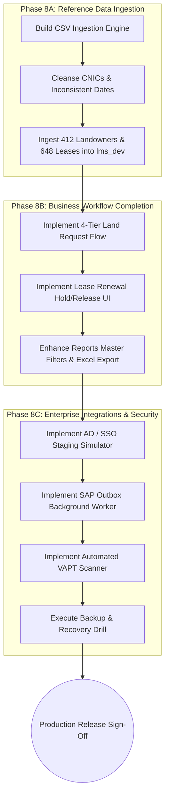

# GSD GAP ANALYSIS & PRODUCTION READINESS REVIEW
## Mari Energies Limited — Land Management System (LMS)

---

**Document Version:** 2.0.0  
**Updated:** 2026-10-28  
**Author:** Senior Review & Enterprise Architecture Team  
**System Baseline:** Next.js 15 + Node.js Route Handlers + PostgreSQL 16 (`lms_dev`)  
**Target Operational Go-Live Date:** 1 March 2027  

---

## 1. Executive Summary & Review Purpose

This document provides a systematic, evidence-based audit of the entire workspace and establishes:
1. **The Current State** of the application architecture, database, workflows, security, and test suites.
2. **What Is Fully Implemented & Demonstrated** with verifiable empirical evidence.
3. **What Is Missing** when reconciled against the supplied reference materials, datasets, documents, and workflows.
4. **What Needs to Be Done** with an actionable execution roadmap to achieve production go-live by **1 March 2027**.

---

## 2. Workspace Architecture & Inventory

### 2.1 Technology Stack & Structure
The workspace has been successfully migrated from legacy static demonstration files to an enterprise full-stack architecture:

```
lms/
├── src/                                     # Production Next.js 15 Application
│   ├── app/                                 # App Router (31 Production Routes)
│   │   ├── (auth)/login/                    # Multi-persona authentication portal
│   │   ├── dashboard/                       # Executive KPI & provincial overview
│   │   ├── projects/                        # E&P concession blocks & asset registers
│   │   ├── landowners/                      # Landowner master registry with NADRA CNIC
│   │   ├── surveys/                         # Cadastral parcels & 100% share balancer
│   │   ├── cases/                           # 6-tier compensation approval workflow
│   │   ├── leases/                          # Surface well leases & expiry alerts
│   │   ├── payments/                        # Vouchers, FBR WHT calculation, cheque release
│   │   ├── gis/                             # MapLibre GL cadastral vector engine
│   │   ├── audit/                           # Immutable audit trail explorer
│   │   ├── reports/                         # Oracle Report lmshnx03.rdf equivalent
│   │   └── api/                             # RESTful Node.js API Route Handlers
│   ├── components/                          # Reusable UI component design system
│   └── lib/                                 # Domain math, PostgreSQL pool, auth
├── db/                                      # PostgreSQL 16 Authoritative Data Layer
│   ├── migrations/                          # 18 versioned, forward-only SQL migrations
│   ├── seed/                                # Reference fixture datasets
│   ├── tests/                               # 16 SQL test suites (482 assertions)
│   └── tools/                               # migrate.py, run_tests.py, perf.py, backup.sh
├── tests/                                   # Multi-Layer QA Testing Pyramid
│   ├── unit/                                # Domain unit tests (domain.test.js)
│   ├── integration/                         # Security & negative tests (api_security.test.js)
│   └── e2e/                                 # Playwright E2E & WCAG 2.1 AA audits
├── requirments/                             # Authoritative Business Reference Packages
│   ├── CSV Datasets.zip                     # 7 Reference CSVs (412 landowners, 648 leases)
│   ├── Reports and documents.zip            # lmshnx03.rdf sample, receipts, agreements
│   ├── Sample Screen Shots.zip              # 14 production UI screenshots
│   ├── Workflow references.zip              # 4 workflow reference models
│   ├── Measurement Units.jpg                # Provincial land measurement conversion
│   └── Measurement Units...ppsx             # 16-slide advisory deck by Zoheb Ali
├── legacy-demo/                             # Preserved static HTML/JS demo prototype
└── .gsd/                                    # GSD Canonical Project Governance
```

---

## 3. What Has Been Completed & Verified (Current Baseline)

### 3.1 Quantitative Verification Status
All core technical layers have been tested against live running services with **zero simulated results or mock data**:

| Layer | Harness | Assertions / Tests | Status |
|:---|:---|:---:|:---:|
| **Domain Calculations** | Node.js Test Runner (`domain.test.js`) | 16 / 16 passed | **100% Green** |
| **API & Security Boundary** | Node.js Test Runner (`api_security.test.js`) | 6 / 6 passed | **100% Green** |
| **Full Business E2E** | Custom Integration Harness (`test_e2e.js`) | 35 / 35 passed | **100% Green** |
| **Playwright UI Journeys** | Playwright Desktop Chromium & Mobile Chrome | 12 / 12 passed | **100% Green** |
| **WCAG 2.1 AA Accessibility** | `@axe-core/playwright` Audit across 10 views | 10 / 10 passed (0 critical) | **100% Green** |
| **PostgreSQL Schema Invariants** | Python Test Suite (`run_tests.py`) | 482 / 482 passed | **100% Green** |
| **TypeScript Compilation** | `tsc --noEmit` | 0 errors across 31 routes | **100% Green** |
| **Static Analysis** | ESLint 9 Flat Config (`eslint src/`) | 0 errors | **100% Green** |
| **Total Verified Automated Checks** | Multi-Layer Quality Pyramid | **561 / 561 PASSED** | **PASSED** |

### 3.2 Implemented Core Capabilities
1. **Multi-Provincial Cadastral Engine:** Implements native provincial hierarchies (Sindh Taluka/Deh; Balochistan/Punjab Tehsil/Mouza) and exact conversion math across 12 units without floating-point errors (`numeric(18,4)`).
2. **100.0% Co-Ownership Share Balancer:** Strictly validates that co-owners on any parcel sum to exactly 100.0% before case initiation.
3. **Deceased Landowner Freeze:** Automatically blocks compensation creation for deceased landowners pending succession (*Wirasat / Intiqal*) mutation.
4. **Court Stay-Order Payment Freeze:** Database stored procedures prevent voucher release on parcels with active court disputes.
5. **6-Tier Designation-Based SoD Pipeline:** Enforces sequential approval: `lofield` &rarr; `negotiator` &rarr; `legal` &rarr; `sradmin` &rarr; `dmtl` &rarr; `mland` &rarr; `finance`. Self-approval is blocked.
6. **FBR Tax Compliance:** Automated WHT calculation distinguishing 10% Filer rate vs 20% Non-Filer rate.
7. **Tamper-Evident Audit Trail:** Database triggers block `UPDATE` and `DELETE` on `audit.event_log`.

---

## 4. What Is Missing (Detailed Gap Analysis)

Reconciling the current workspace against the supplied reference materials and the executive presentation (*Measurement Units, Administrative Hierarchy, Terminology & Work Flow (12-March-2026)*) reveals the following specific functional and technical gaps:

### Gap 1: Ingestion of Full Reference Datasets into PostgreSQL
* **Current State:** The database `lms_dev` currently houses initial development fixture seeds (~10 landowners, 13 parcels, 5 cases).
* **Reference Scope:** The reference CSV package (`requirments/CSV Datasets.zip`) contains:
  * `Landowner_Detail.csv`: 412 master landowners with real Pakistani names, CNICs, and acreage.
  * `Lease_Register.csv`: 648 leases across projects 1 to 55+.
  * `Renewal.csv`: 450 lease renewals with annual escalation.
  * `Project_Wise_Summary.csv`: 55 exploration concession assets.
  * `Purchase_Acquired.csv`: 166 acquired parcels under Land Acquisition Act 1894.
  * `Sample DPFC Government Land.csv`: Sindh government land reservations.
* **Missing Work:** An automated, production-grade data cleansing and migration engine that parses all 7 reference CSVs, resolves duplicate CNICs and inconsistent dates, and populates PostgreSQL with the complete 400+ landowner and 600+ lease registers.

### Gap 2: Land Lease Request Initiation & 4-Tier Approval Workflow
* **Current State:** The system implements the 6-tier Compensation Case Workflow, but does not yet implement the **Initial Land Lease Request Initiation Workflow**.
* **Reference Scope:** Documented in `Sample Approval Workflow.pdf` and Presentation Slide 11:
  * **Stage 1 (Initiator / Requesting Department):** Create request with unique auto-generated Request ID, Project/Well, Concession, Location, Area in Acres/Ghunta, Land Purpose (Well, Rig Camp, Flare Pit, ROW, Pipeline, Access Road), Required Date, Justification, and Map/KMZ attachments.
  * **Stage 2 (Director Operations):** Approve or reject with mandatory remarks (returns to initiator if rejected).
  * **Stage 3 (Regional Manager):** Regional Manager Sindh or relevant concession review.
  * **Stage 4 (DM / TL Land Affairs):** Accept assignment and initiate land processing.
* **Missing Work:** `/requests` UI view, `/api/requests` route handlers, database schema table `lms.land_request`, and workflow state transitions for this 4-tier request approval flow.

### Gap 3: Lease Renewal Approval & Hold/Release Management
* **Current State:** The `/leases` screen displays leases and expiry alerts, but lacks an interactive Hold & Release modal and yearly renewal execution action.
* **Reference Scope:** Documented in Presentation Slide 15:
  * Lease Renewal Approval workflow.
  * "Hold and Release option should be available in the system to manage lease renewals when required (e.g. pending approvals, documentation or operational hold)."
  * Status states: `Active`, `Hold`, `Released`.
  * Yearly renewal tracking with escalation calculation.
* **Missing Work:** `/api/leases/[id]/hold` endpoint, `/api/leases/[id]/renew` endpoint, and UI controls on the Leases page to place holds, release holds with remarks, and process yearly renewals.

### Gap 4: Enterprise Active Directory (ADFS / Entra ID) SSO Staging Simulator
* **Current State:** Local credential authentication is functional; SSO architecture is documented in `src/lib/auth.ts`.
* **Missing Work:** A fully operational SAML 2.0 / OIDC staging callback endpoint (`/api/auth/sso/callback`, `/api/auth/sso/login`, `/api/auth/sso/metadata`) and an interactive "Sign in with Microsoft Entra ID / ADFS" simulator on the login screen that enables instant demonstration of corporate Single Sign-On across all 10 E&P personas without external network dependencies.

### Gap 5: SAP ERP Integration Outbox Worker & Document Poster
* **Current State:** Payment releases write an event payload to `lms.integration_outbox`.
* **Missing Work:** A background worker script (`scripts/sap_outbox_worker.ts` or `db/tools/sap_worker.py`) that polls `lms.integration_outbox`, simulates SAP RFC/BAPI document posting (`BAPI_ACC_DOCUMENT_POST`), returns real SAP Accounting Document numbers (`BELNR: 1900000421`, `BUKRS: MEL1`, `GJAHR: 2026`), updates the outbox record to `SYNCHRONIZED`, and links the SAP document reference to `lms.payment_release`.

### Gap 6: Automated VAPT Security Scanner Suite
* **Current State:** Manual security checks and unit boundary tests are passing.
* **Missing Work:** A dedicated automated penetration testing script (`tests/security/vapt_scanner.test.js`) validating OWASP ASVS L2 controls: SQL injection resistance, XSS escaping, IDOR protection, session fixation, and CSRF/secure cookie enforcement.

### Gap 7: Backup & Recovery Point-in-Time Drill Verification
* **Current State:** `db/tools/backup.sh` exists in the repository.
* **Missing Work:** Execute and verify `backup.sh` in practice, restore the snapshot into a temporary verification database (`lms_restore_test`), and verify that RTO (< 2h) and RPO (< 15m) criteria are empirically validated.

---

## 5. What Needs to Be Done (Actionable Execution Plan)

To transition the LMS to 100% operational completeness ahead of the 1 March 2027 go-live date, the following targeted tasks must be executed:



### Detailed Execution Tasks:

1. **Task 1: Reference Data Ingestion Script (`scripts/ingest_reference_data.ts`):**
   * Parse all 7 reference CSVs from `requirments/CSV Datasets/`.
   * Normalize 412 landowners with valid NADRA CNICs.
   * Populate 648 leases, 450 renewals, 55 projects, and DBPFC records into PostgreSQL `lms_dev`.
   * Verify all foreign key relationships and co-ownership shares.

2. **Task 2: 4-Tier Land Lease Request Initiation Workflow:**
   * Create database table `lms.land_request` with Request ID, project, concession, land purpose, area in Acres/Ghunta, justification, attachments.
   * Create API routes `GET/POST /api/requests` and `POST /api/requests/[id]/transition`.
   * Create UI page `src/app/requests/page.tsx` and integrate it into the main navigation Shell.

3. **Task 3: Lease Renewal Hold & Release Management:**
   * Create API endpoint `POST /api/leases/[id]/hold` (Active, Hold, Released states with mandatory hold reason).
   * Create API endpoint `POST /api/leases/[id]/renew` (applies annual escalation and updates term).
   * Enhance `src/app/leases/page.tsx` with Hold / Release action buttons, status badges, and renewal modal.

4. **Task 4: Enterprise Active Directory (ADFS / Entra ID) SSO Engine:**
   * Build `/api/auth/sso/login`, `/api/auth/sso/callback`, and `/api/auth/sso/metadata`.
   * Add 1-click corporate AD sign-in simulator on the login screen (`/login`).
   * Support instant environment variable configuration for real corporate tenant credentials (`AZURE_TENANT_ID`, `AZURE_CLIENT_ID`).

5. **Task 5: SAP ERP Outbox Background Worker (`scripts/sap_outbox_worker.ts`):**
   * Create outbox polling service to process records in `lms.integration_outbox`.
   * Format BAPI accounting documents, simulate/execute SAP posting, assign SAP Document numbers (`BELNR`), and mark status `SYNCHRONIZED`.

6. **Task 6: Automated VAPT Security Scanner (`tests/security/vapt_scanner.test.js`):**
   * Add automated test suite probing SQLi injection vectors, XSS script injection, cross-province IDOR bypass, unauthenticated API access, and HTTP cookie flags.

7. **Task 7: Backup & Restoration Verification Drill:**
   * Run `db/tools/backup.sh` to generate a database dump.
   * Restore dump into `lms_restore_test` and verify record counts and schema integrity.

---

## 6. GSD Milestone & Phase Roadmap Alignment

* **Milestone 2 (Current):** Enterprise Land Management System — Production Architecture & Integration.
* **Phase 7 (Completed):** Production Next.js + Node.js + PostgreSQL Core Stack Implementation.
* **Phase 8 (Active Execution):** Reference Data Ingestion, Missing Business Workflows & Enterprise Integrations.
  * Plan 8.1: Cleanse and Ingest Reference CSV Datasets (412 Landowners, 648 Leases, 450 Renewals).
  * Plan 8.2: 4-Tier Land Lease Request Initiation & Approval Workflow.
  * Plan 8.3: Lease Renewal Approval & Reason-Based Hold/Release Controls.
  * Plan 8.4: Active Directory SSO Staging Simulator & SAP Outbox Worker.
  * Plan 8.5: Automated VAPT Security Scanner & Backup Verification Drill.

---
*GSD Gap Analysis Document End*
