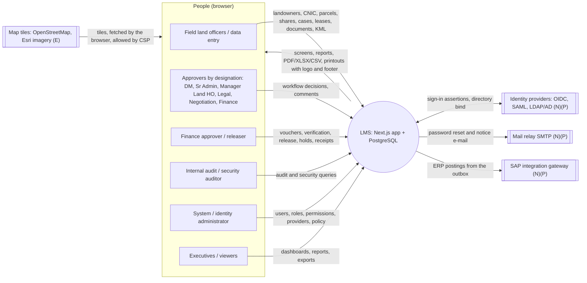
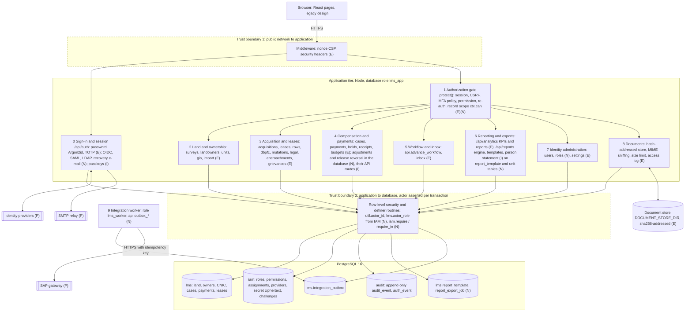
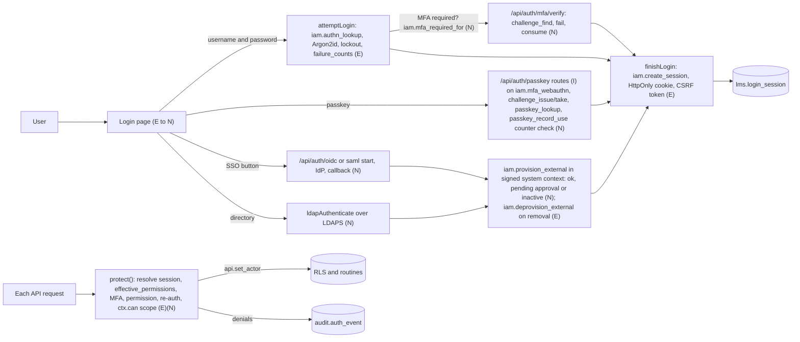
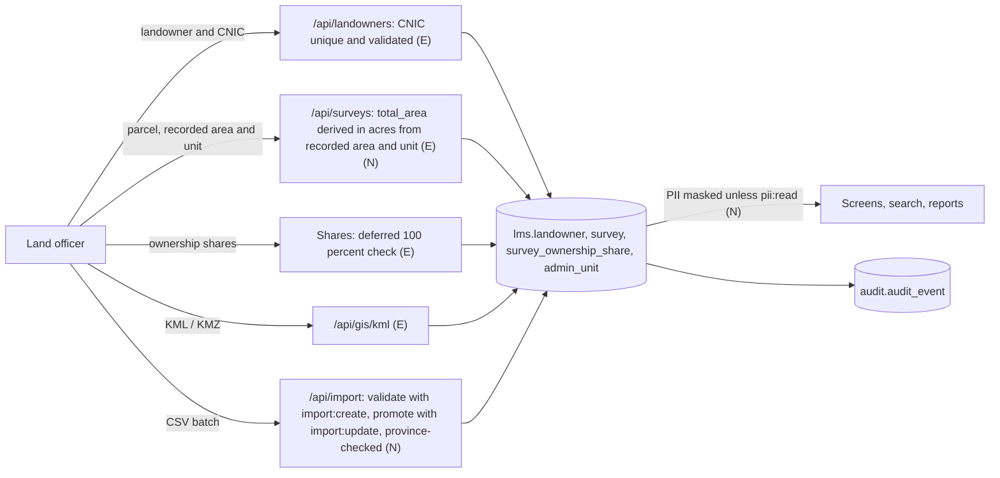
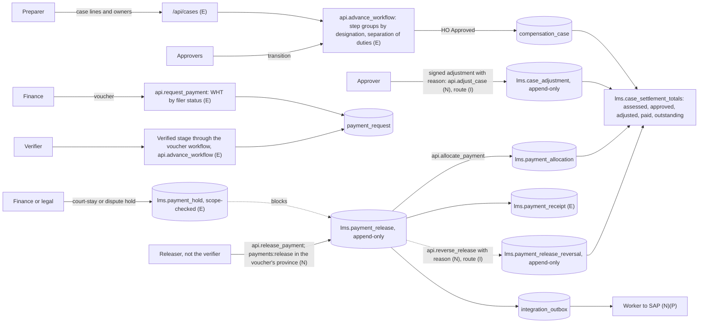
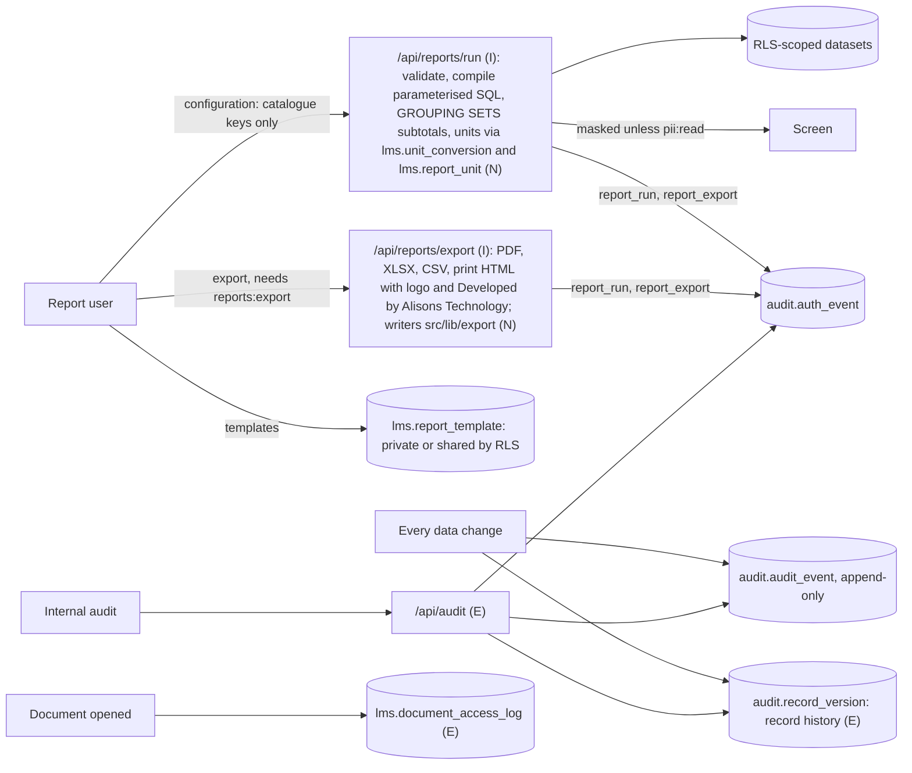

# Data flow diagrams — Mari Energies Land Management System

Status of this document: **draft of 2026-10-30, written from the code and the
database as they stand during the RBAC / reporting implementation.** Each
element is marked:

- **(E)** existing and verified by automated tests before 2026-10-30;
- **(N)** new in migrations 0039–0044 or the current implementation round —
  present in the code/database, verification in progress (see
  `docs/RELEASE_ASSESSMENT_*.md` for the latest test evidence);
- **(I)** being implemented in this round — designed and contracted, **not yet
  present in the code** at the last check;
- **(P)** planned or external, not verified in this environment.

Every component named below was checked against the graphify knowledge graph
of the code and the live test-database schema (`graphify-out/graph.json`,
rebuilt 2026-10-30; 3,386 nodes). Re-check after changes with
`graphify query "<component>"` or `graphify explain "<file>"`.

Diagrams are Mermaid (render in GitHub, VS Code, or any Mermaid viewer).
Trust boundaries are drawn as dashed sub-graphs (styled in each diagram).

## 1. Context diagram (level 0)

## 2. Level 1 — processes, stores and trust boundaries

\* `iam.secret` holds ciphertext only (AES-GCM, keys in the application
environment `IAM_MASTER_KEYS`), never plaintext provider secrets.

### Trust boundaries and sensitive flows

| Boundary | What crosses it | Controls |
|:---|:---|:---|
| Browser → application | credentials, session cookie, CSRF token, CNIC/phone/IBAN, money, documents | TLS (deployment), nonce CSP, same-origin + CSRF on writes, rate limits, MFA policy, re-auth for privileged actions |
| Application → database | the actor id (per transaction), parameterised SQL | the application role holds no ownership and no BYPASSRLS; row-level security per province; definer routines re-check permissions; only lms_readwrite sessions may assert an actor; the system account needs a maintenance session or a signed system context (N) |
| Reporting login → database | — | no actor can be asserted: row-level security returns nothing (N) |
| Application → identity providers | authorization codes, assertions, directory binds | PKCE+state+nonce, signed SAML with single-use request id, LDAPS with CA; mappings explicit only (N) |
| Worker → SAP gateway | ERP postings | dedicated login, idempotency key, no simulated success (N) |
| Application → document store | file bytes | content hash, size/type checks, province check on the parent record (E) |

## 3. Level 2 — sign-in and authorization

## 4. Level 2 — land, ownership and CNIC

## 5. Level 2 — acquisition, compensation and payments

## 6. Level 2 — reporting and audit

## 7. Data stores

| Store | Contents | Protection |
|:---|:---|:---|
| `lms.*` | land, ownership, persons (CNIC, phone, IBAN, address), projects, cases, payments, leases, legal, workflow | RLS per province; field masking without `pii:read` (N); audit triggers |
| `iam.*` | roles, permissions, assignments, sessions, MFA factors, passkeys, providers, provider secrets (ciphertext), challenges | RLS by permission; guards on every change; challenges reachable only through routines (N) |
| `audit.*` | business change history (`audit_event`), record versions (`record_version`) and security events (`auth_event`) | append-only for the application; tamper-evident (DB-02) |
| Document store | uploaded files | content-addressed and verified on read; MIME sniffing and size limit on upload; every access logged in `lms.document_access_log`; access through `/api/documents` only |
| Browser | session cookie (HttpOnly), CSRF token in memory, per-user UI preferences | no business data persisted in the browser |
