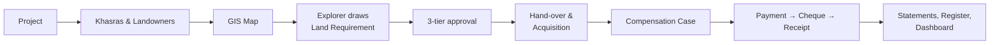

# Key Features User Manual

**Deliverable 2 of 5.** Mari Energies Land Management System (LMS). A presentation-focused guide to the features that best show what the system does.

- For every screen and rule, see the [Complete User Manual](01_COMPLETE_USER_MANUAL.md).
- For the system picture, see the [Architecture & Workflow Diagram](04_ARCHITECTURE_WORKFLOW_DIAGRAM.html).
- The demo video follows this manual chapter by chapter: [Demo Video Script](03_KEY_FEATURES_DEMO_VIDEO_SCRIPT.md), with values from the [Demo Recording Data](05_DEMO_RECORDING_DATA_AND_SCENARIOS.md).

Status: describes the application as built and tested on 31 Oct 2026 (database migration 0059).

---

## Contents

1. [The system in one page](#1-the-system-in-one-page)
2. [Projects / Well Locations](#2-projects--well-locations)
3. [Landowners and the Khasra Register](#3-landowners-and-the-khasra-register)
4. [GIS Land Map](#4-gis-land-map)
5. [Explorer: drawing a land requirement on the map](#5-explorer-drawing-a-land-requirement-on-the-map)
6. [Land Requirement approvals](#6-land-requirement-approvals)
7. [Hand-over and Acquisition](#7-hand-over-and-acquisition)
8. [Compensation Cases](#8-compensation-cases)
9. [Payments, tax, cheques and receipts](#9-payments-tax-cheques-and-receipts)
10. [Statements, Landowner Register and Dashboard](#10-statements-landowner-register-and-dashboard)
11. [Controls that run through every feature](#11-controls-that-run-through-every-feature)

---

## 1. The system in one page

**What it is.** One system for all of Mari Energies' land work in Sindh, Balochistan, Punjab and KPK. The work runs in this order:
1. Exploration asks for land.
2. Management approves it.
3. The land team identifies the khasras and their owners.
4. Compensation is valued and approved.
5. Owners are paid with the correct withholding tax.
6. Every step stays on record.

**Why it matters.**
- Land is the first dependency of every well, road and pipeline.
- Today that work is spread across files, spreadsheets and paper approvals.
- The LMS puts it in one place, with approvals that cannot be skipped, money that cannot exceed what was approved, and a complete audit trail.

**The key features, in the order a piece of land moves through them:**

**Who does what.** Each person has a role (what they may see and do), an *approval position* (which approval step they may decide) and their provinces.

| Person | Role / position | Key features they use |
|---|---|---|
| Exploration Planner | `exploration-planner` | GIS map, draws land requirements |
| Director Operations | `land-request-reviewer` | Approves land requirements (tier 2) |
| Regional Manager | `land-request-reviewer` | Approves land requirements (tier 3) |
| DM / TL Land Affairs | `case-approver` | Final land-requirement approval (tier 4) |
| Land Officer (Field) | `data-entry` | Projects, khasras, landowners, hand-over, cases, vouchers |
| Negotiation Officer | `negotiation-officer` | Checks cases |
| Legal Advisor | `legal-advisor` | Reviews cases and title |
| Sr. Administrator / DM-TL Field | `case-approver` | Verifies and field-approves cases |
| Manager Land (HO) | `land-manager` | Head-office approval, cheque release, reports |
| Finance Officer | `finance-approver` | Verifies vouchers, records receipts |
| Auditor / Viewer | read-only roles | Reports, audit trail |

---

## 2. Projects / Well Locations

**Purpose.** A project is the reason land is needed: a well location, pipeline, access road, camp, compressor station or seismic survey. Every khasra, land request, case and payment is tied to a project, so spend and progress roll up per well.

**How it works.** Menu: *Master Data → Projects / Well Locations*.
- The **Land Officer** (or Manager Land) creates a project with:
  - a unique **code** (e.g. `DHRK-301`)
  - province, name, type, block or concession, district
  - optionally a required area and description
- The project starts as **Active**. Later it can be marked Completed or Cancelled.
- The **Project Dashboard** shows one project at a time: parcels and acres, compensation cases and approved amount, paid compensation, surface leases, and KML features.

**Connects to.** Khasras link to a project. Land requests, acquisitions, cases and vouchers must name one. Budgets are set per project and year, and are checked when a voucher is verified.

**Scenario.** *Daharki Well-03 is planned near Jarwar. The Land Officer registers DHRK-301 so every later record is filed under it.*

**Business value.** One code ties a well to all of its land, money and approvals. Management sees cost per well.

---

## 3. Landowners and the Khasra Register

**Purpose.**
- A **khasra** (survey number) is a parcel in the revenue record.
- A **landowner** is a person identified by **CNIC**, which is the master key: one person, one record, across all provinces.
- **Ownership shares** say who owns what part of each khasra.

**How it works.**

| Feature | What the user does | Rules the system enforces |
|---|---|---|
| Add landowner (*Master Data → Landowners*) | CNIC, name, father or husband name, owner type (Owner / Attorney / both), tax status (Filer / Non-Filer), phone, bank, IBAN, address | CNIC format `12345-1234567-1` and unique. IBAN format checked. Tax status drives withholding tax later. |
| Add khasra (*Master Data → Survey / Khasra Register*) | Revenue location (District → Taluka → Deh), project, khasra no., block, rural / urban, land class (Private / Government), **recorded area in its own unit**, latitude / longitude | Area is converted to acres from the recorded unit (Acre, Kanal, Marla, Ghunta, Jareeb, Murabba, Hectare…). The original unit is kept. A new khasra starts as **Proposed**. |
| Owner shares (**Shares** button) | Add owners and their share % | Total must be **exactly 100%**, and owners must be alive and in the same province. Once registered, shares change only through **Mutation & Succession** (e.g. Wirasat after a death). |

**Land status** moves Proposed → Under Acquisition → Acquired / Leased (or Disputed, Released). It drives the map colours and the warnings.

**Privacy.** CNIC is masked for anyone without personal-data permission. Owner names and shares are shown only to roles that may read landowners. The Exploration Planner, for example, sees parcels but not owners.

**Scenario.** *Two brothers, Ghulam Rasool and Nazir Ahmed Mahar, own khasras 451/2 (12 acres) and 452/1 (64 Kanal = 8 acres) in Deh Jarwar, shared 60/40 and 50/50.*

**Business value.** A clean, single ownership record is the basis for paying the right person the right share. It removes duplicate owners and wrong payees.

---

## 4. GIS Land Map

**Purpose.** See the land: every khasra with coordinates, each land requirement's polygon, and uploaded KML layers, all on one map.

**How it works.** Menu: *Overview → GIS Land Map*.
- **Basemap:** Streets, Satellite imagery, or None (works offline).
- **Survey parcels:** one marker per khasra, coloured by land status:

  | Status | Colour |
  |---|---|
  | Proposed | grey |
  | Under Acquisition | amber |
  | Acquired | green |
  | Leased | blue |
  | Disputed | red |

- **Land requests:** each request's latest polygon, coloured by stage:

  | Stage | Colour |
  |---|---|
  | Draft | grey |
  | Under review | orange |
  | Returned | yellow |
  | Approved | green |
  | Handed over | blue |
  | Rejected | red (hidden by default) |

- Click any marker or polygon for its details and a link to the record. The tables under the map list the same items for keyboard and screen-reader users.
- **KML / KMZ upload and merge** of project boundaries, for roles with GIS create rights.

**Connects to.** Khasra coordinates come from the Survey register. Polygons come from Land Requests. Project selection filters the KML layers.

**Business value.** Field, operations and management look at the same picture. Conflicts (disputed land, land already leased, overlapping requests) are visible before anyone commits.

---

## 5. Explorer: drawing a land requirement on the map

**Purpose.** The **Exploration Planner** (the *Explorer*) states exactly which land exploration needs: a well pad, a camp or an access road. They draw it on the map instead of describing it in words.

**Who.** Role *Exploration Planner* (accounts `explorer` for Sindh, `explorerqta` for Balochistan).
- The planner signs in straight onto the GIS map.
- They see projects, parcels and land status.
- They see **no** landowner names, CNICs, payments or approvals (least privilege).
- Land Officers can also raise land requests.

**How it works.**
1. On the GIS map, click **✎ Draw land request**. The cursor becomes a cross.
2. Mark the corners in any of three ways:
   - **Click** the map (drag a corner to move it, **×** to remove it, **Undo corner**, **Clear**)
   - **Paste lat/long** from a field GPS, one corner per line (longitude-first KML order is detected)
   - **Load KML**
3. The side panel updates live:
   - every corner's latitude and longitude (editable)
   - the **area** in acres and hectares, and the **centre point**
   - the **recorded khasras inside**
   - **warnings**: a disputed parcel; land already acquired, leased or under acquisition; government land (Sindh → DBPFC); an overlap with another open request
4. **Continue: request details**. Enter the project, purpose (Well Location, Access Road, Camp…), priority, required-by date, target deh (pre-filled), concession and justification.
5. **Save as draft** (only the planner sees it) or **Submit to Director Operations**.

**Rules.**
- 3 to 500 corners, all inside Pakistan.
- The edges cannot cross.
- The server measures the shape again and stores its own figures. It never trusts the browser.
- Every saved shape is a **version**: earlier versions are kept when the request is redrawn.

**Scenario.** *The planner pastes four GPS corners around the two Mahar khasras: 20.19 acres, 2 parcels inside, no warnings. They submit REQ-2026-0004 as Urgent, needed by 15 Jan 2027.*

**Business value.**
- Exact coordinates replace "about 20 acres near Jarwar".
- Approvers see precisely what is requested, and what is already on that land, before they decide.

---

## 6. Land Requirement approvals

**Purpose.** Three independent approvals before the land team spends time and money:

| Tier | Position | Question it answers |
|---|---|---|
| 2 | **Director Operations** | Is the operational need real? |
| 3 | **Regional Manager** | Does the region support it (budget, schedule, other activity)? |
| 4 | **DM / TL Land Affairs** | Can the land be obtained (owners, title, litigation)? |

**How it works.** Menu: *Land Operations → Land Requests*.
- Each reviewer opens **Details**, which shows:
  - the polygon versions and corners (lat/long)
  - the parcels inside, and the warnings
  - all decisions so far, with names, dates and comments
- **Map** jumps to the polygon on the GIS map.
- **Review** offers **Approve**, **Return** or **Reject**. An audit comment is mandatory.
- **Return** sends it back to the requester, who clicks **Edit on map**, redraws (a new version is saved, with "What changed"), and sends again. After a return, **every tier decides again**.
- The workflow column shows: 1 Initiator → 2 Director Ops → 3 Regional Mgr → 4 Land Affairs → 5 Land work.

**Controls.**
- Only the holder of a tier's position can decide that tier, and only in their provinces.
- The requester cannot approve.
- No one decides two tiers.
- A draft is private.
- Another province's requests are invisible.

These rules are enforced by the database, not only by the screen.

**Scenario.**
1. Director Operations approves.
2. The Regional Manager **returns** it: "pull the north boundary 45 m south to keep clear of the link road".
3. The planner redraws (v2: 15.83 acres) and resubmits.
4. Director Operations, the Regional Manager and Land Affairs all approve.
5. The polygon turns green.

**Business value.** A fast, traceable, paperless decision. Changes are negotiated on the map, and nobody can approve their own request.

---

## 7. Hand-over and Acquisition

**Purpose.** Turn an approved land requirement into land work by the land team.

**How it works.**
1. The province's **Land Officer (Field)** clicks **Start land work** on the approved request.
2. They choose the kind of work: Acquisition, Lease, Compensation case or DBPFC.
3. For an **Acquisition**, they can tick *Mark the recorded parcels inside the polygon "Under Acquisition"*. Only parcels still "Proposed" change.
4. The request becomes **Handed over** (blue).
5. **Create acquisition** opens the acquisition form **pre-filled** with:
   - the project
   - the drawn area
   - the target date
   - the khasras inside the polygon
6. The new acquisition (e.g. `ACQ-2026-0004`) is linked to the request both ways.
7. The acquisition then moves through Identification → Negotiation → Approval → Acquisition / Lease → Handover:
   - The **Title** checklist records who verified the Fard, the latest mutation, the owners' CNICs, encumbrance, litigation and possession.
   - The six mandatory checks are required before the land can be acquired or leased.

**Scenario.** *The Land Officer takes REQ-2026-0004 up for acquisition. Khasras 451/2 and 452/1 turn amber on the map. ACQ-2026-0004 opens with 15.83 acres and both khasras already selected.*

**Business value.** There is no re-keying between exploration and the land team. Every acquisition can be traced back to the approved request.

---

## 8. Compensation Cases

**Purpose.** Value what each owner is owed (lease rent, crop damage, trees, other) and approve the award through the full chain of positions.

**How it works.** Menu: *Land Operations → Compensation Cases* → **+ Add Compensation Case**.

**The form.**
- **Header:** project, land use, lease rate (Rs / acre / year), lease term (months).
- **Landowners:** the payees, with shares totalling **100%**.
- **Lines:**

  | Line kind | Fields |
  |---|---|
  | Lease | khasra and area (≤ the parcel's area) |
  | Crop | crop, rate, damaged acres |
  | Tree | species, size, rate, count |
  | Other | e.g. a disturbance allowance |

- **Documents seen:**
  1. CNIC copies
  2. Fard
  3. Signed consent
  4. Bank / IBAN
  5. Site photos
  6. Joint survey report

  A power of attorney is needed when an attorney is a payee.

**The database computes the award.** Lease = rate × area × months ÷ 12, plus crop, trees and other. Nobody types the total.

**The approval chain** (separation of duties: the preparer approves nothing, and one person approves one step):

| Stage | Position |
|---|---|
| Prepared | Land Officer |
| Checked | Negotiation Group |
| Reviewed | Legal Advisor |
| Verified | Sr. Administrator (Field) |
| Field Approved | DM / TL (Field) |
| HO Approved | Manager Land (HO) |

**Controls.**
- Field and HO approval are refused if the case has no amount, no landowners, or missing documents.
- Valuation lines freeze once checked and lock at HO approval.
- **Print award sheet** produces the formal award.

**Scenario.** *Case CC-2026-0012 for the Mahar brothers: 12 acres leased for 36 months at Rs 60,000 per acre per year, 5 acres of wheat, 6 Kikar trees and a disturbance allowance. Total award Rs 2,458,000, approved by five different people.*

**Business value.** Consistent, auditable awards. No single person can create and approve a payment entitlement.

---

## 9. Payments, tax, cheques and receipts

**Purpose.** Pay the right owner, at most the approved award, with the correct withholding tax, through a three-person control.

**How it works.** Menu: *Finance → Payments & Cheques* (tabs: Vouchers, Cheques, Liabilities, Holds, Reconciliation).

| Step | Who | What happens |
|---|---|---|
| **Request** voucher | Land Officer | Project, approved case, payee **chosen from the case's owners**, category, pay type, mode (Cross Cheque / Pay Order / IBFT), period, gross amount. The system sets **WHT: Filer 10%, Non-Filer 20%**. A client-sent rate is never trusted. |
| **Verify** | Finance Officer | Budget check; holds and deceased-owner checks. |
| **Release cheque** | Manager Land (HO) | Cheque number generated; net amount = gross − WHT; re-authentication; SAP posting queued. |
| **Record receipt** | Finance Officer | Receipt no., date, who acknowledged, their CNIC. |
| **Print receipt** | Finance / readers | A *Receipt of Payment* with the parcel, heads, gross / WHT / net, amount in words, settlement and declaration. |
| **Allocate** | Land Officer / Finance | Assign the paid amount to the case's owner, which updates the owner's statement. |

**Controls the database enforces.**
- Vouchers on a case can never exceed its award.
- A case voucher must name a landowner, so the tax rate and holds apply.
- A deceased owner is not paid until Wirasat / Intiqal.
- Court stay orders, landowner holds and held leases block payment.
- The raiser, verifier and releaser must be three different people.
- A reversed cheque cannot get a receipt.
- Idempotency keys stop double submission.

**Scenario.**
1. Rs 1,000,000 advance lease rent to Ghulam Rasool Mahar (Filer): WHT Rs 100,000, cheque Rs 900,000.
2. Finance verifies.
3. The Manager Land releases the cheque.
4. Finance records the receipt and prints it.
5. *Option:* a Rs 500,000 voucher to Nazir Ahmed (Non-Filer) shows 20% WHT.
6. *Option:* an attempt to request Rs 2.5 M on a Rs 2.458 M award is refused.

**Business value.** Overpayment, wrong-payee and tax errors are stopped by the system, not caught later by audit. Every cheque has a printed, signed receipt.

---

## 10. Statements, Landowner Register and Dashboard

| Feature | Where | What it shows | Who |
|---|---|---|---|
| **Landowner statement** | Landowners → **Statement** | Owed, paid (gross with WHT shown), balance per owner; printable | Land and finance roles (payment lines need payments permission) |
| **Landowner Register** | Records & Reports → Landowner Register | Every owner × khasra, province-wise. Filters: district → taluka → deh, owner status / type, tax status, land class, payment hold, name, code, khasra. Area in the **province's unit**, as recorded, or any unit (e.g. 12 ac = 96 Kanal). Grouping by province / district / owner. Export CSV / XLSX / PDF | Admin, Manager Land, Finance, Audit (CNIC masked without personal-data permission) |
| **Executive Dashboard** | Overview → Executive Dashboard | Approved vs paid compensation, province breakdown from the registers, approvals waiting, lease alerts (per permission) | Management |
| **Audit Trail** | Records & Reports → Audit Trail | Every change: who, when, before and after | Auditor, administrator |

**Business value.** Management, finance and audit get one consistent set of figures, filtered to what each is allowed to see.

---

## 11. Controls that run through every feature

| Control | What it means for the user |
|---|---|
| **Province isolation** | Users see and act only in their provinces. Another province's records do not exist for them. Enforced by the database (row-level security). |
| **Separation of duties** | Preparer ≠ approver; one person, one step; raiser ≠ verifier ≠ releaser. |
| **Approval positions** | Each step is decided only by the holder of its position (e.g. Director Operations, Legal Advisor, Manager Land HO). |
| **Personal-data masking** | CNIC, bank details and owner names only for those permitted. |
| **Money rules** | Exact decimal amounts; WHT set by policy; payments capped at the award; holds and stay orders respected. |
| **Audit trail** | Every create, change and decision is recorded and cannot be edited. |
| **Secure sign-in** | Password with lockout, optional MFA (authenticator app) and passkeys, SSO-ready; re-authentication for sensitive actions such as cheque release. |

**Known limits** (see the audit report `docs/reports/E2E_AUDIT_2026-10-31.md`):
- A khasra is a point, not a boundary, so "inside the polygon" is point-based.
- Hand-over pre-fill exists for acquisitions only.
- Land requests are not yet in Approvals & Alerts, and notifications are not sent.
- The system is **not yet released**: UAT and some business decisions are pending.
