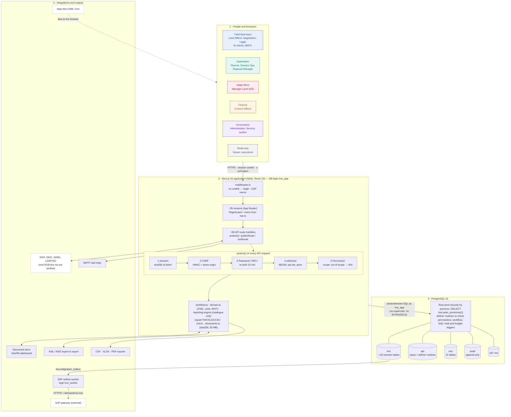
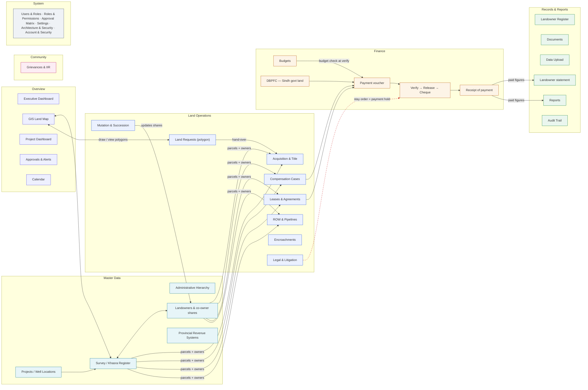
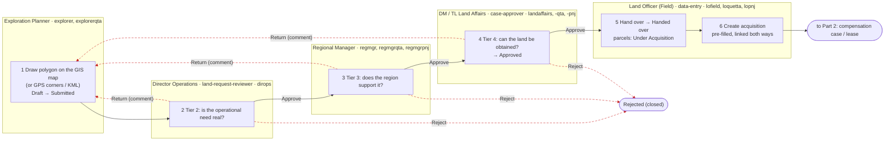
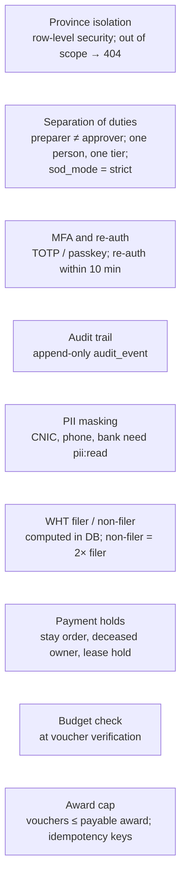

# LMS Architecture & Workflow

**Mari Energies Ltd: Land Management System.** Deliverable 04, 31 Oct 2026.
This document reflects the code and the `lms_dev` database at migration **0059**.
A print-ready version is in [04_ARCHITECTURE_WORKFLOW_DIAGRAM.html](04_ARCHITECTURE_WORKFLOW_DIAGRAM.html).

**Colour key** (the same colours are used in the HTML version):

| Role groups | Module groups |
|---|---|
| Governance (violet) | Overview (indigo) |
| Exploration (teal) | Master Data (cyan) |
| Field land team (blue) | Land Operations (blue) |
| Head office (rose) | Finance (amber) |
| Finance (amber) | Community (pink) |
| Read-only (grey) | Records & Reports (green) |
| | System (slate) |

**Line key:**
- Solid arrow: flow or data dependency.
- Red dashed arrow: return for changes, or a payment hold.
- Dashed box: an external service, or one not yet verified in production.

---

## A. System architecture

**How it works.** The system has four layers.

1. **Browser.** People use any modern browser.
2. **Application.** The browser talks only to the Next.js application. Every API request passes five checks in `protect()`:
   1. session;
   2. CSRF token and same-origin;
   3. password change, MFA and re-authentication;
   4. opening one database transaction tagged with the signed-in user;
   5. the permission, at the user's scope.
3. **Database.** Because the transaction carries the user, PostgreSQL itself enforces:
   - province isolation, through row-level security;
   - the approval and separation-of-duties rules, through triggers;
   - the append-only audit trail.

   The application connects as `lms_app`. That login owns nothing and cannot bypass row-level security.
4. **Integrations.**
   - SSO providers and SMTP.
   - The content-addressed document store.
   - KML and the CSV, XLSX and PDF exports.
   - Map tiles, which the browser fetches directly.
   - A separate SAP outbox worker. It reads `lms.integration_outbox` and posts to the SAP gateway.

Real AD/Entra sign-in and the SAP gateway connection are not yet verified in this environment.

---

## B. Roles, approval positions and modules

Taken from the live `iam.role_permission` table on `lms_dev`.

**Key:**
- **A**: approve, verify or release, by approval position.
- **W**: create and edit.
- **R**: read only.
- **–**: no access.

| Role | Approval position | Demo accounts | Province scope | Projects | Khasra | Owners | Land req. | Acq / Lease / ROW | Cases | Legal / Mutation | Payments | Budgets | DBPFC | Grievances | GIS | Reports | Audit | Users / Roles / Settings |
|---|---|---|---|---|---|---|---|---|---|---|---|---|---|---|---|---|---|---|
| system-administrator | System Administrator | admin | all | – | – | – | – | – | – | – | – | – | – | – | – | R¹ | R | W |
| security-auditor | Internal Audit | audit | all | R | R | R² | R | R | R | R | R | R | R | R | R | R | R | R |
| exploration-planner | — (initiator) | explorer, explorerqta | own | R | R | – | W | – | – | – | – | – | – | – | R | – | – | – |
| land-request-reviewer | Director Operations; Regional Manager | dirops; regmgr, regmgrqta, regmgrpnj | all / own | R | R | – | A | – | – | – | – | – | – | – | R | – | – | – |
| data-entry | Land Officer (Field) | lofield, loquetta, lopnj | own | W | W | W | W | W | W | W | W | – | W | W | W | R | – | – |
| negotiation-officer | Negotiation Group | nego, negoqta | own | R | W | W | W | W | A | – | W | – | R | W | R | R | – | – |
| legal-advisor | Legal Advisor | legal | all | R | R | R | – | W | A | W | – | – | – | W | R | R | – | – |
| case-approver | Sr. Admin LMS (Field); DM / TL (Field); DM / TL Land Affairs | sradmin, sradmqta, sradmpnj, dmfield, dmqta; landaffairs, landaffqta, landaffpnj | own | W | W | W | A | W | A | W | W | – | W | W | W | R | – | – |
| land-manager | Manager Land (HO) | mland | head office | W | W | W | A | W | A | W | A | W | W | W | W | R | – | – |
| finance-approver | Finance Officer | finance | all | R | R | R | – | R | R | R | A | W | R | – | – | R | – | – |
| viewer | — | viewer | all | R | R | – | – | R | R | – | R | – | – | – | R | R | – | – |

¹ The administrator sees only the Landowner Register report, with CNIC masked. It has no business registers, by separation of duties.
² CNIC is masked for the auditor.

**What the table shows.** Each person's access comes from three separate things:
- a **role**, which gives the permissions in the table;
- an **approval position** (`lms.app_user_group`), which decides which workflow stage they may approve;
- their **assigned provinces**, which limit which records they see.

Only the holder of a stage's position can approve that stage. This is why `case-approver` covers three positions:
- the Sr. Admin "Verified" stage;
- the DM/TL Field "Field Approved" stage;
- the DM/TL Land Affairs land-request tier.

The administrator manages users, roles and settings. By separation of duties, it holds no business registers.

---

## C. Module map and data dependencies

**How the modules connect.** The menu groups are the ones in the application (`nav.ts`).

**Land records.**
- A project holds khasra (survey) parcels.
- Each parcel carries co-owner shares that must total exactly 100%. The landowner's CNIC is the master key.
- Acquisition, compensation cases, leases and ROW corridors all work on those parcels and owners.
- A mutation (Wirasat / Intiqal) changes the ownership shares.

**Map and land requests.**
- The GIS map shows one point per khasra and the land-request polygons.
- An approved land request is handed over to the Land Officer as an acquisition.

**Payments.**
- An approved case, a lease or a DBPFC estimate (Sindh government land) produces a payment voucher.
- At verification the budget is checked and any hold applies. A court stay order on the parcel is one such hold.
- The cheque is released and the receipt recorded.
- The paid figures feed the landowner statement and the reports.
- Every change in every module writes to the append-only Audit Trail.

---

## D. End-to-end workflow

### Part 1: Land request and hand-over

**Steps.**
1. The **Exploration Planner** draws the land needed on the GIS map, as a polygon of latitude/longitude corners. The corners can also be pasted from a field GPS or uploaded as KML. The planner then submits the request.
2. The request passes three approval tiers, each decided only by the holder of that position in their own provinces:
   - **Tier 2, Director Operations:** is the operational need real?
   - **Tier 3, Regional Manager:** does the region support it?
   - **Tier 4, DM / TL Land Affairs:** can the land be obtained?
3. **Return.** Any tier can return the request with a comment. The planner edits the polygon and resubmits. A new version is kept, and all tiers start again.
4. **Reject.** Any tier can reject the request, which closes it.
5. **Hand-over.** Once the request is approved, the province's **Land Officer** hands it over:
   - the parcels inside the polygon are marked *Under Acquisition*;
   - an acquisition opens, pre-filled from the request.

**Rules.**
- The requester cannot approve their own request.
- One person can decide only one tier.
- Drafts are visible only to their author.
- The planner never sees owner names, CNICs or payments.

### Part 2: Compensation case and payment

```mermaid
flowchart LR
  subgraph L1["Land Officer (Field) · data-entry"]
    B1["1 Prepare case<br/>owners, heads, award<br/>→ Prepared"]
    B7["7 Raise voucher<br/>named landowner; capped at award<br/>→ Requested"]
  end
  subgraph L2["Negotiation Group · negotiation-officer"]
    B2["2 Check → Checked"]
  end
  subgraph L3["Legal Advisor · legal-advisor"]
    B3["3 Review → Reviewed"]
  end
  subgraph L4["Sr. Admin LMS (Field) · case-approver"]
    B4["4 Verify → Verified"]
  end
  subgraph L5["DM / TL (Field) · case-approver"]
    B5["5 Approval 1 → Field Approved"]
  end
  subgraph L6["Manager Land (HO) · land-manager"]
    B6["6 Approval 2 (Kharat) → HO Approved"]
    B9["9 Release → cheque CHQ-<br/>(not the verifier)"]
  end
  subgraph L7["Finance Officer · finance-approver"]
    B8["8 Verify<br/>budget, holds, WHT by filer status"]
    B10["10 Receipt RCPT-<br/>allocate to the owner"]
  end
  subgraph L8["System · database + SAP worker"]
    B9s["SAP outbox<br/>ERP posting queued"]
    B11["11 Landowner statement<br/>owed, paid, balance → reports"]
  end

  B1 --> B2 --> B3 --> B4 --> B5 --> B6 --> B7 --> B8 --> B9
  B9 --> B10 --> B11
  B9 --> B9s
  B2 & B3 & B4 & B5 & B6 -. "Return for changes (reason required)" .-> B1

  linkStyle 11,12,13,14,15 stroke:#c81e1e,stroke-dasharray:6 4
```

**Steps.**
1. The **Land Officer** prepares the compensation case from the acquisition or lease: owners, heads of compensation and award.
2. The case then passes five position-checked stages:
   - **Checked** by the Negotiation Group;
   - **Reviewed** by the Legal Advisor;
   - **Verified** by the Sr. Admin LMS (Field);
   - **Field Approved** by the DM / TL (Field);
   - **HO Approved** (Kharat) by Manager Land (HO).
3. **Return for changes.** Any approver can send the case back to the Land Officer with a reason. Every approval then starts again.
4. **Voucher.** The Land Officer raises the payment voucher. It must name a landowner, and the vouchers on a case cannot exceed its award.
5. **Verification.** The **Finance Officer** verifies the voucher. At this point:
   - the budget is checked;
   - payment holds apply: court stay order, deceased owner, lease or landowner hold;
   - the FBR withholding tax is computed for the payee's filer or non-filer status.
6. **Release.** **Manager Land (HO)** releases the cheque. The releaser cannot be the verifier. Release queues the ERP posting in the SAP outbox.
7. **Receipt and statement.** Finance records the receipt, and the landowner statement shows the balance.

**Separation of duties.**
- The preparer cannot approve.
- One person, one tier.
- Only the position holder decides, in their own provinces.
- Finance verifies and Manager Land releases.

---

## E. Controls built into the system

**What the controls do.** All of these rules are enforced by the server and the database, not only by the screens.

| Control | How it works |
|---|---|
| Province isolation | PostgreSQL row-level security shows each user only their assigned provinces. A record outside their scope answers 404. |
| Separation of duties | The strict mode is on and the administrator override is off. The preparer cannot approve, and one person decides one tier. |
| MFA and re-authentication | Sensitive permissions need TOTP or a passkey. Privileged actions need re-authentication within 10 minutes. |
| Audit trail | The audit trail is append-only. |
| PII masking | CNIC, phone and bank details need `pii:read`. The auditor and the administrator see CNICs masked. |
| Withholding tax | Computed in the database. The non-filer rate is twice the filer rate. A rate sent by the client is never trusted. |
| Payment holds | A court stay order, a deceased owner (until the Wirasat / Intiqal mutation), a lease hold or a landowner hold blocks verification and release. |
| Budget check | The voucher must fit the project budget. |
| Award cap | Vouchers on a case cannot exceed its payable award. Idempotency keys stop duplicate payments. |

---

## Sources and limits

**Sources:**
- `CLAUDE.md` §2–§5 and §9b
- `docs/architecture/DATA_FLOW_DIAGRAMS.md`
- `src/components/layout/nav.ts`
- `docs/plans/EXPLORATION_LAND_REQUEST_GIS_PLAN.md`
- `docs/reports/E2E_AUDIT_2026-10-31.md`
- `db/migrations/0015_reference_data.sql` (workflow stages and positions), 0057–0059
- `iam.role_permission` on `lms_dev`, queried 31 Oct 2026

**Not yet verified in production:**
- real SSO against AD/Entra;
- the SAP gateway connection;
- production TLS, backups and monitoring.

The system is **not yet released**: see the release assessment and the open items in the E2E audit.

**Limit:** until PostGIS khasra boundaries are added, a parcel counts as "inside" a polygon when its single point is inside it.
