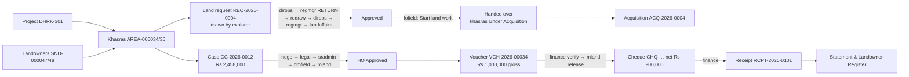

# Demo Recording Data & Test Scenarios

**Deliverable 5 of 5.** These are the values you type during the key-features demo video.

The sequence matches the [Key Features User Manual](02_KEY_FEATURES_USER_MANUAL.md) and the [Demo Video Script](03_KEY_FEATURES_DEMO_VIDEO_SCRIPT.md), scene for scene. Every field, option and rule here was checked against the application's forms and database on 31 Oct 2026 (database `lms_dev`, migration 0059).

> All people, CNICs, IBANs, phone numbers and parcel numbers below are **fictional**.

---

## 0. Before you record

| # | Check | How |
|---|---|---|
| 1 | The server runs the latest code | `npm run build`, then restart the server on port 3040. The *Create acquisition* button, the drawing tools and the latest fixes need this. |
| 2 | Demo sign-in list is visible | Demo mode shows each account and its password on the sign-in page. Record on `localhost`, and **turn demo mode off after recording** (audit item O1). |
| 3 | Map tiles load | The map needs internet (OpenStreetMap). Without it, choose Basemap **None**: drawing still works. |
| 4 | Browser | Chrome, 1440 × 900 or larger, zoom 100%. Use one **incognito window per user**, or sign out between users. |
| 5 | Re-authentication | Releasing a cheque asks for the password again if the sign-in is older than 10 minutes. Keep `mland`'s password at hand. |
| 6 | Codes | The codes in "Expected result" (e.g. `REQ-2026-0004`) assume nothing else is created first. If a number differs, carry on: only the number changes. |
| 7 | Retake | If you need a second take, use the **Take-2 values** in §12 so you do not hit "already exists" errors. |

### The cast (demo accounts)

| Username | Person (fictional) | Role / approval position | Province | Appears in scene |
|---|---|---|---|---|
| `lofield` | Sanaullah Khoso | Land Officer (Field) | Sindh | 1, 2, 3, 6, 7, 8 |
| `explorer` | Usman Ghani | Exploration Planner | Sindh | 4, 5 |
| `dirops` | Javed Akhtar | Director Operations | all | 5 |
| `regmgr` | Sadia Memon | Regional Manager (Sindh) | Sindh | 5 |
| `landaffairs` | Zubair Soomro | DM / TL Land Affairs | Sindh | 5 |
| `nego` | Bilal Chandio | Negotiation Officer | Sindh | 7 |
| `legal` | Ayesha Siddiqui | Legal Advisor | all | 7 |
| `sradmin` | Faisal Shaikh | Sr. Administrator LMS (Field) | Sindh | 7 |
| `dmfield` | Nadia Baig | DM / Team Lead (Field) | Sindh | 7 |
| `mland` | Imran Qadir | Manager Land (HO) | all | 7, 8, 9 |
| `finance` | Shazia Noor | Finance Officer | all | 8, 9 |

---

## 1. The story

*Daharki Well-03* is a new exploratory well near Jarwar, District Ghotki, Sindh.

1. The **Land Officer** registers the project, two khasras and their owners (two brothers).
2. The **Exploration Planner** marks the land needed on the map.
3. Three approvers decide; the Regional Manager **returns it once** to move the boundary.
4. The Land Officer takes it up, the khasras become *Under Acquisition*, and an **acquisition** opens pre-filled.
5. A **compensation case** values lease, crop, trees and disturbance. Five positions approve it.
6. **Finance and the Manager Land** pay the first owner: WHT is deducted automatically, a cheque is released, and a receipt is printed.
7. The **reports** show the owner's statement and the landowner register.



---

## 2. Scene 1: Project (user `lofield`)

**Projects / Well Locations** → **+ Add Project**

| Field | Value | Required |
|---|---|---|
| Project code | `DHRK-301` | Yes (2–32 letters, digits, `-` `/`; unique) |
| Province | `Sindh` (SND) | Yes |
| Name | `Daharki Well-03 Exploratory Location` | Yes |
| Type | `Well Location` | Yes |
| Block / concession | `Daharki D&PL` | Yes |
| District | `Ghotki` | Yes |
| Required area (acres) | `20` | Optional |
| Description | `Exploratory well pad, rig camp and 0.8 km access road north of Jarwar. Spud planned Feb 2027.` | Optional |

**Expected result:** the project **DHRK-301** is listed with status **Active**.

The project form has no map position. The project's location comes from its khasras and its land request.

---

## 3. Scene 2: Landowners and khasras (user `lofield`)

### 3a. Landowner 1: **Landowners** → **+ Add Landowner**

| Field | Value | Required |
|---|---|---|
| Province | `Sindh` | Yes |
| CNIC | `45104-2000011-3` (type the 13 digits; dashes appear by themselves) | Yes (unique) |
| Full name (as on CNIC) | `Ghulam Rasool Mahar` | Yes |
| Father / husband name | `Muhammad Bux Mahar` | Yes |
| Owner type | `O — Owner` | Yes |
| Tax status | `Filer` | Yes (Filer → 10% WHT) |
| Phone | `0301-2345678` | Optional |
| Bank branch | `HBL Daharki` | Optional |
| IBAN | `PK24HABB0012345678901234` | Optional (24 characters, format checked) |
| Address | `Village Jarwar, Taluka Daharki, District Ghotki` | Optional |

**Expected result:** **SND-000047**, Active.

### 3b. Landowner 2: **+ Add Landowner**

| Field | Value |
|---|---|
| Province | `Sindh` |
| CNIC | `45104-2000012-1` |
| Full name | `Nazir Ahmed Mahar` |
| Father / husband name | `Muhammad Bux Mahar` |
| Owner type | `O — Owner` |
| Tax status | `Non-Filer` (→ 20% WHT, shown in scene 8 option B) |
| Phone | `0302-3456789` |
| Bank branch | `Meezan Bank Daharki` |
| IBAN | `PK57MEZN0003450123456789` |
| Address | `Village Jarwar, Taluka Daharki, District Ghotki` |

**Expected result:** **SND-000048**, Active.

### 3c. Khasra 1: **Survey / Khasra Register** → **+ Add Survey**

| Field | Value | Required |
|---|---|---|
| Province | `Sindh` | Yes |
| Revenue location | `Ghotki → Daharki → Jarwar` | Yes |
| Project | `DHRK-301 — Daharki Well-03 Exploratory Location` | Optional (links the khasra to the project) |
| Survey / khasra no. | `451/2` | Yes |
| Block no. | `9` | Optional |
| Khasra type | `Rural` | Optional |
| Land class | `Private` | Yes |
| Recorded area | `12` with unit `Acre / Killa` | Yes |
| Latitude | `28.0710` | Optional (needed for the map) |
| Longitude | `69.7050` | Optional (give both or neither) |
| Remarks | `Cultivated; tube-well on the east side.` | Optional |

**Expected result:** **AREA-000034**, status **Proposed**, area 12.00 acres.

### 3d. Khasra 2: **+ Add Survey**

| Field | Value |
|---|---|
| Province | `Sindh` |
| Revenue location | `Ghotki → Daharki → Jarwar` |
| Project | `DHRK-301` |
| Survey / khasra no. | `452/1` |
| Block no. | `9` |
| Khasra type | `Rural` |
| Land class | `Private` |
| Recorded area | `64` with unit `Kanal` (shows unit conversion: 64 Kanal = **8.00 acres**) |
| Latitude | `28.0703` |
| Longitude | `69.7062` |
| Remarks | `Wheat crop standing at the time of survey.` |

**Expected result:** **AREA-000035**, Proposed, 8.00 acres.

### 3e. Owner shares

In the **Survey / Khasra Register**, on the khasra's row, click **Shares**. Add each owner with "Landowner to add" and **+**, then **Save shares**. The total must be exactly 100%.

| Khasra | Owner | Share % | Revenue document |
|---|---|---|---|
| AREA-000034 | Ghulam Rasool Mahar (SND-000047) | `60` | `Fard 2026/118` |
| AREA-000034 | Nazir Ahmed Mahar (SND-000048) | `40` | `Fard 2026/118` |
| AREA-000035 | Ghulam Rasool Mahar | `50` | `Fard 2026/119` |
| AREA-000035 | Nazir Ahmed Mahar | `50` | `Fard 2026/119` |

**Expected result:** the shares column shows **100.0%** and **2 owner(s)**.

Negative demo (optional): enter 60 + 30. The **Save shares** button stays disabled until the total is 100%.

---

## 4. Scene 3: The khasras on the GIS map (user `lofield`, optional)

**GIS Land Map**: the two new markers appear near Jarwar, grey (*Proposed*). Click one to see its code, status, area and location.

---

## 5. Scene 4: Exploration Planner draws the land (user `explorer`)

Sign in as `explorer`. The planner lands **directly on the GIS Land Map**: this role has no dashboard, and no Landowners or Payments menu.

1. Click **✎ Draw land request**.
2. Click **Paste lat/long** and paste the four corners below:
   ```
   28.07200, 69.70400
   28.07200, 69.70700
   28.06950, 69.70700
   28.06950, 69.70400
   ```
3. Click **Use these corners**.
4. *(Optional)* Click once on the map to add a fifth corner, then remove it with **×**. This shows that corners can be clicked, dragged and removed.
5. Click **Continue: request details**.

**Expected panel figures:**

| Item | Value |
|---|---|
| Corners | 4 |
| Area | **20.19 acres · 8.17 ha** |
| Centre | 28.07075, 69.70550 |
| Parcels inside | **2: AREA-000034, AREA-000035** |

**Land request details** form:

| Field | Value | Required |
|---|---|---|
| Project | `DHRK-301 — Daharki Well-03 Exploratory Location (SND)` | Yes |
| Purpose | `Well Location` | Yes |
| Priority | `Urgent` | Default Standard |
| Required by | `2027-01-15` | Yes |
| Target deh / village | `Jarwar` (pre-filled from the parcels inside) | Optional |
| Concession block | `Daharki D&PL` | Optional (blank = Mari Concession) |
| Justification | `Exploratory well Daharki Well-03: well pad 120 m × 120 m, rig camp and mud pits, plus a 0.8 km access road. Rig mobilisation is planned for Feb 2027, so the land is needed by 15 Jan 2027.` | Needed to submit |

Click **Submit to Director Operations**. *(Alternative: **Save as draft**, then submit from Land Requests → **Send**.)*

**Expected result:**
- The message "Created **REQ-2026-0004** and sent it to Director Operations."
- The polygon turns **orange** (*Under review*).
- **Land Requests** shows the workflow at step 2 and "Waiting on Director Operations".

---

## 6. Scene 5: Three-tier approval with one return

Every decision needs an **Audit comment**.

| Step | Sign in as | Where | Action | Comment to type | Expected stage after |
|---|---|---|---|---|---|
| 5.1 | `dirops` | Land Requests → REQ-2026-0004 → **Details**, then **Map**, then **Review** | Approve | `Operational need confirmed: Well-03 is in the 2027 drilling plan.` | Under Review - Regional |
| 5.2 | `regmgr` | Land Requests → **Review** | **Return** | `Pull the north boundary about 45 m south to keep clear of the Jarwar link road, then resubmit.` | **Returned** (waiting on the initiator) |
| 5.3 | `explorer` | Land Requests → **Edit on map** | See below | — | — |
| 5.4 | `dirops` | Review | Approve | `Revised boundary acceptable.` | Under Review - Regional |
| 5.5 | `regmgr` | Review | Approve | `Region supports it; no conflict with other activity.` | Under Review - Land Affairs |
| 5.6 | `landaffairs` | Review | Approve | `Private land, two owners identified, no litigation recorded. Approved.` | **Approved** (green) |

**Step 5.3, the redraw by `explorer`:**
1. Click **Clear**, then **Paste lat/long**, and paste the revised corners below. Then **Use these corners**.
   ```
   28.07160, 69.70400
   28.07160, 69.70680
   28.06950, 69.70680
   28.06950, 69.70400
   ```
   Expected: **15.83 acres · 6.41 ha**, still 2 parcels inside.
2. Click **Continue: review and save**.
3. In **What changed**, type: `North boundary moved 45 m south and east edge 20 m west, as asked by the Regional Manager.`
4. Click **Save and send to Director Operations**.

Expected: the stage goes back to **Submitted**, and **Details → Polygon versions** lists **v2 (current)** and **v1**.

**Negative checks you can show:**
- `regmgr` gets no **Review** button while the request waits for Director Operations.
- `explorer` cannot approve their own request.
- In 5.4, `dirops` decides again: after a return, every tier decides afresh.

---

## 7. Scene 6: Hand-over and acquisition (user `lofield`)

1. **Land Requests** → REQ-2026-0004 → **Start land work**.

   | Field | Value |
   |---|---|
   | Land work | `Acquisition` |
   | Mark the recorded parcels inside the polygon "Under Acquisition" | ✔ (ticked) |
   | Comment | `Negotiation with the Mahar family starts 10 Nov 2026.` |

   Click **Take it up**.

   **Expected result:**
   - "REQ-2026-0004 handed over for acquisition. 2 parcel(s) marked Under Acquisition: AREA-000034, AREA-000035."
   - The stage is **Handed over** (blue on the map).
   - Both khasras are now **Under Acquisition** in the Survey register.

2. On the same row, click **Create acquisition**. The form **"Add Acquisition — from REQ-2026-0004"** opens pre-filled:

   | Field | Pre-filled / enter | Required |
   |---|---|---|
   | Project | DHRK-301 (pre-filled) | Yes |
   | Mode | `Private Lease` | Yes |
   | Area required | 15.83 (pre-filled from the polygon) | Yes |
   | Negotiated rate (Rs / acre) | `60000` | Optional |
   | Target handover | 2027-01-15 (pre-filled) | Optional |
   | Surveys | AREA-000034, AREA-000035 (pre-filled chips) | Optional |
   | Remarks | `From land request REQ-2026-0004 (Well Location).` (pre-filled) | Optional |

   Click **Save**.

   **Expected result:**
   - **ACQ-2026-0004** is created at stage **Identification**.
   - Land Requests → Details shows "record **ACQ-2026-0004**".

3. *(Optional)* Click **Title** and tick:
   - Fard / Record of Rights
   - Latest mutation verified
   - CNIC of every owner verified

   Each tick records who and when.

---

## 8. Scene 7: Compensation case and its approval chain

### 8a. Create the case (user `lofield`)

**Compensation Cases** → **+ Add Compensation Case**

Header:

| Field | Value | Required |
|---|---|---|
| Project / well location | `DHRK-301` | Yes |
| Land used for | `Well Location` | Yes |
| Lease rate (Rs / acre / year) | `60000` | Required when there are lease lines |
| Lease term (months) | `36` | Required when there are lease lines |
| Remarks | `Three-year surface lease for the Well-03 pad, with crop and tree damage.` | Optional |

**Landowners** (+ Add line). The shares must total 100%.

| Landowner | Share % | As |
|---|---|---|
| Ghulam Rasool Mahar (SND-000047) | `60` | `O — Owner` |
| Nazir Ahmed Mahar (SND-000048) | `40` | `O — Owner` |

**Lease lines**

| Survey | Owners' share % | Area (ac) | Reduced area (ac) |
|---|---|---|---|
| AREA-000034 | `100` | `12` | *(blank)* |

**Crop compensation**

| Survey | Crop | Rate (Rs/ac) | Damaged (ac) |
|---|---|---|---|
| AREA-000035 | `Wheat` | `45000` | `5` |

**Tree compensation**

| Survey | Species | Size | Rate (Rs) | Count |
|---|---|---|---|---|
| AREA-000035 | `Kikar` | `Medium` | `8000` | `6` |

**Other compensation**

| Survey | For | Amount (Rs) |
|---|---|---|
| AREA-000034 | `Disturbance allowance` | `25000` |

**Documents seen**: tick all six:
1. CNIC copies of all landowners
2. Fard / record of rights
3. Signed consent / agreement
4. Bank details or IBAN certificate
5. Site photographs
6. Joint survey / measurement report

Click **Create case**.

**Expected amounts** (calculated by the database, not typed):

| Head | Calculation | Amount (Rs) |
|---|---|---|
| Lease | 60,000 × 12 ac × 36 ÷ 12 | 2,160,000 |
| Crop | 45,000 × 5 ac | 225,000 |
| Trees | 8,000 × 6 | 48,000 |
| Other | — | 25,000 |
| **Total award** | | **2,458,000** |

**Expected result:**
- **CC-2026-0012**, stage **Prepared**.
- `lofield` sees **no approve button**: the preparer cannot approve.

### 8b. Approval chain: one person, one step

Open the case and use the workflow button. A note is optional, but say it aloud.

| Step | Sign in as | Button | Note | Stage after |
|---|---|---|---|---|
| 1 | `nego` | → Checked | `Rates agreed with both owners on site.` | Checked |
| 2 | `legal` | → Reviewed | `Title clear per Fard 2026/118–119; no litigation.` | Reviewed |
| 3 | `sradmin` | → Verified | `Field records and measurements verified.` | Verified |
| 4 | `dmfield` | → Field Approved | `Approved at field level.` | Field Approved |
| 5 | `mland` | → HO Approved | `Approved at head office.` | **HO Approved** (locked) |

**Negative checks:**
- `nego` cannot approve two steps; the second attempt is refused.
- Step 4 is refused if a required document is unticked, with "Missing documents: …".

---

## 9. Scene 8: Payment, WHT, cheque and receipt

### 9a. Request the voucher (user `lofield`)

**Payments & Cheques** → **+ Request Payment**

| Field | Value | Required |
|---|---|---|
| Project | `DHRK-301` | Yes |
| Case | `CC-2026-0012 · Rs 2,458,000 outstanding` | Optional (only HO Approved cases are listed) |
| Payee (landowner) | `Ghulam Rasool Mahar — Filer` | Required when a case is chosen |
| Category | `Lease Rent` | Yes |
| Pay type | `Advance Lease (multi-year)` | Yes |
| Payment mode | `Cross Cheque` | Yes |
| Land class | `Private` | Yes |
| Period from | `2026-11-01` | Yes |
| Period to | `2029-10-31` | Optional (on or after the start) |
| Gross amount (Rs) | `1000000` | Yes |
| Remarks | `First instalment: advance lease rent for the Well-03 pad (60% owner).` | Optional |

**Expected result:**
- **VCH-2026-00034**, stage **Requested**.
- WHT **10%** = Rs 100,000; net **Rs 900,000**. The rate is set by the system from the owner's Filer status.

**Option B (shows the non-filer rate):** a second voucher for **Nazir Ahmed Mahar**: category `Crop Compensation`, pay type `One-time`, mode `Direct Credit (IBFT)`, gross `500000`.
- Expected WHT is **20%** = Rs 100,000; net Rs 400,000.

**Negative checks:**
- Gross `2500000`: refused, "case CC-2026-0012 award is 2458000.00 … at most … can still be requested".
- A typed payee name instead of an owner: refused.

### 9b. Verify (user `finance`)

**Payments** → Vouchers → VCH-2026-00034 → **Verify**. Note: `Payee, WHT and case checked.`

**Expected result:** stage **Verified**. The budget check runs here.

### 9c. Release the cheque (user `mland`)

**Payments** → VCH-2026-00034 → **Release cheque**.

| Field | Value |
|---|---|
| Cheque date | `2026-11-05` (or today) |
| Note | `Released to the owner at Daharki field office.` |

If asked, re-enter `mland`'s password.

**Expected result:**
- Stage **Released**; cheque **CHQ-25186412** for **Rs 900,000** (net).
- A SAP posting is queued.

### 9d. Record and print the receipt (user `finance`)

**Payments** → **Cheques** tab → CHQ-25186412 → **Record receipt**.

| Field | Value | Required |
|---|---|---|
| Receipt no. | `RCPT-2026-0101` | Yes |
| Received on | `2026-11-05` | Yes |
| Acknowledged by | `Ghulam Rasool Mahar` | Yes |
| Their CNIC | `45104-2000011-3` | Optional |
| Remarks | `Cheque received in person.` | Optional |

Then click **Print receipt** in the Receipts table.

**Expected result:** a printable *Receipt of Payment* showing:
- the parcel (Survey 451/2, Deh Jarwar, Taluka Daharki, District Ghotki)
- the heads
- Gross 1,000,000; less WHT (Filer) 100,000; **Total 900,000**
- the amount in words
- the settlement (payable to this owner, paid before, this payment, balance)
- the declaration and signature blocks

### 9e. Allocate to the case (user `lofield` or `finance`, optional)

**Payments** → **Liabilities** tab → CC-2026-0012 → **Allocate voucher**:
- Voucher: `VCH-2026-00034`
- Amount: `900000` (the net amount)

**Expected result:** the case shows **Part paid**, and Ghulam Rasool Mahar's statement balance falls by the allocated amount.

---

## 10. Scene 9: Reports and dashboard

| Step | Sign in as | Where | What to show | Expected |
|---|---|---|---|---|
| 10.1 | `lofield` | **Landowners** → SND-000047 → **Statement** | Owed, paid, balance; payment lines gross with WHT in the description | The award share and Rs 1,000,000 paid (900,000 cheque + 100,000 WHT) |
| 10.2 | `mland` | **Records & Reports → Landowner Register** | Province `Sindh`, District `Ghotki`, Taluka `Daharki`, Deh `Jarwar`; Area unit `All in Kanal`; Show `One row per owner` | Ghulam Rasool Mahar and Nazir Ahmed Mahar with their khasras and shares; 12 ac = **96 Kanal**, 8 ac = **64 Kanal** |
| 10.3 | `mland` | Export buttons **PDF / Excel / CSV** | Download | The file has the same rows as the screen |
| 10.4 | `mland` | **Executive Dashboard** | Province chart, paid vs approved, approvals waiting | Figures include the new case and cheque |
| 10.5 | `audit` | **Audit Trail** | Filter by record `REQ-2026-0004` or `CC-2026-0012` | Every change, with who and when |

---

## 11. Validation scenarios (quick "what if" shots)

| # | Scenario | Where / who | Input | Expected message / result |
|---|---|---|---|---|
| V1 | Boundary crosses itself | GIS draw (`explorer`) | Paste `28.0720, 69.7040` / `28.0695, 69.7070` / `28.0720, 69.7070` / `28.0695, 69.7040` | "The boundary crosses itself…"; Continue disabled |
| V2 | Corner outside Pakistan | GIS draw | `50.0, 10.0` as one corner | "Every corner must be inside Pakistan…" |
| V3 | Shares ≠ 100% | Shares dialog | 60 + 30 | Save disabled |
| V4 | Duplicate CNIC | Add Landowner | `45104-2000011-3` again | "A landowner with this CNIC is already registered" |
| V5 | Preparer approves own case | `lofield` on CC-2026-0012 | — | No approve button |
| V6 | Over-award voucher | Request Payment | Gross `2500000` on CC-2026-0012 | Refused; "at most … can still be requested" |
| V7 | Province isolation | `loquetta` (Balochistan) | Open Land Requests | REQ-2026-0004 is not listed |
| V8 | Planner sees no owner data | `explorer` | Menu | No Landowners / Payments / Cases; the Survey register has no Shares button |

---

## 12. Take-2 values (for a second recording)

Use these if the first take's records already exist. All rules are the same.

| Item | Take-2 value |
|---|---|
| Project code / name | `DHRK-302` / `Daharki Well-04 Exploratory Location` |
| Landowner 1 | CNIC `45104-2000021-7`, `Abdul Sattar Lund`, father `Haji Karim Bux Lund`, Filer, IBAN `PK11UNIL0109000300123456` |
| Landowner 2 | CNIC `45104-2000022-5`, `Shabbir Ahmed Lund`, father `Haji Karim Bux Lund`, Non-Filer |
| Khasra 1 | `461/3`, block 10, 12 Acre, lat `28.0810` lng `69.7350` |
| Khasra 2 | `462/1`, block 10, 64 Kanal, lat `28.0803` lng `69.7362` |
| Polygon v1 | `28.08200, 69.73400` / `28.08200, 69.73700` / `28.07950, 69.73700` / `28.07950, 69.73400` |
| Polygon v2 | `28.08160, 69.73400` / `28.08160, 69.73680` / `28.07950, 69.73680` / `28.07950, 69.73400` |
| Receipt no. | `RCPT-2026-0102` |

Areas are about the same as take 1. These coordinates are clear of every existing request and of the Disputed parcel AREA-000011 (28.090, 69.720).
