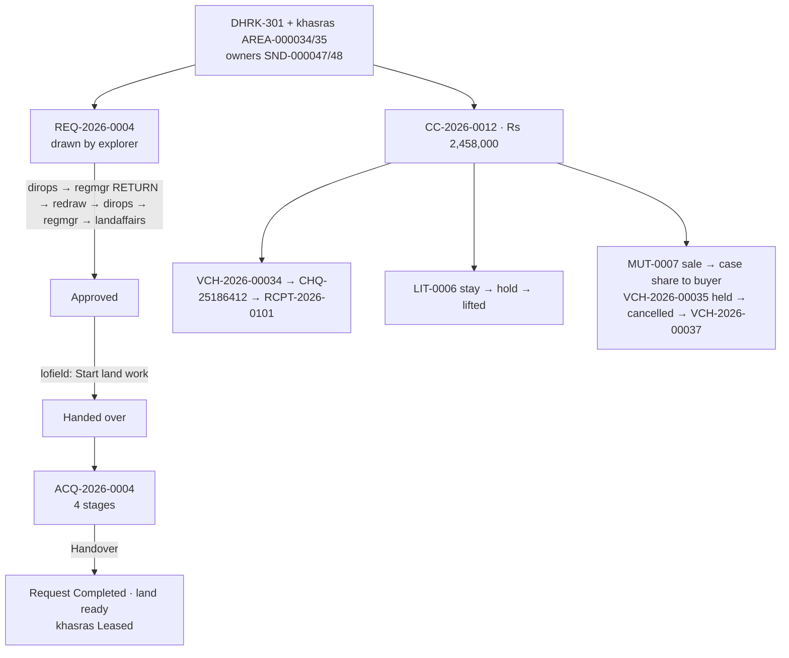

# Client Demo Walkthrough: every requirement, step by step

**For:** the person giving the demo to Mari Energies.
**Covers:** all 8 points the client raised on 2 Nov 2026 (see `docs/reports/CLIENT_REQUIREMENTS_ANALYSIS_2026-11-02.md`). Each part says which account signs in, where to click, what to type, and what the client should see.
**Checked:** the whole script was run through the application on a copy of `lms_dev` (migration 0062) on 2 Nov 2026: 63 checks, 0 failures. The codes below (REQ-2026-0004, CC-2026-0012 …) are the ones that run produced.

> All people, CNICs, IBANs and parcel numbers are **fictional**.

---

## 0. Before the demo

| # | Check | How |
|---|---|---|
| 1 | Latest code is running | `npm run build`, then restart the server. On the live VPS: `git pull`, `python3 db/tools/migrate.py up` (as lms_migrator), `npm ci && npm run build`, `pm2 restart lms-app`. |
| 2 | Database is at **0062** | `python db/tools/migrate.py status` shows 0 pending. On a new database also load `db/seed/seed_exploration_accounts.sql` and `db/seed/seed_director_account.sql`. |
| 3 | Back up first | `pg_dump -Fc -d lms_dev -f backups/before_client_demo.dump`. To repeat the demo, restore this file (see §14). |
| 4 | Demo sign-in list | Demo mode shows every account with its password on the sign-in page. Turn it off after the demo. |
| 5 | Browser | Chrome, 1440 × 900, zoom 100%. One **incognito window per account**, or sign out between accounts. |
| 6 | Map | Needs internet for the map tiles. Without it choose Basemap **None**; drawing still works. |
| 7 | Re-authentication | Releasing a cheque, holds, cancelling a voucher and changing access ask for the password again if the sign-in is older than 10 minutes. |
| 8 | Codes | If something was created before the demo, the numbers move up (e.g. REQ-2026-0005). Only the number changes. |

### The cast

| Username | Person (fictional) | Role / approval position | Province | Tabs | Used in part |
|---|---|---|---|---|---|
| `director` | Asif Rehman | **Director (all tabs, read-only demo account)** | all | **33** | 1 |
| `admin` | Asma Rahim | System Administrator | all | 10 | 3, 4 |
| `explorer` | Usman Ghani | Exploration Planner | Sindh | 9 | 3, 6, 7 |
| `dirops` | Javed Akhtar | Director Operations | all | 9 | 6 |
| `regmgr` | Sadia Memon | Regional Manager (Sindh) | Sindh | 9 | 6 |
| `landaffairs` | Zubair Soomro | DM / TL Land Affairs | Sindh | 25 | 6 |
| `lofield` | Sanaullah Khoso | Land Officer (Field) | Sindh | 23 | 5, 7, 8, 9, 10, 11 |
| `nego` | Bilal Chandio | Negotiation Officer | Sindh | 18 | 7, 8 |
| `legal` | Ayesha Siddiqui | Legal Advisor | all | 19 | 8, 10, 11 |
| `sradmin` | Faisal Shaikh | Sr. Administrator LMS (Field) | Sindh | 25 | 7, 8, 11 |
| `dmfield` | Nadia Baig | DM / Team Lead (Field) | Sindh | 25 | 7, 8 |
| `mland` | Imran Qadir | Manager Land (HO) | all | 27 | 2, 7, 8, 9, 10, 11 |
| `finance` | Shazia Noor | Finance Officer | all | 16 | 9, 10, 11 |
| `audit` | (Internal Audit) | Security Auditor | all | 32 | 12 |
| `viewer` | Hina Jamal | Viewer | all | 7 | 1, 2 |

### Demo map

| Part | Client's point | Who | Minutes |
|---|---|---|---|
| 1 | "One account with all tabs, then fewer tabs" | director, viewer, explorer | 5 |
| 2 | "Sindh is not visible on mobile" | viewer / mland on a phone | 2 |
| 3 | "Exploration person gets temporary access" | admin | 3 |
| 4 | "Province units, sizes set in Settings" | admin | 4 |
| 5 | "No duplicate or wrong entries; one CNIC, many lands" | lofield | 8 |
| 6 | "Exploration raises a request → approvals" | explorer, dirops, regmgr, landaffairs | 10 |
| 7 | "Land department acquires it, shows progress, tells completion" | lofield, nego, dmfield, mland, sradmin, explorer | 8 |
| 8 | Compensation case (the main acquisition workflow) | lofield + 5 approvers | 8 |
| 9 | Payment, tax, cheque, receipt | lofield, finance, mland | 6 |
| 10 | "Court case → payment hold until the decision" | lofield, legal, finance, mland | 6 |
| 11 | "Owner sold the land → future payments to the new owner" | lofield, sradmin, legal, mland, finance | 8 |
| 12 | CNIC search, statement and audit trail | lofield, audit, mland | 5 |

**Full demo ≈ 75 minutes. Short demo (30 min):** parts 1, 6, 7, 10, 11, 12, with the data of part 5 entered beforehand.



---

## Part 1. One account with every tab, then the ladder (client point 2)

**Sign in as `director`.**

1. The sidebar shows **all 33 tabs**: Overview, Master Data, Land Operations, Finance, Records & Reports, System.
2. Open any register, e.g. **Compensation Cases** or **Payments & Cheques**: everything is visible, but there is no Add, Edit or Approve button.
3. Open **Landowners**: CNICs are masked (`45102-*******-3`).

**Say:** "This is the overview account the client asked for. It reads everything in every province and changes nothing, so it does not break separation of duties."

**Then show the ladder.** Sign in, one after another, and point at the sidebar:

| Account | Tabs | What they see |
|---|---|---|
| `director` | 33 | everything, read-only |
| `audit` | 32 | everything read-only + audit, users, roles |
| `mland` | 27 | Head-office approvals, payment release, budgets, reports |
| `lofield` | 23 | Field data entry in Sindh, payments raising |
| `finance` | 16 | Vouchers, verification, holds, finance reports |
| `admin` | 10 | Users, roles, settings, audit; no business registers |
| `explorer` | 9 | GIS map, projects, khasras (no owners), land requests, Approvals & Alerts |
| `viewer` | 7 | Dashboards and read-only registers |

---

## Part 2. Sindh on a phone (client point 7)

**Sign in as `viewer` (or `mland`) on a phone**, or in Chrome press **F12 → device toolbar → iPhone 12 Pro (390 × 844)** and reload.

1. After sign-in the **Select province** screen opens.
2. **Expected:** the heading and the **Sindh** card are at the top; scroll down for Balochistan, Punjab, KPK and "All provinces".

**Say:** "The province chooser used to be centred and cut the top off on small screens. It now starts at the top."

---

## Part 3. Temporary access for the exploration person (client point 1)

**Sign in as `admin`.**

1. **Users & Roles** → find **explorer (Usman Ghani)** → **Access**.
2. In the grants table, on **Exploration Planner**, click **Set end date**.

   | Field | Value |
   |---|---|
   | Valid until | `31/03/2027` |
   | Reason | `Exploration campaign 2026-27: access until 31 Mar 2027` |

3. Click **Save**. If asked, re-enter the admin password.

**Expected:** the grant shows **"until 31 Mar 2027"**. In the Users list the Roles column shows the same. Within 7 days of the date it shows an amber "ends in N days" badge; after the date a red **Expired** badge, and the person loses every permission automatically.

**Say:** "Access ends by itself. No one has to remember to remove it."

---

## Part 4. Province units and unit sizes in Settings (client point 8)

**Sign in as `admin`.**

1. **Settings → Land units**. Choose **Sindh**.
2. Left card **Units used in Sindh**: Acre, Jireb, Ghunta, Square Feet (the order the forms offer them). **Change list…** lets you tick other units.
3. Right card **Unit sizes in Sindh**: on **Jireb** click **Set size…**

   | Field | Value |
   |---|---|
   | Jireb per acre | `2` |
   | Confirmed by the Land Department | ✔ |
   | Source / note | `Confirmed by the Land Department, Sindh (demo)` |

   Click **Save**.
4. **Expected:** the row shows **2** under *SND (per acre)* with "confirmed · since 02 Nov 2026".
5. Switch to **Punjab**: Kanal 8, Marla 160 per acre. Each province keeps its own sizes.

**Say:** "Units are per province, and their sizes are set here. A new size applies to new entries; khasras already recorded keep their area, so nothing changes silently."

*(The khasra form showing Sindh units first is seen in Part 5.)*

---

## Part 5. Master data without duplicates (client point 3)

**Sign in as `lofield`.** Choose province **Sindh**.

### 5a. Project: **Projects / Well Locations → + Add Project**

| Field | Value |
|---|---|
| Project code | `DHRK-301` |
| Province | `Sindh` |
| Name | `Daharki Well-03 Exploratory Location` |
| Type | `Well Location` |
| Block / concession | `Daharki D&PL` |
| District | `Ghotki` |
| Required area (acres) | `20` |
| Description | `Exploratory well pad, rig camp and 0.8 km access road north of Jarwar. Spud planned Feb 2027.` |

**Expected:** **DHRK-301**, Active.

### 5b. Show the duplicate checks: **Landowners → + Add Landowner**

1. Province `Sindh`, CNIC `45102-1100012-3`, then click into the next box.
   **Expected:** a **red box**: this CNIC is already registered as **SND-000002 Mukhtiar Ali Jarwar**, with an **Open** button. **Save is disabled.**
2. Clear the CNIC. Type Full name `Mukhtar Ali Jarwar`, Father `Allah Ditto Jarwar`.
   **Expected:** an **amber warning**: a similar person exists in Sindh (**SND-000002**, district Ghotki). It warns but does not block.
3. Click **Cancel**.

**Say:** "The same CNIC can never be entered twice. One CNIC can own many khasras; a near-match on name and father's name is flagged before saving."

### 5c. Three landowners: **+ Add Landowner** (owner type `O — Owner` each time)

| Field | Owner 1 | Owner 2 | Buyer (used in Part 11) |
|---|---|---|---|
| Province | Sindh | Sindh | Sindh |
| CNIC | `45104-2000011-3` | `45104-2000012-1` | `45104-2000013-9` |
| Full name | `Ghulam Rasool Mahar` | `Nazir Ahmed Mahar` | `Abdul Ghaffar Chachar` |
| Father / husband | `Muhammad Bux Mahar` | `Muhammad Bux Mahar` | `Haji Allah Bachayo Chachar` |
| Tax status | `Filer` | `Non-Filer` | `Filer` |
| Phone | `0301-2345678` | `0302-3456789` | `0333-7654321` |
| Bank branch | `HBL Daharki` | `Meezan Bank Daharki` | `UBL Daharki` |
| IBAN | `PK24HABB0012345678901234` | `PK57MEZN0003450123456789` | `PK36UNIL0109000312345678` |
| Address | `Village Jarwar, Taluka Daharki, District Ghotki` | same | `Mohalla Chachar, Daharki, District Ghotki` |

**Expected:** **SND-000047**, **SND-000048**, **SND-000049**.

### 5d. Two khasras: **Survey / Khasra Register → + Add Survey**

| Field | Khasra 1 | Khasra 2 |
|---|---|---|
| Province | Sindh | Sindh |
| Revenue location | `Ghotki → Daharki → Jarwar` | same |
| Project | `DHRK-301` | `DHRK-301` |
| Survey / khasra no. | `451/2` | `452/1` |
| Block no. | `9` | `9` |
| Khasra type | `Rural` | `Rural` |
| Land class | `Private` | `Private` |
| Recorded area + unit | `12` **Acre** | `320` **Ghunta** |
| Latitude / Longitude | `28.0710` / `69.7050` | `28.0703` / `69.7062` |
| Remarks | `Cultivated; tube-well on the east side.` | `Wheat crop standing at the time of survey.` |

While choosing the unit, open the dropdown: **"Units of SND"** (Acre, Jireb, Ghunta, Square Feet) come first, then **"Other units"** (client point 8).

**Expected:** **AREA-000034** (12.00 ac) and **AREA-000035** (320 Ghunta = **8.00 ac**, converted by the system), both **Proposed**.

**Duplicate khasra:** click **+ Add Survey** again with `451/2`, block `9`, Jarwar. **Expected:** "Khasra / survey no. 451/2 (block 9) already exists in Jarwar as AREA-000034. Open that parcel instead of adding it again."

### 5e. Owner shares: on each khasra's row click **Shares**, add both owners, **Save shares**

| Khasra | Ghulam Rasool Mahar | Nazir Ahmed Mahar | Revenue document |
|---|---|---|---|
| AREA-000034 | `60` | `40` | `Fard 2026/118` |
| AREA-000035 | `50` | `50` | `Fard 2026/119` |

**Expected:** 100.0%, 2 owners. *(Try 60 + 30: Save stays disabled until the total is 100%.)*

---

## Part 6. Exploration raises the request; three tiers approve (client point 1)

### 6a. Draw and submit: **sign in as `explorer`**

The planner lands on the **GIS Land Map**: no dashboard, no landowners, no payments.

1. Click **✎ Draw land request** → **Paste lat/long** → paste, then **Use these corners**:
   ```
   28.07200, 69.70400
   28.07200, 69.70700
   28.06950, 69.70700
   28.06950, 69.70400
   ```
2. **Expected panel:** 4 corners · **20.19 acres** · parcels inside **AREA-000034, AREA-000035**.
3. **Continue: request details**:

   | Field | Value |
   |---|---|
   | Project | `DHRK-301 — Daharki Well-03 Exploratory Location (SND)` |
   | Purpose | `Well Location` *(the list now also has Gathering Station, Processing Facility, Borrow Area (Green Area), Extra Land, Seismic / Exploration)* |
   | Priority | `Urgent` |
   | Required by | `15/01/2027` |
   | Target deh | `Jarwar` |
   | Concession block | `Daharki D&PL` |
   | Justification | `Exploratory well Daharki Well-03: well pad 120 m × 120 m, rig camp and mud pits, plus a 0.8 km access road. Rig mobilisation is planned for Feb 2027, so the land is needed by 15 Jan 2027.` |

4. Click **Submit to Director Operations**.

**Expected:** **REQ-2026-0004**, polygon orange (*Under review*), "Waiting on Director Operations".

### 6b. The approvals, with one return

Each approver first opens **Approvals & Alerts → Waiting on you**: the request is listed there (**Open** shows its details). The decision is made on **Land Requests → Review** on the request's row. Every decision needs a comment.

| Step | Sign in as | Decision | Comment | Stage after |
|---|---|---|---|---|
| 1 | `dirops` | Approve | `Operational need confirmed: Well-03 is in the 2027 drilling plan.` | Regional Manager |
| 2 | `regmgr` | **Return** | `Pull the north boundary about 45 m south to keep clear of the Jarwar link road, then resubmit.` | **Returned** |
| 3 | `explorer` | redraw, see below | — | Submitted |
| 4 | `dirops` | Approve | `Revised boundary acceptable.` | Regional Manager |
| 5 | `regmgr` | Approve | `Region supports it; no conflict with other activity.` | Land Affairs |
| 6 | `landaffairs` | Approve | `Private land, two owners identified, no litigation recorded. Approved.` | **Approved** |

**Step 3, `explorer`:** **Approvals & Alerts → Your land requests** shows "Returned" with the comment. Go to **Land Requests → Edit on map** → **Clear** → **Paste lat/long**:
```
28.07160, 69.70400
28.07160, 69.70680
28.06950, 69.70680
28.06950, 69.70400
```
**Use these corners** (≈ **15.83 acres**) → **Continue: review and save** → What changed: `North boundary moved 45 m south and east edge 20 m west, as asked by the Regional Manager.` → **Save and send to Director Operations**.

**Show:** *Details → Polygon versions* lists v2 (current) and v1. `explorer` cannot approve; `regmgr` has no Review button while it waits for Director Operations; after a return every tier decides again.

---

## Part 7. Land department takes it up; progress; "land ready" (client point 1)

### 7a. Hand-over and acquisition: **sign in as `lofield`**

1. **Land Requests** → REQ-2026-0004 → **Start land work**:

   | Field | Value |
   |---|---|
   | Land work | `Acquisition` |
   | Mark the recorded parcels inside "Under Acquisition" | ✔ |
   | Comment | `Negotiation with the Mahar family starts 10 Nov 2026.` |

   **Expected:** 2 parcels marked **Under Acquisition** (AREA-000034, AREA-000035); stage **Handed over**.
2. On the same row: **Create acquisition**. The form opens pre-filled from the request:

   | Field | Value |
   |---|---|
   | Project | DHRK-301 (pre-filled) |
   | Mode | `Private Lease` |
   | Area required | 15.83 (pre-filled) |
   | Negotiated rate (Rs / acre) | `60000` |
   | Target handover | 15/01/2027 (pre-filled) |
   | Surveys | AREA-000034, AREA-000035 (pre-filled) |

   **Save** → **ACQ-2026-0004**, stage *Identification*.
3. **Title** → tick all six checks (Fard, mutation, CNICs, no encumbrance, no litigation, possession). They are required before the Approval stage.

### 7b. The requester follows the progress: **sign in as `explorer`** (keep this window open)

**Land Requests → REQ-2026-0004 → Details**: a **Land work progress** strip shows the acquisition's five stages, with *Identification* current. The explorer has no access to the acquisition register, yet sees its stage.

### 7c. Acquisition stages: one person, one stage (Acquisition & Title → ACQ-2026-0004 → stage button)

| Step | Sign in as | Button | Explorer's Details now shows |
|---|---|---|---|
| 1 | `nego` | → Negotiation | Negotiation |
| 2 | `dmfield` | → Approval | Approval |
| 3 | `mland` | → Acquisition / Lease | Acquisition / Lease |
| 4 | `sradmin` | → Handover | **Handover** |

**Expected after step 4:**
- REQ-2026-0004 is **Completed (land ready)**: "Acquisition ACQ-2026-0004 handed over: the land is ready."
- AREA-000034 and AREA-000035 are **Leased** *(a Direct Purchase or LAA acquisition would mark them **Acquired**)*.
- `explorer` → **Approvals & Alerts → Your land requests** shows **"Land ready · REQ-2026-0004"**.
- The Land Requests list shows a 6th step **"Land ready"** and the KPI *Land ready*.

**Say:** "From the exploration request to land ready, every step is in one chain, and the person who asked sees the progress and the completion."

*(A request handed over for a lease, case or DBPFC is closed by the Land Officer with **Mark land ready**.)*

---

## Part 8. Compensation case and its approval chain

### 8a. Create: **sign in as `lofield`** → **Compensation Cases → + Add Compensation Case**

| Field | Value |
|---|---|
| Project | `DHRK-301` |
| Land used for | `Well Location` |
| Lease rate (Rs / acre / year) | `60000` |
| Lease term (months) | `36` |
| Remarks | `Three-year surface lease for the Well-03 pad, with crop and tree damage.` |

| Section | Line |
|---|---|
| Landowners | Ghulam Rasool Mahar `60` % `O`; Nazir Ahmed Mahar `40` % `O` |
| Lease lines | AREA-000034, owners' share `100`, area `12` |
| Crop | AREA-000035, `Wheat`, rate `45000`, damaged `5` ac |
| Trees | AREA-000035, `Kikar`, `Medium`, rate `8000`, count `6` |
| Other | AREA-000034, `Disturbance allowance`, `25000` |
| Documents seen | tick all six |

**Create case** → **CC-2026-0012**, *Prepared*. The system calculates (nothing typed):

| Head | Calculation | Rs |
|---|---|---|
| Lease | 60,000 × 12 ac × 36 ÷ 12 | 2,160,000 |
| Crop | 45,000 × 5 | 225,000 |
| Trees | 8,000 × 6 | 48,000 |
| Other | | 25,000 |
| **Total award** | | **2,458,000** |

### 8b. Approvals (each sees it in Approvals & Alerts; button on the case row)

| Step | Sign in as | Button | Note |
|---|---|---|---|
| 1 | `nego` | → Checked | `Rates agreed with both owners on site.` |
| 2 | `legal` | → Reviewed | `Title clear per Fard 2026/118–119; no litigation.` |
| 3 | `sradmin` | → Verified | `Field records and measurements verified.` |
| 4 | `dmfield` | → Field Approved | `Approved at field level.` |
| 5 | `mland` | → HO Approved | `Approved at head office.` → **locked** |

**Show:** `lofield` has no approve button (preparer); `nego` cannot approve a second step.

---

## Part 9. Payment, tax, cheque and receipt

### 9a. Two vouchers: **sign in as `lofield`** → **Payments & Cheques → + Request Payment**

| Field | Voucher A | Voucher B (kept unpaid for Part 11) |
|---|---|---|
| Project | DHRK-301 | DHRK-301 |
| Case | CC-2026-0012 | CC-2026-0012 |
| Payee | Ghulam Rasool Mahar — Filer | Nazir Ahmed Mahar — Non-Filer |
| Category | `Lease Rent` | `Crop Compensation` |
| Pay type | `Advance Lease (multi-year)` | `One-time` |
| Payment mode | `Cross Cheque` | `Direct Credit (IBFT)` |
| Land class | `Private` | `Private` |
| Period | `01/11/2026` – `31/10/2029` | from `01/11/2026` |
| Gross (Rs) | `1000000` | `500000` |
| Remarks | `First instalment: advance lease rent for the Well-03 pad (60% owner).` | `Wheat crop damage on 452/1 (40% owner).` |

**Expected:** **VCH-2026-00034**: WHT **10%** (Filer), net **Rs 900,000**. **VCH-2026-00035**: WHT **20%** (Non-Filer), net **Rs 400,000**. The rate is set by the system.

**Show:** a voucher of Rs 2,500,000 is refused: "award is 2458000.00 … at most 958000.00 can still be requested".

### 9b. Verify, release, receipt

| Step | Sign in as | Where / action | Values |
|---|---|---|---|
| 1 | `finance` | VCH-2026-00034 → **Verify** | Note `Payee, WHT and case checked.` |
| 2 | `mland` | VCH-2026-00034 → **Release cheque** | Cheque date `05/11/2026`, note `Released to the owner at Daharki field office.` → **CHQ-25186412**, Rs 900,000 |
| 3 | `finance` | **Cheques** tab → CHQ-25186412 → **Record receipt** | Receipt no. `RCPT-2026-0101`, received `05/11/2026`, acknowledged by `Ghulam Rasool Mahar`, CNIC `45104-2000011-3`, remarks `Cheque received in person.` |
| 4 | `finance` | Receipts → **Print receipt** | Receipt of Payment: parcel 451/2 Deh Jarwar, gross 1,000,000, less WHT 100,000, total 900,000, amount in words, settlement |

---

## Part 10. Court case → payment hold until the decision (client point 5)

1. **`lofield`**: **+ Request Payment**: case CC-2026-0012, payee **Ghulam Rasool Mahar**, `Lease Rent`, `Yearly Lease`, `Cross Cheque`, `Private`, period `01/11/2027` – `31/10/2028`, gross `200000`, remarks `Second-year rent top-up.` → **VCH-2026-00036**.
2. **`legal`**: **Legal & Litigation → + Add Legal Case**:

   | Field | Value |
   |---|---|
   | Province | `Sindh` |
   | Court case no. | `C.S. 214/2026` |
   | Court | `Senior Civil Judge, Daharki` |
   | Case type | `Civil suit (title)` |
   | Company is | `Proforma Party` |
   | Status | `Pending` |
   | Parties | `Muhammad Yaqoob Mahar v. Ghulam Rasool Mahar & Mari Energies Ltd` |
   | Project | `DHRK-301` |
   | Filed on / Next hearing | `04/11/2026` / `20/11/2026` |
   | Counsel | `Barrister Saima Abro` |
   | Financial exposure | `1200000` |
   | **Parcels concerned** | search `451/2` → add **AREA-000034** |
   | **Landowners concerned** | search `Ghulam` → add **Ghulam Rasool Mahar** |
   | **Stay order in force** | ✔ |
   | Remarks | `Cousin claims a share in khasra 451/2; court ordered status quo on payments.` |

   **Save** → **LIT-0006**; the list shows *Stay order*. 2 holds are placed (the parcel and the landowner).
3. **`finance`**: **Payments → Holds** lists them. On VCH-2026-00036 (shown *On hold*) click **Verify**.
   **Expected:** refused: "Payment is on hold: stay order in C.S. 214/2026 (Senior Civil Judge, Daharki)". No money can move on that parcel or owner.
4. The court decides. **`mland`**: **Legal & Litigation** → LIT-0006 → **Update**: Status `Decided — In Favour`, untick *Stay order*, **Court order lifting the stay**: `Order of 20 Nov 2026 in C.S. 214/2026: suit dismissed, stay vacated.` → Save.
   *(Lifting releases held money, so it needs the Manager Land's authority, not only the Legal Advisor's.)*
5. **`finance`**: VCH-2026-00036 → **Verify** → now **Verified**.

**Say:** "A stay order stops every payment on the parcel and the owner at once, in the database. It is lifted only by recording the court's order."

---

## Part 11. Owner sold the land → future payments go to the new owner (client point 4)

Nazir Ahmed Mahar sells his whole share to Abdul Ghaffar Chachar. Nazir's voucher VCH-2026-00035 (Rs 500,000) is still unpaid.

| Step | Sign in as | Action | Values |
|---|---|---|---|
| 1 | `lofield` | **Mutation & Succession → + Add Mutation** | Type `Sale / Transfer`; Transferor `Nazir Ahmed Mahar`; **+ Add transferee**: `Abdul Ghaffar Chachar`, relation `Buyer`, share `100`; Remarks `Nazir Ahmed Mahar sold his whole share in 451/2 and 452/1 to Abdul Ghaffar Chachar.` → **MUT-0007**, *Initiated*, parcels 451/2, 452/1 |
| 2 | `sradmin` | MUT-0007 → **Revenue record** | Revenue mutation no. `Intiqal 881/2026`, date `10/11/2026`, office `Mukhtiarkar Daharki` → Save; then **→ Revenue Verified** |
| 3 | `legal` | **→ Legal Cleared** | |
| 4 | `mland` | **→ Approved & Applied** | the transfer is applied |

**Expected, all automatic:**
- Khasra shares: 451/2 → Ghulam 60 / **Abdul Ghaffar 40**; 452/1 → Ghulam 50 / **Abdul Ghaffar 50**.
- Case CC-2026-0012 owners: Ghulam 60% / **Abdul Ghaffar 40%**. Nazir had been paid nothing, so his whole 40% moved.
- MUT-0007 → **Details → Payments re-pointed**: "case CC-2026-0012 · Nazir Ahmed Mahar → Abdul Ghaffar Chachar · 40%".
- VCH-2026-00035 (Nazir) is **On hold**: "Ownership changed by mutation MUT-0007 (Sale / Transfer): cancel and raise for the new owner, or release if earned before the transfer".

Then:

| Step | Sign in as | Action | Values |
|---|---|---|---|
| 5 | `finance` | VCH-2026-00035 → **Cancel voucher** | Reason `Land sold by mutation; crop compensation raised again for the buyer.` → *Cancelled*, hold lifted |
| 6 | `lofield` | **+ Request Payment** for the buyer | Case CC-2026-0012, payee **Abdul Ghaffar Chachar — Filer**, `Crop Compensation`, `One-time`, `Direct Credit (IBFT)`, `Private`, from `01/11/2026`, gross `500000`, remarks `Wheat crop damage on 452/1 — now payable to the buyer (mutation).` → **VCH-2026-00037**, WHT 10%, net **Rs 450,000** |
| 7 | `lofield` | try a new voucher for **Nazir** on the case | refused: "the payee is not an owner on case CC-2026-0012" |

**Say:** "Field initiates, revenue and legal verify, head office applies. The system moves the unpaid share to the buyer, holds anything already raised for the seller, and Finance decides. If the seller had already been paid part, he keeps exactly that part. If he still owned another khasra in the same case, he would keep the share for that khasra."

---

## Part 12. CNIC search, statement and audit (client point 6)

| Step | Sign in as | Where | What to show |
|---|---|---|---|
| 1 | `lofield` | Header search box: `45104-2000013-9` | Finds **SND-000049 Abdul Ghaffar Chachar** (S/o Haji Allah Bachayo Chachar, Active); open it to see his khasras 451/2 and 452/1 and shares |
| 2 | `lofield` | **Landowners** → SND-000047 → **Statement** | Ghulam Rasool Mahar: award share, paid Rs 1,000,000 (cheque 900,000 + WHT 100,000), balance |
| 3 | `mland` | **Records & Reports → Landowner Register**: Sindh, Ghotki, Daharki, Jarwar; unit `All in Kanal`; one row per owner | Ghulam Rasool and Abdul Ghaffar with khasras and shares; 12 ac = 96 Kanal, 8 ac = 64 Kanal; export PDF / Excel |
| 4 | `audit` | **Audit Trail**, search `CC-2026-0012`, then `MUT-0007`, `LIT-0006` | Every change: who, when, old and new values, including the automatic share move and holds |
| 5 | `mland` | **Executive Dashboard** | Approved vs paid, approvals waiting, province chart |

---

## 13. Quick "what if" checks (if the client asks)

| Question | Show | Result |
|---|---|---|
| Can the same CNIC be added twice? | Add Landowner `45104-2000011-3` | Save blocked; "already registered" |
| Can the preparer approve? | `lofield` on CC-2026-0012 | No approve button |
| Can one person approve two steps? | `nego` on the next case step | Refused |
| Can Balochistan see Sindh? | `loquetta` → Land Requests | REQ-2026-0004 not listed |
| Does the explorer see owner data? | `explorer` menu | No Landowners, Cases, Payments; no Shares button |
| Boundary crossing itself? | GIS draw `28.0720,69.7040` / `28.0695,69.7070` / `28.0720,69.7070` / `28.0695,69.7040` | "The boundary crosses itself…" |
| Pay more than the award? | Voucher Rs 2,500,000 on CC-2026-0012 | Refused |
| Pay during a stay order? | Part 10 step 3 | Refused until the court order is recorded |

---

## 14. Repeat the demo / troubleshooting

- **Repeat from the start:** restore the backup taken in §0:
  `pg_restore --clean --if-exists -d lms_dev backups/before_client_demo.dump` (stop the app first), then restart. The same codes come out again.
- **Numbers differ** (e.g. REQ-2026-0005): something was created before; carry on.
- **"Please confirm your identity"**: re-enter the password (sign-in older than 10 minutes).
- **No map tiles**: Basemap → None.
- **Approver sees no button**: check the province chosen in the header (Sindh) and that the previous step was done by someone else.
- **Voucher shows On hold**: open **Payments → Holds** to see why (stay order or mutation).
