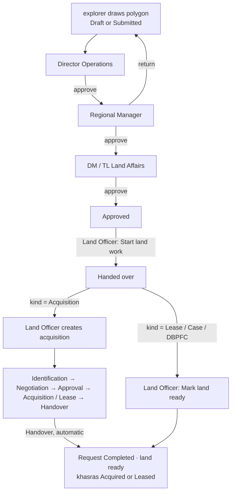
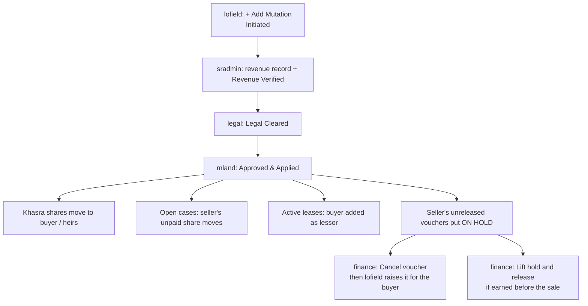

# Team Guide: the 2 November update: how it works, how to test it, how to demo it

**For:** our own team (developers, testers, whoever gives the demo).
**Covers:** what changed for the client's 8 points, how each flow works behind the screen, how to set up and test it, and how to run the demo.
**Related:** `06b_SHORT_DEMO` (the click-by-click demo script), `06_CLIENT_DEMO_WALKTHROUGH` (the full 75-minute version), `docs/reports/CLIENT_REQUIREMENTS_ANALYSIS_2026-11-02.md` (§9–10: what was built and the decisions taken).

---

## 1. What is new, in one table

| # | Client asked | What we built | Where on screen | Who uses it |
|---|---|---|---|---|
| 1 | Exploration request → approvals → purchase → progress → completion | Request follows its acquisition stage; acquisition **Handover** marks khasras Acquired/Leased and closes the request as **Completed (land ready)**; land requests in **Approvals & Alerts** with notices to the requester; lease form pre-filled from a request; **Mark land ready** for lease/case/DBPFC hand-overs | Land Requests, Approvals & Alerts, Acquisition & Title | explorer, dirops, regmgr, landaffairs, lofield |
| 1 | Temporary access | Role **"Valid until"** date: set, change, remove; access stops automatically after that day (Pakistan time) | Users & Roles → Access | admin |
| 2 | One account with all tabs | Demo account **`director`**: 33 tabs, every action except payment release, every approval position | whole menu | director |
| 3 | No duplicate / wrong entries | Same CNIC blocks Save; similar name + father name warns; duplicate khasra refused with the existing code | Landowners, Survey / Khasra Register | lofield |
| 4 | Sold land → payments to new owner | Applying a mutation moves the seller's **unpaid** case share to the buyer/heirs (paid part stays; parcel-wise if he keeps other land in the case), adds them as lessors, and **holds** the seller's unreleased vouchers. Finance gets **Cancel voucher** | Mutation & Succession → Details; Payments & Cheques | lofield, sradmin, legal, mland, finance |
| 5 | Court case → payment hold | Already existed. New: the Legal Case form now has **Parcels concerned** and **Landowners concerned**; without them a stay held nothing | Legal & Litigation | legal, mland, finance |
| 6 | Acquisition demo | Now runs to the end (land ready) | — | — |
| 7 | Sindh hidden on mobile | Province chooser starts at the top on small screens | Select province screen | everyone |
| 8 | Province units, sizes in Settings | **Settings → Land units**: unit list per province and each local unit's size (per acre); khasra form shows the province's units first; 5 prototype purposes added | Settings, Survey / Khasra Register | admin, lofield |

Database changes: migrations **0060**, **0061**, **0062**. Demo account seed: `db/seed/seed_director_account.sql`.

---

## 2. How each flow works

### 2.1 Land request → land ready

- **Who decides each tier:** the person holding that position (Director Operations, Regional Manager, DM / TL Land Affairs) in the request's province. The requester cannot approve; nobody approves two tiers. A return sends it back to the requester, and every tier decides again.
- **Progress for the requester:** each acquisition stage change is copied onto the request (`work_stage`). The explorer has no access to acquisitions but sees the strip in **Details**.
- **Khasra status at Handover:** Direct Purchase or LAA 1894 → **Acquired**. Private lease, government lease, ROW / easement → **Leased** (company has a right of use; title stays with the owner). Disputed or Released khasras are not touched.
- **Notices:** Approvals & Alerts → *Waiting on you* (approvers, Land Officer) and *Your land requests* (requester: returned, rejected, approved, handed over, land ready).

### 2.2 Temporary access

- Admin → **Users & Roles** → **Access** on the user → **Set end date** on the grant → date + reason.
- The date means the end of that day, Pakistan time. After it, the person has no permissions from that role; nothing has to be removed by hand.
- Technically a change is "revoke + new grant", so the history keeps both.

### 2.3 Province units

- **Settings → Land units → province tab.**
  - *Units used in …*: the order the khasra form shows them (**Change list…**).
  - *Unit sizes in …*: **Set size…** = how many of that unit make one acre, with a *confirmed* tick. **Use the national size** removes the override.
- Acre, hectare and square measures are fixed and cannot be resized.
- A new size applies to khasras saved from that day on. A khasra already recorded keeps its area.

### 2.4 Duplicates

| Check | When | What happens |
|---|---|---|
| Same CNIC | Landowner form, on leaving the CNIC box | red box, **Save disabled**, Open button to the existing person |
| Similar name + father name in the province | on leaving the name boxes | amber warning only |
| Same khasra (survey no. + block + deh) | on Save | refused: "already exists in Jarwar as AREA-000034" |

### 2.5 Mutation → payments

- **What the seller keeps on a case:** the part already paid to him. If he still owns another khasra in the same case, also the share for that khasra (worked out from the value of the case lines on each khasra).
- **Record:** Mutation → **Details → Payments re-pointed** lists every move.
- A new voucher for the seller on that case is refused ("not an owner on case …").

### 2.6 Court stay

- **Legal** records the case with the parcels and landowners concerned and ticks **Stay order**. The database places a hold on each one.
- Any voucher on those parcels or owners cannot be verified or released ("Payment is on hold: stay order …").
- **Manager Land** lifts it: Update → decided status, untick stay, type the court order. (Not the Legal Advisor: lifting releases money, so it needs payment-hold authority.)

---

## 3. Set up before testing or a demo

| Step | Command / action |
|---|---|
| 1. Get the code | `git pull` (or use the working copy) |
| 2. Migrate the database | `python db/tools/migrate.py --dsn "<lms_migrator DSN>" up`, then `status` must show 0 pending (62 applied) |
| 3. Demo accounts | on a new database: `psql -U lms_migrator -d <db> -f db/seed/seed_exploration_accounts.sql` and `-f db/seed/seed_director_account.sql`; set passwords with `npx tsx scripts/iam/bootstrap.ts --username <name>` (or `npm run demo:setup` for a fresh demo DB) |
| 4. Build and restart | `npm run build`, then restart (local: the 3040 server; live: `pm2 restart lms-app`) |
| 5. Backup | `pg_dump -Fc -d <db> -f backups/before_demo.dump` |
| 6. Browser | Chrome, 1440 × 900, one incognito window per account |

Windows: set `PGCLIENTENCODING=UTF8` and `PYTHONUTF8=1` before migrate/psql.

---

## 4. Test checklist (tick each; expected result in the last column)

Use the data and steps in `06b_SHORT_DEMO` (Part 0 creates the data).

| # | Test | Account | Expected |
|---|---|---|---|
| T1 | Phone view (F12 → device iPhone 12 Pro) | viewer | "Select province" heading and Sindh card at the top |
| T2 | Menu sizes | director / explorer / viewer | 33 / 9 / 7 tabs |
| T3 | Director can act everywhere | director | Add buttons on every register, "→ next" on workflows; payment **Release** refused (one person cannot raise/verify and release); on one record only one step (separation of duties) |
| T3a | Row details | any | click a row on Users, Cases, Payments, Surveys, Audit…: a details window opens; **Close** / Esc shuts it; a row's own button (e.g. Edit) still opens its own dialog |
| T3b | Only your step's button | legal on a *Legal Cleared* mutation; nego on a *Negotiation* acquisition | no "→" button; the row shows "Waiting on Manager Land (HO)" / "Waiting on DM / Team Lead (Field)" |
| T3c | Documents before field approval | dmfield on a case with unticked documents | "Missing documents: …"; tick them in the case's **Document checklist**, then it works |
| T3d | Shares before mutation | lofield creates a mutation for an owner with no recorded shares | at **Approved & Applied**: "Select the holdings to transfer." Record shares first |
| T4 | Set role end date | admin | grant shows "until …"; past date refused |
| T5 | Set Jireb size in Sindh | admin | row shows the new per-acre figure, "confirmed" |
| T6 | Khasra unit list | lofield | unit dropdown: "Units of SND" first, then "Other units" |
| T7 | Ghunta conversion | lofield | 320 Ghunta saved as 8.00 ac |
| T8 | Duplicate CNIC `45102-1100012-3` | lofield | red box, Save disabled |
| T9 | Similar name `Mukhtar Ali Jarwar` / `Allah Ditto Jarwar` | lofield | amber warning naming SND-000002 |
| T10 | Duplicate khasra 451/2 block 9 | lofield | refused with "already exists … AREA-000034" |
| T11 | Request appears in approver's queue | dirops | Approvals & Alerts → Waiting on you |
| T12 | Return goes back to requester | regmgr → explorer | explorer sees "Returned" notice; Edit on map |
| T13 | Requester cannot approve own request | explorer | no Review button |
| T14 | Hand-over marks khasras | lofield | "2 parcel(s) marked Under Acquisition" |
| T15 | Acquisition pre-filled from request | lofield | project, area, khasras filled in |
| T16 | Requester sees progress | explorer | Details → strip moves with each acquisition stage |
| T17 | Handover completes the request | sradmin → explorer | request Completed; "Land ready" notice; khasras Leased |
| T18 | Lease hand-over closed by hand | lofield | **Mark land ready** button (not offered for acquisition) |
| T19 | Stay holds payment | legal → finance | Verify refused with "stay order" message |
| T20 | Only Manager Land lifts the stay | legal → mland | legal refused; mland succeeds; Verify then works |
| T21 | Mutation moves the case share | mland | case owners Ghulam 60 / Abdul Ghaffar 40; Details shows the move |
| T22 | Seller's voucher held | finance | VCH of Nazir shows On hold (ownership changed) |
| T23 | Cancel voucher | finance | voucher Cancelled; hold lifted |
| T24 | Voucher for buyer | lofield | accepted, WHT 10% (Filer) |
| T25 | Voucher for seller refused | lofield | "not an owner on case …" |
| T26 | CNIC search | lofield | `45104-2000013-9` finds SND-000049 |
| T27 | Audit | audit | MUT-0007 changes listed with who and when |

**Automated tests** (developers):

| Suite | Command | Last result (2 Nov) |
|---|---|---|
| Typecheck, lint | `npm run typecheck` · `npm run lint` | pass |
| DB | `bash db/tools/rebuild.sh lms_test seed` then `python db/tools/run_tests.py --db lms_test --no-rebuild` | 26/26, 919 checks |
| API | server on 3041 + `npx vitest run tests/iam tests/regression` | 1545/1548; rerun of failures 109/109 |
| Demo rehearsal | the whole walkthrough through the API on a DB copy | 63 checks, 0 failures |

---

## 5. Giving the demo

1. **Before:** set up (§3), enter Part 0 data from `06b_SHORT_DEMO`, take the backup, open incognito windows for the accounts you will switch between.
2. **Order** (follows the client's messages): all tabs → mobile → exploration request and approvals → acquisition and land ready → court stay → land sold → CNIC and audit. Units and temporary access fit after the tabs if time allows.
3. **One sentence per part** to say to the client:

| Part | Say |
|---|---|
| Tabs | "One overview account sees everything and changes nothing; every other role sees only its own work." |
| Request | "Exploration marks the land on the map; three positions approve in turn; nobody approves their own or two tiers." |
| Land ready | "The requester sees each stage of the acquisition and is told when the land is ready." |
| Court stay | "A stay order stops every payment on that land and owner, in the database, until the court's order is recorded." |
| Land sold | "Field starts it, revenue and legal verify, head office applies; unpaid money moves to the new owner, and anything already raised for the old owner waits for Finance." |
| Duplicates | "The same CNIC or khasra can never be entered twice." |
| Units | "Each province has its own units and sizes, set here; old records keep their area." |

4. **After:** to repeat, restore the backup and restart. Turn demo mode (password list on the sign-in page) off when the demo period ends.

---

## 6. If something goes wrong

| Problem | Cause / fix |
|---|---|
| No Review / → button for an approver | Wrong province in the header, or the previous step was not done, or this person already decided another tier |
| "Please confirm your identity" | Sign-in older than 10 minutes; re-enter the password |
| Voucher shows On hold | Payments → **Holds** tab shows why (stay order, mutation, lease hold) |
| Explorer sees no progress strip | The Land Officer has not created the acquisition yet |
| Request does not become Completed | The acquisition is not at Handover yet, or the hand-over kind was not Acquisition (use **Mark land ready**) |
| Stay order held nothing | Parcels / landowners were not added on the legal case |
| Map is blank | No internet for tiles: Basemap → None |
| Codes have different numbers | Records were created before; carry on |
| New screens missing | Build and restart not done after `git pull` / migrate |
