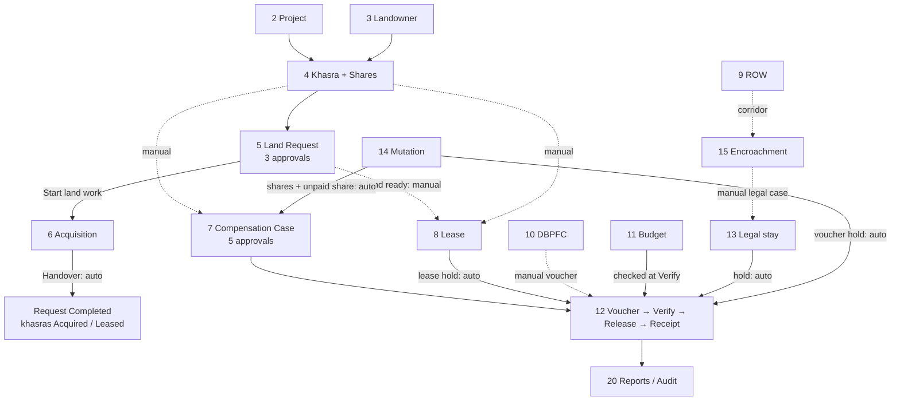

# LMS Module Workflow — Quick Reference

For the presenter. Each module lists **who signs in, where to click, what to pick, what happens**, and how it connects to the other modules. The values to type are in **09 Demo Data Sheet** (same section numbers).

---

## 0. Accounts, switching, tips

**Switch account:** top-right name → **Sign out** → on the sign-in page click the next account (demo mode lists every account with its password). Faster: keep **one incognito window per account**.
**Province:** after sign-in pick it on *Select province*; change it later with the province chip in the header (e.g. **Sindh ▾**).

| Sign in as | Person | Position | Province | Acts in (section) |
|---|---|---|---|---|
| `admin` | Asma Rahim | System Administrator | all | 1 Users, 21 Settings, 20 Audit |
| `director` | Asif Rehman | Director (demo): every business position | all | anything, one step per record; **not** cheque release |
| `explorer` | Usman Ghani | Exploration Planner | SND | 5 draws land requests |
| `dirops` | Javed Akhtar | Director Operations | all | 5 tier 1 |
| `regmgr` | Sadia Memon | Regional Manager | SND | 5 tier 2 |
| `landaffairs` | Zubair Soomro | DM / TL Land Affairs | SND | 5 tier 3 |
| `lofield` | Sanaullah Khoso | Land Officer (Field) | SND | creates records in 2–10, 12–17; hand-over (5) |
| `nego` | Bilal Chandio | Negotiation Group | SND | 6 Negotiation, 7 Checked, 16 In Progress |
| `legal` | Ayesha Siddiqui | Legal Advisor | all | 7 Reviewed, 13 cases, 14 Legal Cleared, 15 Legal Follow-up |
| `sradmin` | Faisal Shaikh | Sr. Administrator LMS (Field) | SND | 6 Handover, 7 Verified, 8/9 Under Review, 10 Referred, 14 Revenue Verified, 15 Assessed, 16 Resolved |
| `dmfield` | Nadia Baig | DM / Team Lead (Field) | SND | 6 Approval, 7 Field Approved, 15 Action Approved, 16 Assigned |
| `mland` | Imran Qadir | Manager Land (HO) | all | final approvals in 6–10, 14–16; **cheque release**; lifts stays; budgets |
| `finance` | Shazia Noor | Finance Officer | all | 12 **Verify**, holds, cancel voucher, receipts; budgets |
| `audit` | Tariq Mehmood | Internal Audit | all | 20 read-only + Audit Trail |
| `viewer` | Hina Jamal | — | all | read-only, CNIC masked |

Same jobs in other provinces: `loquetta`, `negoqta`, `sradmqta`, `dmqta`, `regmgrqta`, `landaffqta`, `explorerqta` (Balochistan); `lopnj`, `sradmpnj`, `regmgrpnj`, `landaffpnj` (Punjab + KPK).

**Tips**
- **Click a row** (not its buttons) → the record's details open; **Close** or **Esc** shuts them.
- The **→ next stage** button appears only for the position that owns that step. Everyone else sees **"Waiting on <position>"** on the row. Pressing it opens a box: type a **Note** → **Move to <stage>**.
- **Separation of duties:** whoever created a record cannot approve it, and one person takes only one step of the same record. That is why the creator (`lofield`) never does the next step.
- **Cancel / Stop** on a row (cases, acquisitions, mutations; DBPFC and ROW: Stop) needs a reason and is open to anyone who may edit that module.
- **Release cheque**, holds and **Cancel voucher** ask for the password again when the sign-in is older than **10 minutes**.

---

### 1. Users & Roles
**What it is:** accounts, roles, provinces and approval positions. **Menu:** System → Users & Roles.

| # | Sign in as | Go to | Do | Result |
|---|---|---|---|---|
| 1 | `admin` | Users & Roles | **+ Add User** → *Username*, *Full name*, *Email*, *Department*, *Position*, *Office* → *Roles*, *Provinces*, *Approval positions* (multi-select) → **Create and get invitation link** | link shown; copy it to the person |
| 2 | `admin` | click the user's row | details: account, work, roles, 2-step, sessions → **Access** (role end date "valid until"), **Edit**, **Status** | changes are audited |

**How it connects**
- `[automatic]` the *Approval positions* given here decide who sees the **→** button in sections 5–16 (`lms.workflow_step_group`, checked by `api.advance_workflow`).
- `[automatic]` *Provinces* limit what the user sees everywhere (row-level security).
- `[shows in]` Audit Trail (20).

**If refused:** you cannot change your own roles → another admin does it.

### 2. Projects / Well Locations
**What it is:** the well / facility the land is for. **Menu:** Master Data → Projects / Well Locations.

| # | Sign in as | Go to | Do | Result |
|---|---|---|---|---|
| 1 | `lofield` | Projects / Well Locations | **+ Add Project** → *Project code*, *Province* ▾, *Name*, *Type* ▾, *Block / concession*, *District* ▾, *Required area* → **Save** | project in the list |

**How it connects**
- `[picks]` none (it is the root).
- `[automatic]` every khasra, request, acquisition, case, lease, ROW, DBPFC, budget, voucher, encroachment, grievance and legal case picks a project; the project must be in the same province (`tg_link_same_province`).
- `[shows in]` Project Dashboard (one page per project), Executive Dashboard, reports.

### 3. Landowners
**What it is:** owners, identified by CNIC. **Menu:** Master Data → Landowners.

| # | Sign in as | Go to | Do | Result |
|---|---|---|---|---|
| 1 | `lofield` | Landowners | **+ Add Landowner** → *Province* ▾, *CNIC* (type the 13 digits), *Full name (as on CNIC)*, *Father / husband name*, *Owner type* ▾, *Tax status* ▾ (Filer / Non-Filer), IBAN, *Bank branch* → **Save** | code e.g. SND-0000NN |
| 2 | `lofield` | click the owner's row | **Statement**: owed, paid, balance (payment lines only for payment roles) | — |

**How it connects**
- `[picks]` none.
- `[automatic]` *Tax status* sets the withholding tax on every voucher to this owner: Filer 10 %, Non-Filer 20 % (`finance.wht_pct` × `finance.wht_nonfiler_multiplier`).
- `[automatic]` a **Deceased** owner cannot be paid until a Virasat mutation (14).
- `[shows in]` shares (4), case owners (7), lessor (8), payee (12), legal stay (13), mutation (14), Landowner Register (20).

**If refused:** "A landowner with this CNIC is already registered" → open the existing owner.

### 4. Survey / Khasra Register + Shares
**What it is:** the parcel and who owns which share. **Menu:** Master Data → Survey / Khasra Register.

| # | Sign in as | Go to | Do | Result |
|---|---|---|---|---|
| 1 | `lofield` | Survey / Khasra Register | **+ Add Survey** → *Province* ▾, *Revenue location* (district → taluka → deh), *Project* ▾, *Survey / khasra no.*, *Block no.*, *Land class* ▾, *Recorded area* + *Recorded unit* ▾ (province units listed first), *Latitude*, *Longitude* → **Save** | AREA-0000NN, area in acres |
| 2 | `lofield` | the khasra's row → **Shares** | *Landowner to add* → type 3 letters → pick → **+** → share % → repeat → **Save shares** (must total 100 %) | "100.0 %, N owner(s)" |

**How it connects**
- `[picks]` *Project* (2); owners in *Landowner to add* (3).
- `[automatic]` lat / long puts the khasra on the **GIS map** (5) as a coloured point; a land request polygon lists the khasras whose point is inside.
- `[automatic]` *Status* changes by itself: request hand-over → *Under Acquisition*; acquisition Handover → *Acquired* / *Leased* (6).
- `[automatic]` **Shares** are what a mutation (14) transfers. Record them **before** any mutation of that owner.
- `[shows in]` case / lease / legal pickers, GIS, Landowner Register.

**If refused:** "This khasra / survey no. (and block) already exists in this deh" → open the existing one.

### 5. GIS Land Map & Land Requests
**What it is:** exploration draws the land it needs; three positions approve; the Land Officer takes it up. **Menu:** Overview → GIS Land Map; Land Operations → Land Requests.

| # | Sign in as | Go to | Do | Result |
|---|---|---|---|---|
| 1 | `explorer` | GIS Land Map | **✎ Draw land request** → click the corners on the map, or **Paste lat/long** → paste one corner per line → **Use these corners** (or **Load KML**) | panel: acres, *Parcels inside*, warnings |
| 2 | `explorer` | same panel | **Continue: request details** → *Project* ▾, *Purpose* ▾, *Priority* ▾, *Required by*, *Justification* → **Submit to Director Operations** (or **Save as draft**, later **Send**) | REQ-2026-NNNN, *Submitted*; polygon orange |
| 3 | `dirops` | Land Requests → row → **Review** | *Decision* ▾ **Approve** → *Comment* → **Approve** | *Under Review - Regional* |
| 4 | `regmgr` | Land Requests → row → **Review** | *Decision* ▾ **Return** → *Comment* → **Return for revision** (or Approve / **Reject**) | *Returned*; requester alerted |
| 5 | `explorer` | Land Requests → row → **Edit on map** | **Clear** → new corners → **Continue: review and save** → *What changed* → **Save and send to Director Operations** | v2 polygon; back to tier 1 |
| 6 | `dirops`, then `regmgr`, then `landaffairs` | Land Requests → row → **Review** | *Decision* **Approve** → *Comment* → **Approve** | *Approved* (green) |
| 7 | `lofield` | Land Requests → row → **Start land work** | *Land work* ▾ (Acquisition / Lease / Compensation case / DBPFC) → keep the tick *Mark the recorded parcels inside … "Under Acquisition"* → *Comment* → **Take it up** | *Handed over* |
| 8a | `lofield` | same row → **Create acquisition** | opens Acquisition & Title with the form pre-filled → section 6 | request closes by itself at Handover |
| 8b | `lofield` | same row → **Mark land ready** (Lease / Case / DBPFC only) | *<kind> record no.* (e.g. LSE-…) → *Comment* → **Mark land ready** | *Completed* |
| — | requester | Land Requests → **Withdraw** (Draft / Returned) | — | *Withdrawn* |

**How it connects**
- `[picks]` *Project* (2); corners on the map.
- `[automatic]` *Parcels inside* = khasras (4) whose point lies in the polygon; disputed / government land / overlapping requests raise warnings.
- `[automatic]` **Take it up** with the tick → those khasras (if *Proposed*) become *Under Acquisition* (`/api/requests/[id]/transition` HANDOVER).
- `[automatic]` the acquisition's stage is copied to the request (*Land work progress* in **Details**); at **Handover** the request becomes *Completed* and khasras *Acquired* / *Leased* (`lms.tg_acquisition_progress`).
- `[manual]` Lease / Case / DBPFC kinds: `lofield` creates the record in 8 / 7 / 10 himself (no pre-filled button), then comes back for **Mark land ready**.
- `[shows in]` GIS *Land requests* layer (coloured by stage), Approvals & Alerts → *Waiting on you* for each tier, *Your land requests* for the requester ("Land ready"), Calendar (*Required by*).

**If refused:** "the … tier is decided by a holder of that position" → sign in as that tier's account; returned requests restart at tier 1.

### 6. Acquisition & Title
**What it is:** negotiate and take the land (lease, purchase, LAA, ROW). **Menu:** Land Operations → Acquisition & Title.

| # | Sign in as | Go to | Do | Result |
|---|---|---|---|---|
| 1 | `lofield` | Land Requests → **Create acquisition** (or **+ Add Acquisition**) | *Project* ▾, *Mode* ▾ (Private Lease / Direct Purchase / Government Land … / LAA 1894 Acquisition / ROW / Easement), *Area required*, *Negotiated rate (Rs / acre)*, *Target handover*, *Survey to add* → **Save** | ACQ-2026-NNNN, *Identification* |
| 2 | `lofield` | row → **Title** | tick the title checks → close | checks shown on the row |
| 3 | `nego` | row → **→ Negotiation** | *Note* → **Move to Negotiation** | others see "Waiting on DM / Team Lead (Field)" |
| 4 | `dmfield` | row → **→ Approval** | *Note* → **Move to Approval** | *Approval* |
| 5 | `mland` | row → **→ Acquisition / Lease** | *Note* → **Move to Acquisition / Lease** | *Acquisition / Lease* |
| 6 | `sradmin` | row → **→ Handover** | *Note* → **Move to Handover** | *Handover* |
| — | anyone who edits acquisitions | row → **Cancel** | *Reason* → **Confirm: Cancelled** | *Cancelled* |

**How it connects**
- `[picks]` *Project* (2), khasras via *Survey to add* (4); the land request (5) when opened from **Create acquisition**.
- `[automatic]` at **Handover**: khasras → *Acquired* (Direct Purchase, LAA) or *Leased* (other modes); the linked land request → *Completed* (`lms.tg_acquisition_progress`).
- `[manual]` the award is a separate **Compensation Case** (7): `lofield` creates it; there is **no field linking** a case to an acquisition (they share the project and khasras).
- `[shows in]` Approvals & Alerts (each stage's position), request *Land work progress*, dashboards.

### 7. Compensation Cases
**What it is:** the award per owner (lease, crop, trees, other). **Menu:** Land Operations → Compensation Cases.

| # | Sign in as | Go to | Do | Result |
|---|---|---|---|---|
| 1 | `lofield` | Compensation Cases | **+ Add Compensation Case** → *Project / well location* ▾, *Land used for* ▾, *Lease rate (Rs / acre / year)*, *Lease term (months)*, *Remarks* | — |
| 2 | `lofield` | same form | each section **+ Add line**: *Landowners* (owner, share %, Owner or attorney), *Lease lines* (survey, survey share, lease area), *Crop compensation*, *Tree compensation*, *Other compensation* | totals update |
| 3 | `lofield` | same form | *Documents seen*: tick all (CNICs, Fard, consent, bank / IBAN, photos, joint survey; + power of attorney if an attorney is payee) → **Create case** | CC-2026-NNNN, *Prepared* |
| 4 | `nego` | click the case row → **→ Checked** | *Note* → **Move to Checked** | others see "Waiting on Legal Advisor" |
| 5 | `legal` | case row → **→ Reviewed** | *Note* → **Move to Reviewed** | *Reviewed* |
| 6 | `sradmin` | case row → **→ Verified** | *Note* → **Move to Verified** | *Verified* |
| 7 | `dmfield` | case row → **→ Field Approved** | *Note* → **Move to Field Approved** | needs all documents ticked |
| 8 | `mland` | case row → **→ HO Approved** | *Note* → **Move to HO Approved** | locked; **Print award sheet** |
| 9 | `mland` (not the preparer) | case row → **Adjust award** | *Change (Rs)*, *Reason* → **Confirm adjustment** | enhancement / decree / correction |

**How it connects**
- `[picks]` *Project* (2), owners (3), khasras on each line (4).
- `[automatic]` lease lines reserve the parcel area; a parcel cannot be committed twice (`tg_case_term_commitment`).
- `[automatic]` vouchers (12) against this case cannot exceed the award; payees must be case owners.
- `[automatic]` an applied mutation (14) moves the seller's **unpaid** share to the buyer / heirs (parcel-wise) and holds his unreleased vouchers.
- `[manual]` no field links a case to an acquisition (6) or a land request; for a request handed over as "Compensation case", `lofield` enters the CC code in **Mark land ready** (5).
- `[shows in]` Approvals & Alerts, Payments → Liabilities tab, Landowner Statement (3), dashboards.

**If refused:** "Missing documents: …" → case row → **Document checklist** → tick → retry.

### 8. Leases & Agreements
**What it is:** surface lease and yearly rent. **Menu:** Land Operations → Leases & Agreements.

| # | Sign in as | Go to | Do | Result |
|---|---|---|---|---|
| 1 | `lofield` | Leases & Agreements | **+ Add Lease** → *Project / well location* ▾, *Lease kind* ▾, *Initial area (acres)*, *Lessor (landowner)* (type 3 letters → pick), *Survey parcel (optional)*, *Start date*, *Term (years)*, *Annual rent (Rs)*, *Escalation (% / yr)* → **Save** | LSE-NNNNN, *Draft* |
| 2 | `sradmin` | lease row → **→ Under Review** | *Note* → **Move to Under Review** | *Under Review* |
| 3 | `mland` | lease row → **→ Approved** | *Note* → **Move to Approved** | *Approved* |
| 4 | `lofield` / `sradmin` / `mland` | lease row → **Hold** (or **Release**) | *Reason* → **Place hold** (or *Release justification* → **Release hold**) | on hold: rent vouchers and renewal blocked |
| 5 | same | lease row → **Renew** | *Extension (years)*, *Renewal note* → **Renew** | new end date, escalated rent |

**How it connects**
- `[picks]` *Project* (2), *Lessor* (3), *Survey parcel* (4).
- `[automatic]` an **Approved** lease blocks the parcel for that period (`tg_lease_propagate`); a lease **Hold** puts all its vouchers on hold (12).
- `[automatic]` an applied mutation (14) moves the seller's lessor role on active leases to the buyer / heirs.
- `[manual]` for a land request handed over as "Lease", `lofield` enters the LSE code in **Mark land ready** (5).
- `[shows in]` Calendar (*Lease Expiry*), Executive Dashboard (lease expiry alerts), Payments (*Lease Rent* vouchers), **Print** (agreement summary, *Print Lease Deed*).

### 9. ROW & Pipelines
**What it is:** pipeline / road right of way. **Menu:** Land Operations → ROW & Pipelines.

| # | Sign in as | Go to | Do | Result |
|---|---|---|---|---|
| 1 | `lofield` | ROW & Pipelines | **+ Add ROW Corridor** → *Project* ▾, *Corridor name*, *Type* ▾, *Agreement date*, *From*, *To*, *Length (m)*, *Width (m)*, *Tenure (years)*, *Annual rent (Rs)*, *Obligations* → **Save** | ROW-NNNN, area = length × width |
| 2 | `sradmin` | row → **→ Under Review** | *Note* → **Move to Under Review** | — |
| 3 | `mland` | row → **→ Approved** | *Note* → **Move to Approved** | — |
| — | editor | row → **Stop** | *Reason* → **Confirm: Stopped** | — |

**How it connects**
- `[picks]` *Project* (2) only; the form has no khasra picker.
- `[none]` no automatic effect on khasras. (Khasras become *Leased* through an **acquisition** with mode *ROW / Easement*, section 6.)
- `[manual]` an encroachment on the corridor is reported in 15 (*Or a ROW corridor*).
- `[shows in]` Calendar (*ROW Renewal*), dashboards.

### 10. DBPFC — Sindh Govt Land
**What it is:** government land priced by the District Board committee. **Menu:** Finance → DBPFC — Sindh Govt Land.

| # | Sign in as | Go to | Do | Result |
|---|---|---|---|---|
| 1 | `lofield` | DBPFC — Sindh Govt Land | **+ Add Estimate** → *Sindh project* ▾, *District* ▾, *Area*, *Estimated rate (Rs / acre / year)*, *Remarks* → **Save** | DBP-NNNN, *Estimated* |
| 2 | `sradmin` | row → **→ Referred to DBPFC** | *Note* → **Move to Referred to DBPFC** | — |
| 3 | `mland` | row → **Record rate** | *Fixed rate (Rs / acre / year)*, *Committee reference*, *Meeting date* → **Save rate** | rate recorded (does not move the stage) |
| 4 | `mland` | row → **→ Rate Fixed** | *Note* → **Move to Rate Fixed** | *Rate Fixed* |

**How it connects**
- `[picks]` *Sindh project* (2), *District*.
- `[automatic]` only Manager Land may record the fixed rate (`tg_dbpfc_rate_authority`); each change is kept in the rate history.
- `[manual]` payment: `lofield` raises a voucher (12) with the payee = the government office; WHT is what the voucher states (default 0 %, the payee is not a landowner).
- `[automatic]` a land request (5) over *Government* land shows a DBPFC warning.

### 11. Budgets
**What it is:** approved money per project and year. **Menu:** Finance → Budgets.

| # | Sign in as | Go to | Do | Result |
|---|---|---|---|---|
| 1 | `mland` (or `finance`) | Budgets | **+ Add Budget** → *Project* ▾, *Fiscal year*, *Approved amount (Rs)*, *Approval reference*, *Remarks* → **Save** | BGT-NNNN |
| 2 | same | row → **Revise** | new amount → **Save** | — |

**How it connects**
- `[automatic]` at voucher **Verify** (12), if the project has a budget for the year of the voucher's *Period from*, a voucher that would take it over the budget is refused (`lms.wf_guard_payments`).
- `[shows in]` Payments reconciliation warning "over budget", dashboards.

### 12. Payments & Cheques
**What it is:** voucher → verify → cheque → receipt. **Menu:** Finance → Payments & Cheques.

| # | Sign in as | Go to | Do | Result |
|---|---|---|---|---|
| 1 | `lofield` | Payments & Cheques | **+ Request Payment** → *Project* ▾, *Case (optional)* ▾, *Payee (landowner)* (3 letters → pick), *Category* ▾, *Pay type* ▾, *Payment mode* ▾, *Land class* ▾, *Period from* / *Period to*, *Gross amount (Rs)*, *Remarks* → **Request** | VCH-2026-NNNNN, *Requested*; WHT and net shown |
| 2 | `finance` | voucher row → **Verify** | *Note* → **Verify** | *Verified* |
| 3 | `mland` | voucher row → **Release cheque** | *Cheque date* → **Confirm release** (password again if > 10 min) | *Released*, CHQ-… |
| 4 | `finance` | Cheques tab → **Record receipt** | *Receipt no.*, *Received on*, *Acknowledged by*, *Their CNIC* → **Save** → **Print receipt** | RCPT-… |
| 5 | `finance` (or `lofield`) | Liabilities tab → case row → **Allocate voucher** | *Voucher* ▾, *Amount (Rs)* = the **net** amount, *Note* → **Allocate** | case settled by that amount |
| 6 | `finance` / `mland` | Holds tab → **Place hold** | *Hold applies to* ▾ (landowner / case / voucher / …), *Which*, *Reason* → **Place hold** | voucher shows *On hold* |
| 7 | `finance` / `mland` | Holds tab → hold row → **Lift hold** | *Why it can be lifted* → **Lift hold** | (court-stay holds: **Lift on the legal case**, 13) |
| 8 | `finance` | voucher row → **Cancel voucher** | *Reason* → **Cancel voucher** | *Cancelled* (its own holds lifted first) |
| 9 | a release holder who did not release it | Cheques tab → **Reverse release** | reason → **Confirm reversal** | cheque reversed |

**How it connects**
- `[picks]` *Project* (2), *Case* (7), *Payee* (3); lease (8) and DBPFC (10) vouchers carry their record.
- `[automatic]` WHT: Filer 10 %, Non-Filer 20 %, set by the database from the owner's tax status.
- `[automatic]` holds come from: a legal **stay** (13), a lease **Hold** (8), a **mutation** (14), or a manual hold; any hold blocks Verify and Release.
- `[automatic]` vouchers on a case cannot exceed the award; budget checked at Verify (11); the raiser / verifier cannot release.
- `[shows in]` Landowner Statement (3), receipts, Reports, dashboards (paid vs approved), Reconciliation tab.

**If refused:** "Payment is on hold: …" → lift the stay (13) or **Lift hold**; "at most … can still be requested" → lower the gross.

### 13. Legal & Litigation
**What it is:** court cases; a stay order stops payments. **Menu:** Land Operations → Legal & Litigation.

| # | Sign in as | Go to | Do | Result |
|---|---|---|---|---|
| 1 | `legal` | Legal & Litigation | **+ Add Legal Case** → *Province* ▾, *Project* ▾, *Court case no.*, *Court*, *Case type* ▾, *Company is* ▾, *Status* ▾, *Parties*, *Filed on*, *Parcels concerned* (*Parcel to add* → pick), *Landowners concerned* (*Landowner to add* → pick), tick **Stay order in force** → **Save** | LIT-NNNN, *Stay order* |
| 2 | `legal` | row → **Hearing** | *Hearing date*, *Proceedings*, *Next date* → **Save** | next hearing in Calendar |
| 3 | `mland` | row → **Update** | *Status* ▾, untick **Stay order in force (holds payments)**, *Court order lifting the stay* → **Save** | holds lifted |

**How it connects**
- `[picks]` *Project* (2), parcels (4), landowners (3).
- `[automatic]` stay in force → a payment hold on every linked landowner and parcel; stay ended → those holds lifted (`lms.tg_legal_case_stay`).
- `[automatic]` only a payment-hold holder (Manager Land) may lift a stay (`tg_legal_stay_authority`), not the Legal Advisor.
- `[shows in]` Payments → Holds tab and voucher *On hold* (12), Calendar (*Court Hearing*), Inbox notifications.

**If refused:** "lifting a court stay … needs the authority that places and lifts payment holds" → sign in as `mland`.

### 14. Mutation & Succession
**What it is:** sale, inheritance, gift or partition of a share. **Menu:** Land Operations → Mutation & Succession.

| # | Sign in as | Go to | Do | Result |
|---|---|---|---|---|
| 0 | `lofield` | Survey / Khasra Register (4) | check the transferor's **Shares** are recorded | — |
| 1 | `lofield` | Mutation & Succession | **+ Add Mutation** → *Type* ▾, *Transferor (current owner)* (3 letters → pick), **+ Add transferee** (or heir): *Heir*, *Relation*, *Share* (total 100) → **Save** | MUT-NNNN, *Initiated*; *Surveys* filled from his shares |
| 2 | `sradmin` | row → **Revenue record** | *Revenue mutation no.*, *Mutation date*, *Revenue office* (+ *Succession certificate no.* for Virasat) → **Save** | — |
| 3 | `sradmin` | row → **→ Revenue Verified** | *Note* → **Move to Revenue Verified** | — |
| 4 | `legal` | row → **→ Legal Cleared** | *Note* → **Move to Legal Cleared** | — |
| 5 | `mland` | row → **→ Approved & Applied** | *Note* → **Move to Approved & Applied** | transfer applied |
| 6 | any | row → **Details** | *Payments re-pointed* list | — |

**How it connects**
- `[picks]` *Transferor* and heirs / transferees (3); khasras come from the transferor's shares (4).
- `[automatic]` on *Approved & Applied* (`api.apply_mutation` → `lms.mutation_repoint_payments`): shares move on the khasras; the seller's **unpaid** share on open cases (7) and his lessor role on active leases (8) move to the buyer / heirs, parcel by parcel; his unreleased vouchers go **on hold** (12).
- `[manual]` `finance` then **Cancel voucher** (or **Lift hold**) on the held vouchers, and `lofield` raises new vouchers for the buyer.

**If refused:** "Select the holdings to transfer." → the transferor had no shares when it was saved: record shares, **Cancel** this mutation, create it again.

### 15. Encroachments
**What it is:** someone occupying company land or a corridor. **Menu:** Land Operations → Encroachments.

| # | Sign in as | Go to | Do | Result |
|---|---|---|---|---|
| 1 | `lofield` | Encroachments | **+ Report Encroachment** → *Project* ▾, *Survey parcel* ▾ **or** *Or a ROW corridor* ▾, *Category* ▾, *Risk* ▾, *Detected on*, *Encroacher*, *Area affected*, *Latitude* / *Longitude*, *Description*, *Impact*, *Corrective action* → **Save** | ENC-2026-NNNN, *Reported* |
| 2 | `sradmin` | row → **→ Assessed** | *Note* → **Move to Assessed** | (not `lofield`: he reported it) |
| 3 | `dmfield` | row → **→ Action Approved** | *Note* → **Move to Action Approved** | — |
| 4 | `legal` | row → **→ Legal Follow-up** | *Note* → **Move to Legal Follow-up** | required step, even if no court case |
| 5 | `mland` | row → **→ Resolved** | *Note* → **Move to Resolved** | (DM already acted, so Manager Land closes) |

**How it connects**
- `[picks]` *Project* (2), a khasra (4) **or** a ROW corridor (9).
- `[none]` no automatic effect elsewhere: it does not hold payments or change the khasra.
- `[manual]` court action: sign in as `legal` → Legal & Litigation → **+ Add Legal Case** with the same project and *Parcels concerned* = the khasra. There is **no field linking** the legal case back to the encroachment; quote the ENC code in *Parties* or *Remarks*.
- `[shows in]` Approvals & Alerts (each stage's position), Dashboards (open / high-risk counts), Reports.

### 16. Grievances & IIR
**What it is:** a complaint from a landowner or the community. **Menu:** Community → Grievances & IIR.

| # | Sign in as | Go to | Do | Result |
|---|---|---|---|---|
| 1 | `lofield` | Grievances & IIR | **+ Add Grievance** → *Province* ▾, *Type* ▾, *Complainant*, *Complainant CNIC*, *Mobile*, *Project* ▾, *Category* ▾, *Severity* ▾, *Channel* ▾, *Due date*, *Description* → **Save** | GRV-2026-NNNN, *Registered* |
| 2 | `dmfield` (or `mland`) | row → **→ Assigned** | *Note* → **Move to Assigned** | — |
| 3 | `nego` (or `legal` / `sradmin`) | row → **→ In Progress** | *Note* → **Move to In Progress** | (not `lofield`: he registered it) |
| 4 | `sradmin` (or `legal`) | row → **→ Resolved** | *Note* → **Move to Resolved** | **(to confirm)** the database requires a *Resolution* text for Resolved, and this screen has no Resolution box, so the step is refused today. Stop the demo at *In Progress*. |
| 5 | `mland` | row → **→ Closed** | *Note* → **Move to Closed** | — |

**How it connects**
- `[picks]` *Project* (2) only. The complainant is typed text, not a landowner record.
- `[none]` no automatic effect on payments or cases.
- `[manual]` if it is about a payment: check the owner's **Statement** (3) and the voucher (12) yourself.
- `[shows in]` Approvals & Alerts, the row shows overdue against the **15-day** target, dashboards.

### 17. Documents
**What it is:** files attached to any record. **Menu:** Records & Reports → Documents.

| # | Sign in as | Go to | Do | Result |
|---|---|---|---|---|
| 1 | `lofield` | Documents | **+ Upload Document** → *Record type* ▾ (Project, Survey, Landowner, Compensation case, Lease, ROW corridor, Acquisition, Legal case, Mutation, Encroachment, Grievance, Payment voucher, DBPFC estimate), *Record* (pick), *Category* ▾, *File* (≤ 50 MB) → **Upload** | DOC-NNNNN |
| 2 | any reader | row → **Download** | — | the download is logged |
| 3 | editor | row → **Archive** | *Reason* → **Archive** | hidden from the list |

**How it connects:** `[picks]` the record chosen in *Record*. `[shows in]` Audit Trail → document access tab (20).

### 18. Data Upload (Import)
**What it is:** bulk load of landowners or khasras from a CSV. **Menu:** Records & Reports → Data Upload.

| # | Sign in as | Go to | Do | Result |
|---|---|---|---|---|
| 1 | `lofield` | Data Upload | **+ Upload file** → *Into* ▾ (Landowners / Survey / khasra register), *Province* ▾, *File* → upload | batch *Uploaded* |
| 2 | `lofield` | batch row → **Validate** | errors listed per row; fix the file and upload again | — |
| 3 | `sradmin` / `dmfield` / `mland` | batch row → **Promote <N>** (number of valid rows) | — | records created in 3 or 4 |

**How it connects:** `[automatic]` promoted rows become normal landowners (3) / khasras (4).

### 19. Approvals & Alerts, Calendar
**Menu:** Overview → Approvals & Alerts; Overview → Calendar.

| # | Sign in as | Go to | Do | Result |
|---|---|---|---|---|
| 1 | any approver | Approvals & Alerts → **Waiting on you** | click the row → **Open record** (or **Comment**) | the record's screen |
| 2 | requester | Approvals & Alerts → *Your land requests* | read "Returned" / "Land ready" | — |
| 3 | any | Calendar | click an entry → **Open record** | — |

**How it connects:** `[shows in]` *Waiting on you* lists every record whose next step belongs to your position (cases, acquisitions, mutations, leases, ROW, DBPFC, payments, encroachments, grievances, land requests). Calendar shows *Lease Expiry*, *ROW Renewal*, *Court Hearing* and land-request *Required by* dates.

### 20. Reports, Landowner Register, Dashboards, Audit Trail
| # | Sign in as | Go to | Do |
|---|---|---|---|
| 1 | `mland` | Overview → Executive Dashboard / Project Dashboard | KPIs, province chart, lease expiry, recent cases; click a row for details |
| 2 | `mland` | Records & Reports → Reports | pick a report → filters → **PDF / Excel / CSV** |
| 3 | `mland` | Records & Reports → Landowner Register | *Province* → *District* → *Taluka* → *Deh*, owner / tax filters, *Area unit*, grouping → export |
| 4 | `audit` | Records & Reports → Audit Trail | search a code (e.g. CC-…) → click a row: old and new values; tabs: events, versions, authentication, document access |

### 21. Settings
| # | Sign in as | Go to | Do | Result |
|---|---|---|---|---|
| 1 | `admin` | System → Settings → **Land units** | per province **Change list…** (units offered on forms), **Set size…** (local size, e.g. Ghunta; *Source / note*) → **Save**, or **Use the national size** | new khasras use it; old khasras keep the size they were recorded with |

---

## End-to-end link map

Solid arrow = the system does it; dotted = a person does it in the other module.

## When something is refused

| Message (start) | Cause | Fix |
|---|---|---|
| Missing documents: … | Case documents not ticked | Case row → **Document checklist** → tick → retry |
| Select the holdings to transfer. | Mutation saved before the transferor's shares existed | Record **Shares** (4); **Cancel** the mutation; create it again |
| the X step is for: … You hold: … | Wrong position for this step | Sign in as the account in the step table |
| segregation of duties: you prepared … / already approved … | Same person on two steps | Use the next account in the table |
| Payment is on hold: … | Stay order, lease hold, mutation or manual hold | `mland` lifts the stay (13) or **Lift hold** / **Cancel voucher** (12) |
| Budget check failed: … | Voucher takes the project over its budget | **Revise** the budget (11) or lower the gross |
| … at most X can still be requested | Vouchers would exceed the award | Lower the gross, or **Adjust award** (7) |
| the landowner is recorded as deceased … | Deceased payee | Virasat mutation first (14) |
| Save shares stays disabled | Shares ≠ 100 % | Correct the percentages |
| A landowner with this CNIC is already registered. | Duplicate CNIC | Open the existing owner |
| This khasra / survey no. … already exists … | Duplicate khasra | Open the existing parcel |
| Not found / outside your province access | Record in another province | Province chip, or that province's account |
| lifting a court stay … needs the authority … | Legal Advisor tried to lift a stay | Sign in as `mland` |
| the transferor holds no share of parcel … | No share on that khasra | Check **Shares** (4) |
| Password asked again | Sign-in older than 10 min | Re-enter the password |
