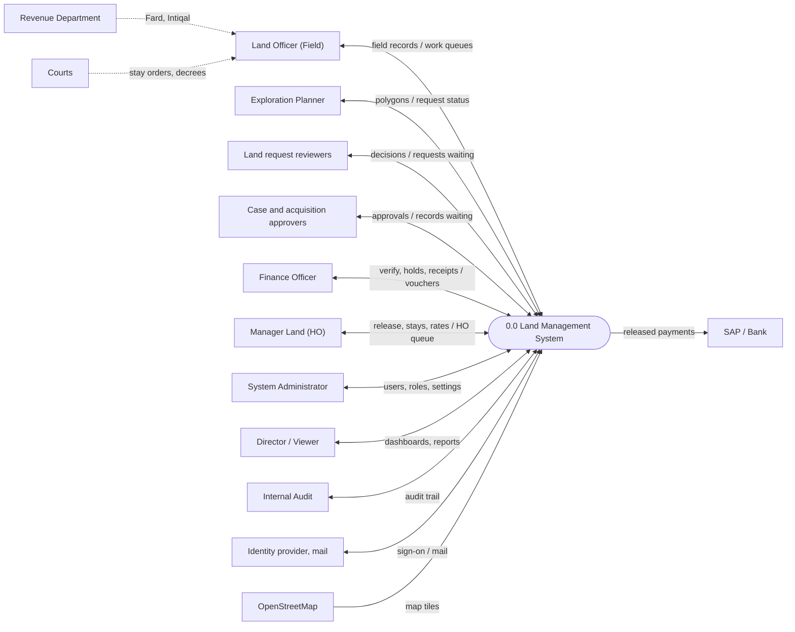
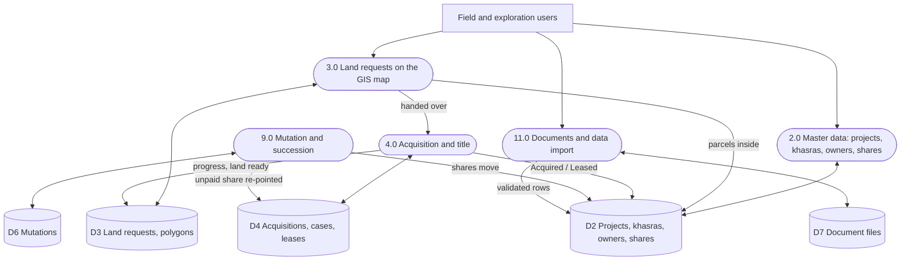
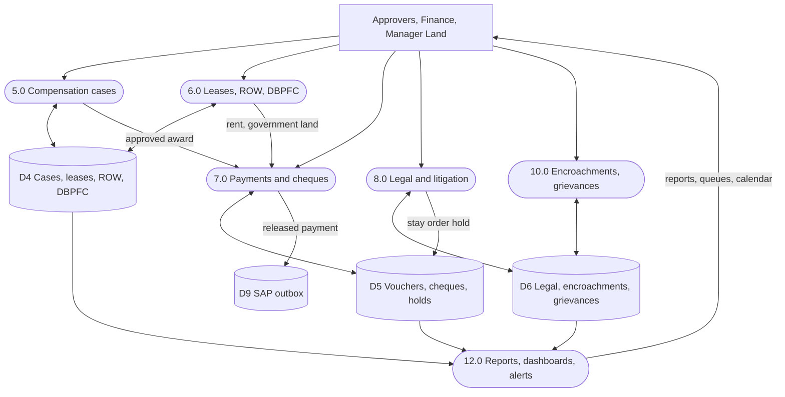
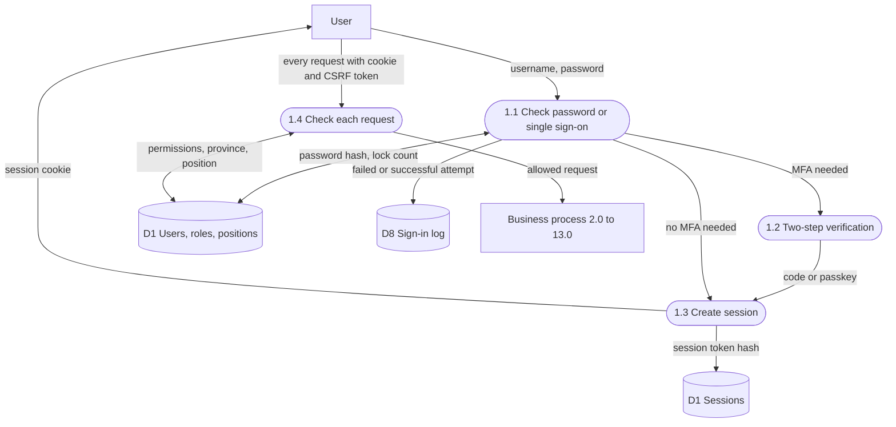
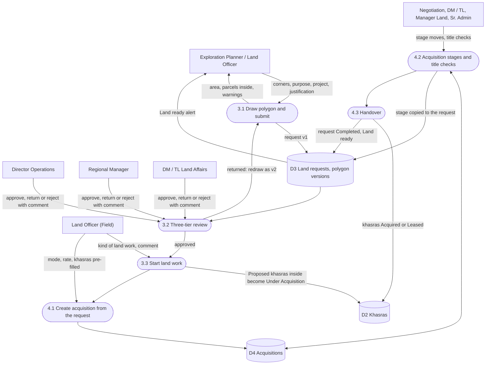
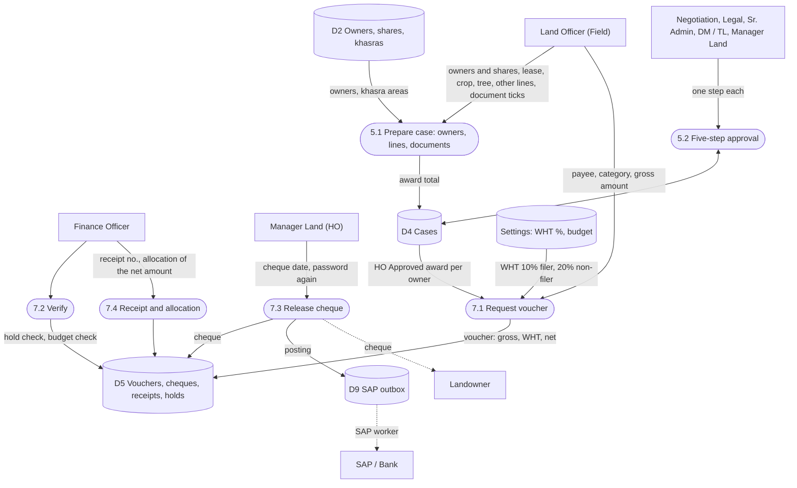
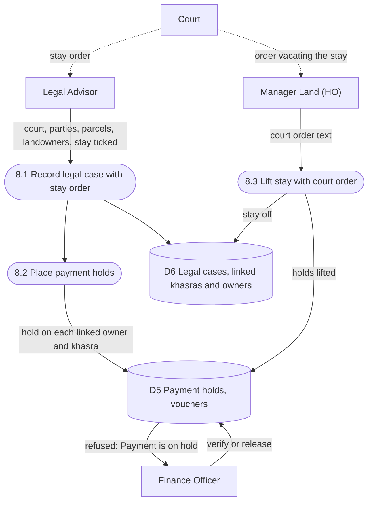
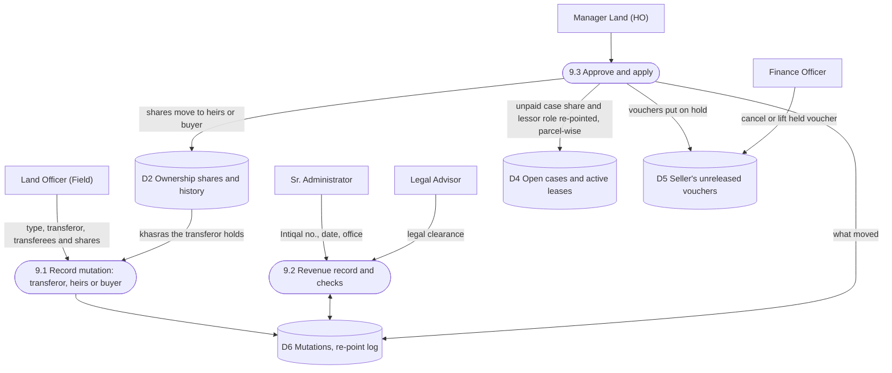
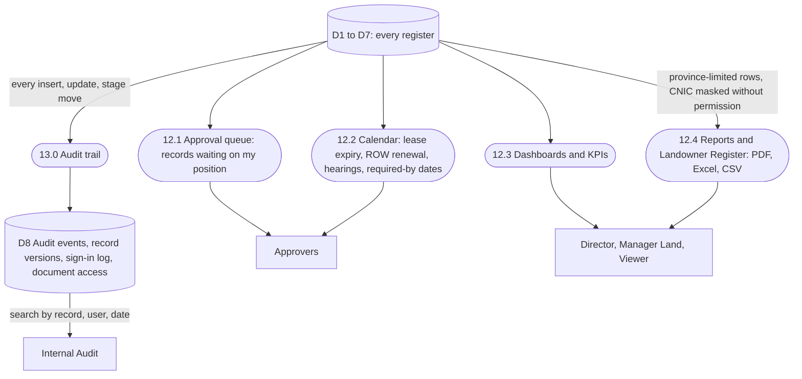

# LMS Data Flow Diagrams

Mari Energies Land Management System. The diagrams show how data moves between people, outside parties, the system's processes and its data stores. They describe the system as built on 3 Nov 2026 (database migration 0062).

**How to read them**

| Shape | Meaning |
|---|---|
| Rectangle | External entity: a person or outside party |
| Rounded box with a number | Process: work the system does (1.0, 2.0 …) |
| Cylinder with D-number | Data store: where the data is kept (D1, D2 …) |
| Arrow label | The data that moves |
| Dotted arrow | Happens outside the system, or by hand |

---

## 1. Level 0: Context diagram

The whole system as one process, with everyone who gives it data or takes data from it. The full list of what each one gives and gets is in section 5.

---

## 2. Level 1: Main processes and data stores

Shown in two parts. **Every process** also writes each change to **D8 Audit trail**, and every request first passes **1.0 Sign in and access control** (see 3.1).

### 2a. Land side

### 2b. Money and control side

---

## 3. Level 2 flows

### 3.1 Process 1.0: Sign in and access control

Every request runs as the signed-in user inside one database transaction. The database itself checks the user's province, permission and approval position before any data is read or changed.

### 3.2 Processes 3.0 and 4.0: Land request to land ready

### 3.3 Processes 5.0 and 7.0: Compensation to cheque

### 3.4 Process 8.0: Court stay stops payment

### 3.5 Process 9.0: Mutation moves shares and payments

### 3.6 Processes 12.0 and 13.0: Reports, alerts and audit

---

## 4. Data stores

| Store | Holds | Main tables |
|---|---|---|
| D1 | Users, roles, permissions, approval positions, provinces, sessions, MFA | `lms.app_user`, `lms.app_user_group`, `lms.app_user_province`, `iam.role`, `iam.role_permission`, `iam.user_role`, `lms.login_session`, `iam.mfa_*` |
| D2 | Projects, administrative hierarchy, khasras, landowners, ownership shares | `lms.project`, `lms.admin_unit`, `lms.survey`, `lms.landowner`, `lms.survey_ownership_share`, `lms.survey_ownership_history` |
| D3 | Land requests, versioned polygons | `lms.land_request`, `lms.land_request_area` |
| D4 | Acquisitions, title checks, compensation cases and lines, leases, ROW corridors, DBPFC estimates, budgets | `lms.acquisition`, `lms.acquisition_title_check`, `lms.compensation_case`, `lms.case_*`, `lms.lease`, `lms.row_corridor`, `lms.dbpfc_estimate`, `lms.budget` |
| D5 | Vouchers, cheques, reversals, receipts, allocations, payment holds, reconciliation | `lms.payment_request`, `lms.payment_release`, `lms.payment_release_reversal`, `lms.payment_receipt`, `lms.payment_allocation`, `lms.payment_hold`, `lms.reconciliation_run` |
| D6 | Legal cases and hearings, mutations and re-point log, encroachments, grievances | `lms.legal_case`, `lms.legal_hearing`, `lms.mutation`, `lms.mutation_repoint`, `lms.encroachment`, `lms.grievance` |
| D7 | Uploaded files (stored by content hash), KML layers, import batches | `lms.document`, `lms.project_kml_import`, `lms.import_batch` + the document folder on disk |
| D8 | Audit events, record versions, sign-in events, document access log | `audit.audit_event`, `audit.record_version`, `audit.auth_event`, `lms.document_access_log` |
| D9 | Released payments waiting to be posted to SAP | `lms.integration_outbox` |
| — | Workflow stages, who approves each step, settings | `lms.workflow_stage`, `lms.workflow_step_group`, `lms.system_setting` |

## 5. External entities

| Entity | Gives the system | Gets from the system |
|---|---|---|
| Land Officer (Field) | Projects, khasras, owners, shares, cases, vouchers, mutations, encroachments, grievances, documents | Work queues, alerts, calendar |
| Exploration Planner | Land request polygons | Request status, Land ready |
| Land request reviewers (Director Operations, Regional Manager, DM / TL Land Affairs) | Approve, return, reject | Requests waiting on them |
| Case and acquisition approvers (Negotiation, Legal, Sr. Admin, DM / TL Field, Manager Land) | One approval step each | Records waiting on their position |
| Finance Officer | Verification, holds, receipts, cancellations | Vouchers, cheques, reconciliation |
| Manager Land (HO) | Cheque release, lifting stays, rate fixing, budgets | Head-office queue, dashboards |
| Director / Viewer | — | Dashboards, reports |
| Internal Audit | — | Audit trail, sign-in log |
| System Administrator | Users, roles, positions, settings, land units | User and session lists |
| Revenue Department (outside the system) | Fard, Intiqal, revenue records, entered by the Land Officer | — |
| Courts (outside the system) | Stay orders and decrees, entered by Legal / Manager Land | — |
| SAP / Bank | — | Postings of released payments (D9) |
| Identity provider, mail server | Single sign-on identity | Invitation and password-reset mail |
| OpenStreetMap | Map tiles | — |
