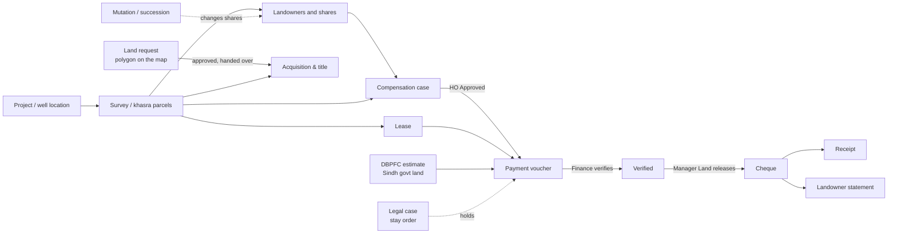
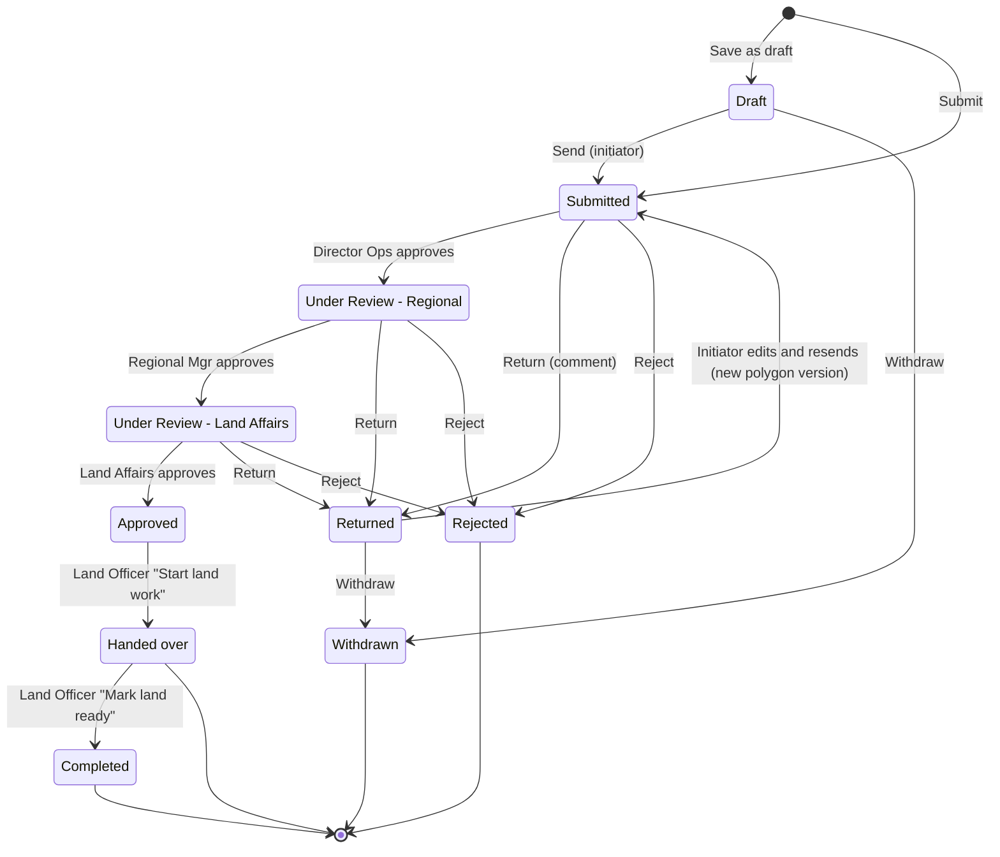
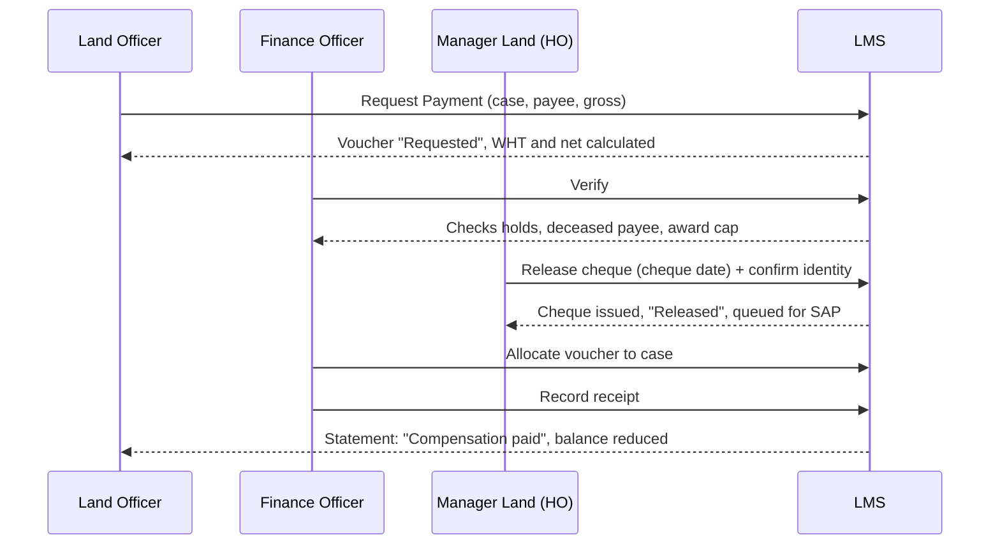
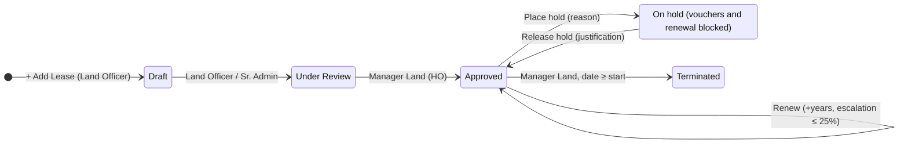

# Mari Energies Land Management System: Complete User Manual

| | |
|---|---|
| **System** | Mari Energies Land Management System (LMS) |
| **Audience** | Land officers, negotiators, legal advisors, field approvers, Manager Land (HO), Finance, internal audit, exploration planners, land-request reviewers, system administrators, and stakeholders |
| **Manual version** | 2.0, 3 November 2026 |
| **Describes** | The application as released to Mari Energies (November 2026) |
| **Prepared by** | **Alisons Technology** |
| **Confidentiality** | Internal — contains demonstration sign-in credentials (see 3.2). Do not distribute outside Mari Energies. |

> **How to read this manual.** Chapters 1–3 explain the ideas and the rules that apply everywhere. Chapter 4 describes each screen in the order of the menu. Chapter 5 walks through the end-to-end business processes that cross several screens. Use the table of contents to jump straight to your task.

---

## Table of contents

1. [Introduction](#1-introduction)
2. [Getting started](#2-getting-started)
3. [Roles, permissions and controls](#3-roles-permissions-and-controls)
4. [Module guide](#4-module-guide)
   - 4.1 [Overview](#41-overview): Executive Dashboard, Project Dashboard, Approvals & Alerts, Calendar, GIS Land Map
   - 4.2 [Master Data](#42-master-data): Administrative Hierarchy, Provincial Revenue Systems, Projects, Survey / Khasra Register, Landowners, Setting up master data in order
   - 4.3 [Land Operations](#43-land-operations): Land Requests, Acquisition & Title, Compensation Cases, Leases, ROW & Pipelines, Encroachments, Mutation & Succession, Legal & Litigation
   - 4.4 [Finance](#44-finance): Payments & Cheques, DBPFC, Budgets
   - 4.5 [Community](#45-community): Grievances & IIR
   - 4.6 [Records & Reports](#46-records--reports): Reports, Landowner Register, Documents, Data Upload, Audit Trail
   - 4.7 [System](#47-system): Users & Roles, Roles & Permissions, Approval Matrix, Settings, Architecture & Security, Account & Security
5. [End-to-end workflows](#5-end-to-end-workflows)
6. [Reports, exports and the audit trail](#6-reports-exports-and-the-audit-trail)
7. [Administration](#7-administration)
8. [Glossary](#8-glossary)
- [Appendix A: Workflow stages and approval positions](#appendix-a-workflow-stages-and-approval-positions)
- [Appendix B: Common messages and what to do](#appendix-b-common-messages-and-what-to-do)

---

## 1. Introduction

### 1.1 Purpose

The LMS is Mari Energies' single register for the land the company needs for exploration and production. It records:

- where the land is (province, district, taluka/tehsil, deh/mouza, khasra or survey number);
- who owns it and in what shares;
- how the company obtains it (lease, purchase, LAA 1894 acquisition, government land, right of way);
- what the company owes each landowner and what it has paid, net of withholding tax;
- disputes, court cases, encroachments and community grievances; and
- every decision, by whom and when.

Each step of a process is done by the person whose job it is, and approved by someone else. The system enforces this. The rules sit in the database, so they apply whichever screen is used.

### 1.2 Provinces

The company operates in four provinces. Each has its own revenue hierarchy, parcel identifier and land units, and the system follows each province's own terms.

| Code | Province | Revenue hierarchy | Parcel identifier | Common units |
|---|---|---|---|---|
| **SND** | Sindh | District → Taluka → Deh | Survey No. & Block No. | Acre, Ghunta (Jireb provisional) |
| **BAL** | Balochistan | District → Sub-Division → Tehsil → Sub-Tehsil / Qanungo Halka → Mouza | Khasra No. | Acre, Rod, Pole |
| **PNJ** | Punjab | District → Tehsil → Qanungo Halka → Mouza | Khasra No. | Acre, Kanal, Marla |
| **KPK** | Khyber Pakhtunkhwa | District → Sub-Division → Tehsil → Mouza | Khasra No. (rural) / Survey No. (urban) | Acre, Kanal (Bigha provisional) |

### 1.3 Land units

Areas are entered in the unit the revenue record uses. The database converts them to acres for totals. You cannot type the acre figure yourself.

| Unit | Equivalent | Status |
|---|---|---|
| 1 acre | 8 kanal = 160 marla = 4,840 sq yd = 43,560 sq ft = 4,046.86 m² | Confirmed |
| 1 kanal | 20 marla = 505.86 m² | Confirmed |
| 1 ghunta (Sindh) | 1/40 acre | Confirmed |
| 1 rod (Balochistan) | 1/4 acre | Confirmed |
| 1 pole (Balochistan) | 1/160 acre | Confirmed |
| 1 hectare | 2.47105 acres | Confirmed |
| 1 murabba | 25 acres | Confirmed |
| 1 jireb / jareeb (Sindh) | 0.5 acre (assumed) | **Provisional**: varies by district; awaiting Land Department confirmation |
| 1 bigha (KPK) | 0.5 acre (assumed) | **Provisional**: varies by district; awaiting Land Department confirmation |

Screens and reports mark a provisional factor so that nobody relies on it by mistake. The **Administrative Hierarchy** screen has an area converter (see [4.2.1](#421-administrative-hierarchy)).

### 1.4 Key concepts

| Concept | Meaning in the LMS |
|---|---|
| **Project / well location** | A piece of company work that needs land: a well site, pipeline, access road, camp, compressor station, processing facility or seismic survey. Each project belongs to one province. |
| **Survey / khasra (parcel)** | One cadastral parcel in the revenue record, identified by its khasra or survey number within a deh/mouza. It has a recorded area, a land class (Private or Government), a land status (Proposed, Under Acquisition, Acquired, Leased, Released, Disputed) and, optionally, a map point (latitude/longitude). |
| **Landowner** | A person who owns a share of a parcel. The **CNIC** (13-digit national identity number, format `XXXXX-XXXXXXX-X`) is the master key: the same CNIC cannot be registered twice. Each landowner also has an FBR tax status (Filer or Non-filer) and a status (Active, Deceased, Inactive). |
| **Ownership shares** | The percentage each owner holds in a parcel. The shares of a parcel must total exactly **100.0%**. After first registration, shares change only through a **mutation**. |
| **Compensation case** | The company's valuation of what it owes the owners of one or more parcels for a project: surface lease, crops, trees and other items. A case passes six approval stages and is locked once Head Office approves it. |
| **Payment voucher** | A request to pay a landowner (or another payee). Withholding tax is calculated by the system. A voucher is verified by Finance and released by Manager Land (HO). |
| **Cheque / release** | Releasing a voucher issues the cheque (or pay order / IBFT) for the **net** amount. The system generates the cheque reference. |
| **Receipt** | The landowner's acknowledgement that the payment was received. It can be printed as a Receipt of Payment. |
| **Approval position** | The designation that may decide a step, e.g. *Negotiation Group*, *Legal Advisor*, *Manager Land (HO)*, *Finance Officer*. A position is separate from a role: a role says **what** you may do, a position says **which step** you may decide. |
| **Segregation of duties (SoD)** | The person who prepares a record cannot approve it, and one person cannot approve two steps of the same record. |
| **Province scope** | Field staff see only the records of their own province(s). Head-office roles see all provinces. A record outside your scope behaves as if it does not exist ("not found"). |
| **Personal data (PII)** | CNICs, phone numbers and bank details are shown in full only to roles that hold the personal-data permission. Everyone else sees them masked (last digits only). |
| **Audit trail** | Every change, decision, sign-in and document download is recorded permanently. Audit records cannot be edited or deleted by anyone. |

### 1.5 How the main pieces connect

---

## 2. Getting started

### 2.1 Supported browsers and access

Use a current version of Microsoft Edge, Google Chrome or Firefox. The screens adapt to tablets and phones, but data entry is easiest on a desktop. The GIS map needs an internet connection for its background tiles. Drawing and saving still work without one, on a blank background.

### 2.2 Signing in

The sign-in page offers two tabs: **Username & password** and **Single sign-on (SSO)**.

**With a username and password**

1. Open the LMS address given by your administrator.
2. On the **Username & password** tab, enter your **Username** and **Password**.
3. Click **Sign in**.
4. If your account uses two-step verification, the **Second step of sign-in** appears (see 2.3).
5. Choose your province (see 2.4).

**With single sign-on (SSO)**

1. Choose the **Single sign-on (SSO)** tab.
2. Click **Sign in with …** for your organisation's account and complete the sign-in on the identity provider's page.
3. You return to the LMS signed in.

If no SSO method is configured, the tab says that it is unavailable. The administrator configures single sign-on against the company directory (Active Directory / Entra ID) under **Settings → Sign-in methods** (see [7.5](#75-single-sign-on)).

**With a passkey**

Under **Other ways to sign in**, click **Sign in with a passkey** and confirm with your device (fingerprint, face or PIN). This works only if you registered a passkey on that device (see [4.7.6](#476-account--security)) and the server runs on HTTPS.

> **Demonstration accounts.** A set of ready-made demonstration accounts is provided for walking through the system. Their usernames, designations and passwords are listed in [section 3.2](#32-roles-and-the-demo-accounts); sign in with any of them on the **Username & password** tab.

**Rules that protect your account**

| Rule | Current setting |
|---|---|
| Wrong password attempts before the account locks | 5 |
| Lock duration | 15 minutes |
| Session ends after inactivity | 60 minutes |
| Session ends in any case after | 12 hours |
| Minimum password length | 12 characters (a long phrase works well) |
| Passwords that are refused | common passwords, and passwords containing your username or name |
| Previous passwords you cannot reuse | 5 |

The sign-in error message is the same whether the username or the password was wrong. This is deliberate.

### 2.3 Two-step verification (MFA)

If two-step verification applies to you, after your password the system asks for one of these:

- the **6-digit code** from your authenticator app;
- a **recovery code** (click **Use a recovery code instead**). Each recovery code works once;
- your **passkey** (click **Use a passkey instead**).

Click **Start again** to go back to the password step.

Who must use two-step verification is set by the administrator under **Settings → Security policy**: for all users, for chosen roles, or for every role that holds a sensitive permission (releasing payments, managing users, and so on). If your role requires it and you have not set it up, you are taken to **Account & Security** and must enrol before you can continue.

### 2.4 Choosing your province

After sign-in the **Select province** panel appears.

1. Choose the province to work in. Only your own provinces are offered.
2. Head-office users also see **All provinces — Head Office consolidated view**.
3. To change later, click the province chip in the header (or **Change province** in your user menu).

The chosen province filters lists, dashboards and KPIs on every screen. It is a convenience only: the server still enforces your real province access on every request.

### 2.5 The screen layout

| Area | What it holds |
|---|---|
| **Sidebar (left)** | The menu, in groups: Overview, Master Data, Land Operations, Finance, Community, Records & Reports, System. You see only the screens your role can open. |
| **Header (top)** | Page title, global search, province chip, bell (Approvals & Alerts), dark/light mode switch, user menu. |
| **User menu** | Change province, switch dark/light mode, Approvals & Notifications, Account & Security, **Sign out**. |
| **Main area** | KPI tiles, then the register (table) with search, filters, paging and action buttons. |

**Global search**

- Press **Ctrl + K** (⌘ + K on a Mac), or **/** when you are not typing in a field, to jump to the search box.
- Type a khasra number, landowner name, case, lease or voucher code. Results are grouped by module and also list matching **screens**.
- Use **↑ / ↓** to move, **Enter** to open, **Esc** to close.
- Search covers only the modules you may read and only your provinces. A CNIC search works only if you hold the personal-data permission; otherwise the search would reveal whose CNIC it is.

**The bell.** It shows how many items are waiting on you, and opens **Approvals & Alerts**. It appears only for roles that have an inbox.

**Dark mode.** Use the moon/sun button. Your choice is remembered on that browser.

### 2.6 Working with registers (common controls)

Most screens share the same controls:

| Control | Use |
|---|---|
| **+ Add …** | Opens the entry form. It is disabled, with an explanation on hover, when your role lacks a permission the form needs (e.g. "Adding a lease also needs read access to projects and landowners"). |
| **Search box** | Free-text search within the register. |
| **Filters** (Stage, Province, Fiscal year …) | Narrow the list. The count beside them shows the total matching records, not just the rows on screen. |
| **Pager** | Lists show 100 rows per page by default (500 at most). KPIs are always calculated over all records, not just the visible page. |
| **Workflow strip** | The row of stages on a record, with the current stage highlighted. |
| **Open a record** | Click anywhere on a row (not on a button) to open a read-only **details** window; **Close** or **Esc** shuts it. A row's own buttons (Edit, Shares, Open, →) still do their own job. |
| **→ Next stage** button | Moves the record on. You see this button **only when the current step is one of your approval positions**; otherwise the row shows **"Waiting on …"** with that position's name so you always know who it is with. The confirmation dialog says: "The server checks your approval position and separation of duties, and records this in the audit trail." Add a note (optional), then **Move to …**. |
| **Cancel / Stop** | Ends a record where the workflow allows it. A **reason is required**. |
| **Print** buttons | Open a print-ready document (award sheet, lease deed, statement, receipt). Use the browser's Print dialog to print or save as PDF. |

**Confirm it's you (re-authentication).** Sensitive actions, such as releasing a cheque, placing or lifting a hold, lifting a court stay, adjusting an award, or changing roles and settings, need a recent proof of identity. If you have not confirmed in the last **10 minutes**, a **Confirm it's you** prompt asks for your password or passkey. Then the action goes ahead.

### 2.7 Forgotten password

1. On the sign-in page, click **Forgot password?**
2. Enter your **Username** and request a reset link.
3. Open the link and choose a new password (twice). The link is valid for 30 minutes and works once.
4. When the password is set, all other signed-in sessions of your account are ended.

If the link says "This link is invalid, has already been used, or has expired", ask for a new one. An administrator can also generate a **Reset link** for you (see [4.7.1](#471-users--roles)).

**New users** receive an invitation link. It opens "Welcome. Choose the password for your new account." and is valid for 72 hours.

### 2.8 Signing out

Use **Sign out** in the user menu. Close the browser on shared computers. An administrator can also sign you out of every device (**Sign out everywhere**).

---

## 3. Roles, permissions and controls

### 3.1 How access is decided

Three things decide what you can do:

1. **Your role(s)** give permissions in the form *module : action* (for example `cases:approve`, `payments:release`) with a scope (your province, head office, or global).
2. **Your provinces** limit which records you see.
3. **Your approval position** decides which workflow step you may approve.

The menu shows a screen only when your role could use it. The server checks every request again, so a hidden button is a convenience, not the control.

### 3.2 Roles and the demo accounts

The accounts below are the demonstration accounts used throughout this manual. The names are fictitious; your own user accounts are created by the administrator (see [Chapter 7](#7-administration)).

| Role | Demo account(s) | Province(s) | Approval position | In short |
|---|---|---|---|---|
| **System administrator** | `admin` | all | System Administrator | Users, roles, settings, audit, reports, Landowner Register (read-only, CNIC masked). **No business registers** (SoD). |
| **Security auditor** | `audit` | all | Internal Audit | Read-only on every register, plus audit trail, users and roles. CNIC masked. |
| **Data entry (Land Officer)** | `lofield` (SND), `loquetta` (BAL), `lopnj` (PNJ + KPK) | own | Land Officer (Field) | Creates and updates field records, raises payment vouchers, uploads import files, raises land requests, takes approved land requests up. |
| **Negotiation Officer** | `nego` (SND), `negoqta` (BAL) | own | Negotiation Group | Cases (approves "Checked"), leases, ROW, acquisitions, grievances; DBPFC read. |
| **Legal Advisor** | `legal` | all | Legal Advisor | Legal cases, acquisitions, mutations, encroachments; approves cases at "Reviewed". |
| **Case approver** | `sradmin`, `sradmqta`, `sradmpnj` | own | Sr. Administrator LMS (Field) | Field approvals ("Verified"), import promotion, DBPFC. |
| | `dmfield`, `dmqta` | own | DM / Team Lead (Field) | Field approval ("Field Approved"). |
| | `landaffairs` (SND), `landaffqta` (BAL), `landaffpnj` (PNJ + KPK) | own | DM / TL Land Affairs | Final tier of land requests. |
| **Land manager (HO)** | `mland` | all | Manager Land (HO) | Head-office approvals, **payment release**, budgets, lease approval and renewal. |
| **Finance approver** | `finance` | all | Finance Officer | **Payment verification**, holds, receipts, reconciliation, budgets. |
| **Viewer** | `viewer` | all | — | Dashboards, reports, GIS, read-only portfolio (projects, parcels, cases, leases, payments). |
| **Exploration Planner** | `explorer` (SND), `explorerqta` (BAL) | own | — (initiator) | Draws land requests on the GIS map. No landowner data, no payments. |
| **Land Request Reviewer** | `dirops` | all | Director Operations | Tier 2 decision on land requests. |
| | `regmgr` (SND), `regmgrqta` (BAL), `regmgrpnj` (PNJ + KPK) | own | Regional Manager | Tier 3 decision on land requests. |
| **Demonstration (all screens)** | `director` | all | All business positions | A single account for walking through the whole system. It opens **every** screen and can take **every** action **except releasing a payment cheque**. The segregation-of-duties rules still apply to it (one person cannot decide two steps of the same record, and whoever raises or verifies a voucher cannot release it). |

**Sign-in credentials.** Type the username and password on the **Username & password** tab. For privacy the sign-in page no longer lists these accounts, so this manual is the reference — keep it confidential. They are demonstration accounts; for production, change or remove them.

| Username | Name | Designation | Province(s) | What this account can do | Password |
|---|---|---|---|---|---|
| `director` | Asif Rehman | Director (demo, all tabs) | All | Every tab, every action except payment release | `Demo-cVDOVn4gzyFrnaat` |
| `admin` | Asma Rahim | System Administrator | All | System Administrator | `861458146d0e45-Dm7` |
| `audit` | Tariq Mehmood | Audit Officer | All | Audit Officer | `8f23325ad9b249-Dm7` |
| `dirops` | Javed Akhtar | Director Operations | All | Land requests tier 2: approves, returns or rejects; every province | `UAYFjNPUsUbk9Y-Dm7` |
| `dmfield` | Nadia Baig | DM / Team Lead (Field) | SND | DM / Team Lead (Field) | `231fa7d3f2f04a-Dm7` |
| `dmqta` | Benazir Raisani | DM / Team Lead (Field) | BAL | DM / Team Lead (Field) | `f435a2d2cab948-Dm7` |
| `explorer` | Usman Ghani | Exploration Planner | SND | Draws land on the GIS map and raises land requests (Sindh); no landowner data, no approvals | `kPFWNH6ZroZt1C-Dm7` |
| `explorerqta` | Kamran Bugti | Exploration Planner | BAL | Draws land on the GIS map and raises land requests (Balochistan) | `2xMbLpdHYdxBrF-Dm7` |
| `finance` | Shazia Noor | Finance Officer | All | Finance Officer | `e1a43a1896a846-Dm7` |
| `landaffairs` | Zubair Soomro | DM / TL Land Affairs | SND | Land requests tier 4 (final approval) for Sindh | `IP8GS4Gg2RTi3c-Dm7` |
| `landaffpnj` | Farah Khattak | DM / TL Land Affairs | KPK, PNJ | Land requests tier 4 (final approval) for Punjab and KPK | `T4KOkfZBOBks8H-Dm7` |
| `landaffqta` | Gul Bano Rind | DM / TL Land Affairs | BAL | Land requests tier 4 (final approval) for Balochistan | `eBQ0Et28BleRni-Dm7` |
| `legal` | Ayesha Siddiqui | Legal Advisor | All | Legal Advisor | `b45e54ef4c7a43-Dm7` |
| `lofield` | Sanaullah Khoso | Land Officer | SND | Land Officer | `cfb37e6c4cc548-Dm7` |
| `lopnj` | Waqar Lashari | Land Officer | KPK, PNJ | Land Officer | `443857be5d1347-Dm7` |
| `loquetta` | Zarak Baloch | Land Officer | BAL | Land Officer | `b637b78d9f3647-Dm7` |
| `mland` | Imran Qadir | Manager Land (HO) | All | Manager Land (HO) | `6d91a5f3e3de4e-Dm7` |
| `nego` | Bilal Chandio | Negotiation Officer | SND | Negotiation Officer | `ea1740800f454e-Dm7` |
| `negoqta` | Samiullah Marri | Negotiation Officer | BAL | Negotiation Officer | `bf49bd4078b145-Dm7` |
| `regmgr` | Sadia Memon | Regional Manager (Sindh) | SND | Land requests tier 3 for Sindh | `5TZaiaYtCQU8z9-Dm7` |
| `regmgrpnj` | Shahid Leghari | Regional Manager (Punjab/KPK) | KPK, PNJ | Land requests tier 3 for Punjab and KPK | `Hbgc6DEUyxFsqR-Dm7` |
| `regmgrqta` | Naseer Kakar | Regional Manager (Balochistan) | BAL | Land requests tier 3 for Balochistan | `SgCSBTLOT98lsx-Dm7` |
| `sradmin` | Faisal Shaikh | Sr. Administrator LMS (Field) | SND | Sr. Administrator LMS (Field) | `11dd39a97f0641-Dm7` |
| `sradmpnj` | Rukhsana Bibi | Sr. Administrator LMS (Field) | KPK, PNJ | Sr. Administrator LMS (Field) | `32f2f33db06b49-Dm7` |
| `sradmqta` | Rahim Jamali | Sr. Administrator LMS (Field) | BAL | Sr. Administrator LMS (Field) | `4f7c17882e924c-Dm7` |
| `viewer` | Hina Jamal | Analyst | All | Analyst | `a240db801e3e4d-Dm7` |

### 3.3 What each role can do, by module

Key: **R** read · **C** create · **U** update · **A** approve (decide workflow steps) · **V** verify · **Rel** release · **X** export · — no access.

| Module | Land Officer | Negotiation | Legal | Case approver | Manager Land | Finance | Auditor | Admin | Viewer | Planner | Reviewer |
|---|---|---|---|---|---|---|---|---|---|---|---|
| Projects | RCU | R | R | RCU | RCU | R | R | — | R | R | R |
| Survey / Khasra | RCU | RCU | R | RCU | RCU | R | R | — | R | R | R |
| Landowners | RCU | RCU | R | RCU | RCU | R | R | — | — | — | — |
| Land Requests | RC | RC | — | RCA | RCA | — | R | — | — | RC (own) | RA |
| Acquisitions | RCU | RCU | RCU | RCU | RCU | R | R | — | — | — | — |
| Compensation Cases | RCU | RCUA | RUA | RCUA | RCUA | R | R | — | R | — | — |
| Leases | RCU | RCU | RU | RCU | RCU | R | R | — | R | — | — |
| ROW & Pipelines | RCU | RCU | R | RCU | RCU | R | R | — | — | — | — |
| Encroachments | RCU | — | RCU | RCU | RCU | — | R | — | — | — | — |
| Mutations | RCU | — | RCU | RCU | RCU | — | R | — | — | — | — |
| Legal & Litigation | RCU | — | RCU | RCU | RCU | R | R | — | — | — | — |
| Payments | RC | RC | — | RC | R, U, **Rel** | RC, U, **V** | R | — | R | — | — |
| DBPFC | RCU | R | — | RCU | RCU | R | R | — | — | — | — |
| Budgets | — | — | — | — | RCU | RCU | R | — | — | — | — |
| Grievances | RCU | RCU | RCU | RCU | RCU | — | R | — | — | — | — |
| Documents | RCU | RCU | RCU | RCU | RCU | R | R | — | — | — | — |
| Data Upload | RC | — | — | RCU (promote) | RCU (promote) | — | R | — | — | — | — |
| GIS map | R, upload KML | R | R | R, upload | R, upload | — | R | — | R | R | R |
| Reports | R | R | R | R, X | R, X, share | R, X, share | R | R, X, share | R | — | — |
| Landowner Register | — | — | — | — | R | R | R | R | — | — | — |
| Approvals & Alerts | R | R | R | R | R | R | — | — | — | — | — |
| Full CNIC / personal data | Yes | Yes | Yes | Yes | Yes | Yes | Masked | Masked | — | — | — |
| Audit Trail | — | — | — | — | — | — | R, X | R, X | — | — | — |
| Users, roles, settings | — | — | — | — | — | — | R | Full | — | — | — |

Notes:

- "A" means the role may take decisions; **which** step it may decide depends on the approval position (Appendix A).
- Head-office roles (Manager Land, Finance, Auditor, Admin) see all provinces. Field roles see only their own.
- The system administrator has no business permissions on purpose: whoever manages accounts must not also handle land and money.

### 3.4 Approval positions

| Position | Decides |
|---|---|
| Land Officer (Field) | Acquisition negotiation and hand-over; lease / ROW review; DBPFC referral; mutation revenue verification; encroachment assessment; grievance work; land-request hand-over |
| Negotiation Group | Case "Checked"; acquisition negotiation; grievance work |
| Legal Advisor | Case "Reviewed"; mutation "Legal Cleared"; encroachment legal follow-up; grievance work / resolution |
| Sr. Administrator LMS (Field) | Case "Verified"; acquisition hand-over; lease / ROW review; DBPFC referral; mutation verification; encroachment assessment; grievance work / resolution |
| DM / Team Lead (Field) | Case "Field Approved"; acquisition approval; encroachment action / resolution; grievance assignment / resolution |
| Manager Land (HO) | Case "HO Approved"; acquisition "Acquisition / Lease"; lease and ROW approval; DBPFC rate fixed; mutation "Approved & Applied"; encroachment resolution; grievance assignment and closure; **payment release**; lease termination and renewal |
| Finance Officer | **Payment verification** |
| Director Operations | Land request tier 2 |
| Regional Manager | Land request tier 3 |
| DM / TL Land Affairs | Land request tier 4 (final) |
| System Administrator, Internal Audit | No business steps |

The administrator can change which position decides which step on the **Approval Matrix** screen (4.7.3). Every change is recorded.

### 3.5 Segregation-of-duties rules

The database enforces these rules. No screen can bypass them, and administrative override is switched off.

| Rule | Example |
|---|---|
| The preparer cannot approve their own record. | `lofield` prepares a case and cannot move it to "Checked". |
| One person cannot decide two steps of the same record. | `sradmin` verifies a case and cannot also give "Field Approved". |
| Only the holder of the step's position may decide it, and only in their provinces. | `regmgr` (Sindh) cannot decide a Balochistan land request. |
| The person who raised a voucher cannot verify it; Finance verifies, Manager Land releases. | `finance` cannot release; `mland` cannot verify. |
| A receipt is recorded by Finance, never by the voucher's raiser or releaser. | |
| Whoever prepared a case cannot adjust its approved award. | |
| A system administrator cannot hold an approval position. | |
| A requester cannot approve their own land request. | |

### 3.6 Province isolation

- A field user sees only records of their own provinces, in lists, search, reports, the map and exports.
- Opening a record from another province shows **"not found"**. The system does not even confirm that the record exists.
- A record's province comes from its project. Two provinces' data never mix in one case or voucher.

### 3.7 Personal data (PII)

- Full CNIC, phone, IBAN and address are shown only to roles with the personal-data permission (Land Officer, Negotiation, Legal, Case approver, Manager Land, Finance).
- Auditors and the administrator see CNICs masked (last 4 digits).
- Landowner names and owner shares are shown only to roles that may read landowners. The Exploration Planner, the Land Request Reviewers and the Viewer see parcel location, area and status, but not owners.
- Printed statements carry the marking **CONFIDENTIAL — PERSONAL DATA** and the name of the person who printed them.
- Every document download and statement view is logged.

---

## 4. Module guide

Each section gives the purpose, who uses the screen, what is on it, how to work with it, and the rules it applies.

### 4.1 Overview

#### 4.1.1 Executive Dashboard

| | |
|---|---|
| **Purpose** | Portfolio KPIs and charts for management |
| **Menu** | Overview → Executive Dashboard (needs `reports:read`) |
| **Used by** | Manager Land, Finance, Audit, Viewer, Admin, field roles |

**Layout**

- **Dashboard perspective** tabs: **Executive (MD / CFO)**, **Director Operations**, **Field Operations**.
- KPI tiles, including: Total Land Managed, Survey Parcels, Operational Projects, Gross Compensation, Paid (Net Released), Outstanding Liability, Cases in Workflow, Draft Cases (Prepared), HO Approved Cases, Active Leases, Expiring Leases (90d), Leases On Hold.
- Panels: Provincial area and compensation (chart), Unpaid voucher aging brackets, Approval bottlenecks, Lease expiry alerts (≤ 90 days), Project portfolio, Recent compensation cases.
- For administrators: shortcuts to Identity & Access Administration and System & Workflow Configuration.

**Rules.** Each tile is filtered by your own permissions. You see lessor names, rents or voucher amounts only if you may read those registers. Reversed cheques do not count as paid. Province figures come from the parcel register, so unlinked parcels are counted and shared ones are not counted twice.

#### 4.1.2 Project Dashboard

| | |
|---|---|
| **Purpose** | Everything about one project on one page |
| **Menu** | Overview → Project Dashboard |
| **Used by** | Land team, Manager Land, reviewers |

Choose a project in **Select project**. The page shows KPI tiles (Survey Parcels, Compensation Cases, Surface Leases, Paid Compensation, Spatial Features) and panels for: linked khasra/survey parcels; compensation cases with workflow status; registered leases with expiry; budget (Allocated, Committed, spent); and KML/GIS features. "Active leases" excludes expired ones, and counts are true totals, not page counts.

#### 4.1.3 Approvals & Alerts (Inbox)

| | |
|---|---|
| **Purpose** | Your work queue: records waiting for a decision by your position |
| **Menu** | Overview → Approvals & Alerts, or the bell |
| **Used by** | Everyone with an approval position |

**KPI tiles:** Waiting on you (lists your positions), Open approvals, Overdue (past the step's time limit), Unread notifications.

**Tabs**

| Tab | Shows |
|---|---|
| **Waiting on you** | Records whose current step needs one of your positions, in your provinces. |
| **All open** | Every open approval you can see. |
| **Notifications** | Your notifications, with **Mark read** / **Mark all read**. |
| **Bottlenecks** | Each workflow and stage with the waiting position, province and overdue count. |

**How to act on an item**

1. Find the record in **Waiting on you**.
2. Click **Open** to go to the record's own screen, where you take the decision.
3. To discuss without deciding, click **Comment**, type it (visible to everyone who can see the record) and click **Post**.

> **Note.** Exploration land requests are reviewed from the **Land Requests** screen rather than from this inbox.

#### 4.1.4 Calendar

| | |
|---|---|
| **Purpose** | Dates that need action |
| **Menu** | Overview → Calendar |

A chronological schedule of **Lease Expiries**, **ROW Renewals**, **Court Hearings** and land-request target dates, with an **Event Type** filter. Each register is shown only if you may read it. Other users' draft land requests are never shown.

#### 4.1.5 GIS Land Map

| | |
|---|---|
| **Purpose** | See parcels, project features and land requests on a map; draw land requests; manage KML layers |
| **Menu** | Overview → GIS Land Map (`gis:read`) |
| **Used by** | All land roles, the planner, reviewers, viewer |

**Layout**

- **Project** selector and **Basemap**: *Streets*, *Satellite imagery*, or *None (works offline)*.
- Layer switches: **Survey parcels** and **Land requests**.
- **⤢ Show all** frames everything; **Refresh** reloads.
- Clicking a marker opens a side panel: location, land status, recorded area, owner shares (only with landowner access), and for a land request its stage, the position it is waiting on, **Open request** / **Open in Land Requests**.
- Below the map, tables list the same parcels and features as text, each with a **Show** button. These are useful with a screen reader or when there are many markers.

**Colours**

| Item | Colour |
|---|---|
| Survey parcel | By land status (Proposed, Under Acquisition, Acquired, Leased, Released, Disputed) |
| Land request: Draft | Grey |
| Submitted / Under review | Orange |
| Returned | Yellow |
| Approved | Green |
| Handed over | Blue |
| Rejected | Red (hidden by default) |

**KML layers**

1. Choose the project.
2. Click **Upload KML / KMZ**, choose the **File**, give a **Layer name**, and confirm.
3. The layer appears under **KML layers & merge**. Use **Download KML** for one layer or **Download merged KML** for all of the project's layers.

Uploading needs the GIS create permission (Land Officer, Case approver, Manager Land). Other roles see "Your role cannot merge layers".

**Drawing a land request.** Click **✎ Draw land request** (Exploration Planner and Land Officer). See [4.3.1](#431-land-requests) and [5.1](#51-exploration-land-request--approvals--hand-over--acquisition).

**Limits.** A khasra is stored as **one point**, not a boundary. "Parcels inside" a polygon means parcels whose point lies inside it.

---

### 4.2 Master Data

#### 4.2.1 Administrative Hierarchy

| | |
|---|---|
| **Purpose** | The provincial revenue hierarchy used to register parcels (District → Taluka/Tehsil → Deh/Mouza, and the province's other levels) |
| **Menu** | Master Data → Administrative Hierarchy |
| **Used by** | Land Officers, administrators (settings) |

**Add a unit**

1. Click **+ Add Administrative Unit**.
2. Choose **Province**, **Hierarchy level** and **Parent unit**, and enter the **Unit name**.
3. Save. The **Full Revenue Hierarchy Path** is built automatically.

**Area converter.** Enter a **Value** and choose **From unit**; the converter shows the equivalent in every unit, including square metres. The **Unit reference** table lists each factor in force and the provinces that use it. Factors awaiting Land Department confirmation are flagged. An administrator can set each province's unit sizes and the units it offers under **Settings → Land units** ([4.7.4](#474-settings)).

#### 4.2.2 Provincial Revenue Systems

A reference comparison of the four provinces: revenue hierarchy levels, parcel identifier, authorised units, plus each province's KPIs (Admin Units, Surveyed Area, Open Parcels, Approved Compensation). For provinces outside your access, only the revenue system description is shown.

#### 4.2.3 Projects / Well Locations

| | |
|---|---|
| **Purpose** | The register of projects needing land |
| **Used by** | Land Officers and approvers create and edit; most roles read |

**Add a project**

1. Click **+ Add Project**.
2. Enter: **Project code**, **Name**, **Type** (Well Location, Pipeline, Access Road, Camp / Base, Compressor Station, Processing Facility, Seismic Survey, Other), **Province**, **District**, **Block / concession**, **Required area**, **Status** (Active, Completed, Cancelled) and **Description**.
3. Save.

The register shows each project's required area, land linked, approved compensation and released amount. Use **Edit** to change a project.

#### 4.2.4 Survey / Khasra Register

| | |
|---|---|
| **Purpose** | The cadastral parcels, their area, status, location and owners |
| **Used by** | Land Officers create; most roles read |

**KPI tiles:** Surveys (total registered), area, and **Shares not at 100%** (ownership to correct).

**Add a survey (parcel)**

1. Click **+ Add Survey**.
2. Choose **Province**, **Project** and **Revenue location** (the deh/mouza).
3. Enter **Survey / khasra no.** and **Block no.** (Sindh and urban surveys).
4. Choose **Khasra type** (Rural / Urban), **Land class** (Private / Government) and **Land status**.
5. Enter the **Recorded area** and **Recorded unit** exactly as in the revenue record (the unit list offers **this province's own units first**). The **Area in acres** is derived by the database when you save and cannot be typed.
6. Optionally enter **Latitude** and **Longitude** so the parcel appears on the map.
7. Add **Remarks** and save.

**Owner shares**

1. Click **Shares** on the parcel.
2. For a parcel with no owners yet, add each landowner and their percentage. The share balancer must show **100.0%** before you can save.
3. For a parcel that already has registered owners, the dialog is **read-only**. Ownership then changes only through **Mutation & Succession** (4.3.7).

**Rules**

- Shares must total exactly 100%. 90% is refused.
- A second parcel with the same survey / khasra number, block and revenue location is refused as a duplicate.
- Area: a positive number with at most 4 decimals.
- Owner names and shares are visible only to roles that may read landowners.
- "Start land work" on an approved acquisition land request marks the proposed parcels inside it **Under Acquisition**.

#### 4.2.5 Landowners

| | |
|---|---|
| **Purpose** | The register of persons who own land, keyed by CNIC |
| **Used by** | Land Officers and negotiators create; finance, legal, audit read |

**KPI tiles:** Landowners (unique CNIC-based IDs), Non-filers, **Deceased — locked** (awaiting succession), **On payment hold** (stay order or dispute).

**Add a landowner**

1. Click **+ Add Landowner**.
2. Enter **Full name (as on CNIC)**, **Father / husband name** and **CNIC**. The CNIC formats itself as you type (`XXXXX-XXXXXXX-X`). An invalid CNIC turns the field red and keeps **Save** disabled.
3. Choose **Owner type**: Owner, Attorney, or Owner and attorney.
4. Choose **Tax status**: Filer or Non-filer (FBR active taxpayer status). This drives withholding tax.
5. Enter phone, **IBAN** (format `PK` + 2 digits + 4-letter bank code + 16 characters), **Bank branch** and address.
6. Choose the **Province** and save. The system assigns a code such as `SND-000044`.

**Rules**

- A CNIC already registered is refused (duplicate). Adding a person whose **name and father/husband name** already exist warns you of a possible duplicate before you save.
- Marking a landowner **Deceased** locks their shares and blocks every payment to them until a succession mutation is recorded. Bringing a deceased owner back to Active needs a reason of at least 10 characters.
- Changes are recorded with who made them.

**Statement of account**

1. Click **Statement** on the landowner's row.
2. The statement shows Holdings (parcels and total area × share), Active leases, **Paid to date (cheques, after tax)** and a dated list of transactions with a running **Balance (Rs)**.
3. Click **Print** for a printable copy marked confidential.

See [5.2.6](#526-reading-the-landowner-statement) for how each line is calculated. Users without payment access (e.g. Legal Advisor) see only the approved-compensation lines, with no payments, balance or paid-to-date. A note on screen explains why.

---

#### 4.2.6 Setting up master data (the order to follow)

Before any land operation — a land request, acquisition, compensation case, lease, ROW or payment — can be recorded, the master data it depends on must already exist. Create it in this order. Each step is described in full in the section shown.

| Step | What you create | Screen (section) | Who | Needs first |
|---|---|---|---|---|
| 1 | Administrative units (District → Taluka / Tehsil → Deh / Mouza) | Administrative Hierarchy ([4.2.1](#421-administrative-hierarchy)) | Administrator / Land Officer | — |
| 2 | Project / well location | Projects / Well Locations ([4.2.3](#423-projects--well-locations)) | Land Officer / approver | Province, district |
| 3 | Survey / khasra parcel | Survey / Khasra Register ([4.2.4](#424-survey--khasra-register)) | Land Officer | A project and a revenue location (steps 1–2) |
| 4 | Landowner(s) | Landowners ([4.2.5](#425-landowners)) | Land Officer / negotiator | CNIC of each owner |
| 5 | Owner shares on the parcel | Survey / Khasra → **Shares** ([4.2.4](#424-survey--khasra-register)) | Land Officer | The parcel and its landowners (steps 3–4) |

A parcel can only carry a compensation case, lease or acquisition once it exists, has owners, and those owners' shares total exactly **100%**. Shares that do not total 100%, or a landowner marked **Deceased**, will block the downstream step until corrected (shares on the Survey screen; a deceased owner through **Mutation & Succession**, [4.3.7](#437-mutation--succession)).

**Worked example (Sindh).**

1. **Administrative Hierarchy** — confirm District **Ghotki** → Taluka **Mirpur Mathelo** → Deh **Bago Daharki** exist; add any that are missing ([4.2.1](#421-administrative-hierarchy)).
2. **Projects** — add project **DHRK-301**, type **Well Location**, province **Sindh**, district **Ghotki**, required area **12 ac** ([4.2.3](#423-projects--well-locations)).
3. **Survey / Khasra** — add khasra **611/1**, revenue location **Deh Bago Daharki**, recorded area **240 Ghunta**, linked to project **DHRK-301** ([4.2.4](#424-survey--khasra-register)).
4. **Landowners** — add **Ali Nawaz Unar**, CNIC **45105-3100201-7**, Filer; and **Imran Kalhoro**, CNIC **45105-3100202-5**, Non-filer ([4.2.5](#425-landowners)).
5. **Shares** — on khasra 611/1 set Ali Nawaz Unar **60%** and Imran Kalhoro **40%** (the balancer must read **100.0%**), then save ([4.2.4](#424-survey--khasra-register)).

The parcel is now ready to carry a compensation case, lease or acquisition ([Chapter 5](#5-end-to-end-workflows)).

---

### 4.3 Land Operations

#### 4.3.1 Land Requests

| | |
|---|---|
| **Purpose** | A formal request for land by Exploration / Operations, with an optional polygon drawn on the map, approved in three tiers before the land team acts |
| **Menu** | Land Operations → Land Requests (`requests:read`) |
| **Raised by** | Exploration Planner, Land Officer (also Negotiation Officer, Case approver, Manager Land) |
| **Decided by** | Director Operations → Regional Manager → DM / TL Land Affairs |
| **Taken up by** | Land Officer (Field) of the province |

**KPI tiles:** Requests, Pending Director Ops, Pending Regional Manager, Pending Land Affairs, Approved, Handed over, **Land ready** (completed).

**Stages**

**Raise a request on the map** (recommended)

1. Click **✎ Draw a land request on the map** (or **✎ Draw land request** on the GIS map).
2. Click the map to place each corner (4–6 is typical). The polygon closes by itself.
   - Drag a corner to move it; **Undo corner** and **Clear** are available.
   - Or type corners in the **Corners (latitude, longitude)** table (**+ Add corner row**).
   - Or click **Paste lat/long**, paste one `latitude, longitude` pair per line from a GPS, and click **Use these corners**.
   - Or click **Load KML** and pick a file that contains a polygon.
3. The right-hand panel shows each corner's coordinates, the **area** (acres and hectares), the **centre point** and the **Parcels inside**.
4. Read the **warnings**: a disputed, acquired, leased or government parcel inside, or an overlap with another open request.
5. Click **Continue: request details**. Choose the **Project** and **Purpose**, and fill in **Required by**, **Priority** (Standard, Urgent, Emergency) and **Justification**.
6. Click **Save as draft** (only you can see it) or **Submit to Director Operations**.

The system refuses a boundary that crosses itself ("The boundary crosses itself") and corners outside Pakistan.

**Raise a request without a map.** Click **+ Add without a map** and fill in: Project, Concession block, Purpose, Required area (acres, and **Ghunta** for Sindh), Target deh / village, Required by, Priority and Justification.

**Edit a draft or a returned request** (initiator only)

1. On the request, click **Edit on map** and adjust the polygon.
2. Click **Continue**, update the justification and say **what changed**.
3. Click **Save and send**. A new **polygon version** is saved. All versions are kept and listed under **Details** with who drew each and when.

A submitted request is locked: it cannot be edited until a reviewer returns it.

**Decide a request** (reviewers)

1. Open **Details** to see the decisions so far, polygon versions, corners, parcels inside and warnings. Click **Map** to see the polygon on the GIS map.
2. Click **Review** and choose the **Decision**: **Approve**, **Return** (back to the initiator for changes) or **Reject** (closed).
3. A **Comment** is required to return or reject. Save.

Each tier sees the **Review** button only at its own stage and only in its own provinces. When a request is returned and resent, all three tiers decide again from the beginning.

**Take up an approved request** (Land Officer)

1. On an approved request, click **Start land work**.
2. Choose what the work is: **Acquisition**, **Lease**, **Compensation case** or **DBPFC**.
3. For an Acquisition, tick "Mark the recorded parcels inside … Under Acquisition" if appropriate.
4. Add a comment and confirm. The request becomes **Handed over**. The message lists the parcels marked, or says why none were.
5. For an Acquisition, click **Create acquisition**. The acquisition form opens pre-filled with the project, area and parcels inside, and the two records are linked both ways.
6. When the land has been obtained (acquisition handed over, or the lease / case / DBPFC completed), click **Mark land ready**. The request closes as **Completed**, and the requester sees the land-work **progress strip** and that the land is ready. For an acquisition, hand-over also marks the parcels inside **Acquired** or **Leased** in the Survey register.

#### 4.3.2 Acquisition & Title

| | |
|---|---|
| **Purpose** | Track obtaining the land (lease, purchase, LAA 1894, government land, ROW) and verify title before approval |
| **Stages** | Identification → Negotiation → Approval → Acquisition / Lease → Handover (Cancel allowed) |
| **Used by** | Land Officer, Negotiation, Legal, Case approvers, Manager Land |

**KPI tiles:** Acquisitions, In negotiation / approval, Handed over, Area required.

**Add an acquisition**

1. Click **+ Add Acquisition** (or **Create acquisition** from a land request; the title then reads "Add Acquisition — from REQ-…").
2. Choose the **Project** and **Mode**: Private Lease, Direct Purchase, Government Land (Lease / Allotment), LAA 1894 Acquisition, ROW / Easement.
3. Enter **Area required**, **Negotiated rate (Rs / acre)**, **Target handover** and **Remarks**.
4. Under **Survey to add**, search for and add each parcel.
5. Save. The record starts at **Identification**.

**Title verification**

Click **Title** on the acquisition. Tick each check once the evidence has been seen; each tick records who checked it and when. Items marked * are mandatory before the acquisition can be approved:

| Check | Mandatory |
|---|---|
| Fard / Record of Rights (Form VII-B or equivalent) | Yes |
| Latest mutation (Intiqal) verified | Yes |
| CNIC of every owner verified against the revenue record | Yes |
| No encumbrance or mortgage recorded | Yes |
| No pending litigation on the parcel | Yes |
| Physical possession confirmed on site | Yes |
| Boundary demarcated and agreed | No |

**Approvals.** See Appendix A. The record is locked at **Handover**.

#### 4.3.3 Compensation Cases

| | |
|---|---|
| **Purpose** | Value what the company owes the landowners of the affected parcels, and approve it |
| **Stages** | Prepared → Checked → Reviewed → Verified → Field Approved → HO Approved (Cancel allowed before HO approval) |
| **Prepared by** | Land Officer (or Negotiation / Case approver / Manager Land) |
| **Approved by** | Negotiation Group → Legal Advisor → Sr. Administrator LMS → DM / Team Lead (Field) → Manager Land (HO) |

```mermaid
stateDiagram-v2
  direction LR
  [*] --> Prepared
  Prepared --> Checked: Negotiation Group
  Checked --> Reviewed: Legal Advisor
  Reviewed --> Verified: Sr. Administrator LMS (Field)
  Verified --> FieldApproved: DM / Team Lead (Field)
  FieldApproved --> HOApproved: Manager Land (HO)
  Prepared --> Cancelled
  Checked --> Cancelled
  Reviewed --> Cancelled
  Verified --> Cancelled
  FieldApproved --> Cancelled
  HOApproved --> [*]: locked; payable
  FieldApproved: Field Approved
  HOApproved: HO Approved
```

**Register columns:** Case no. and date, Province, Project, Land used for, Owners, Total (Rs), Stage (with days at stage), Waiting on (position), Settlement (amount paid, or "Unreleased"), **Open**.

**Prepare a case**

1. Click **+ Add Compensation Case**. You also need read access to projects, landowners and surveys.
2. Choose the **Project / well location** and **Land used for**.
3. **Landowners — shares must total 100%**: add each landowner (choose *Owner or attorney*) with their share.
4. Add the valuation lines that apply:

   | Section | Fields | Amount |
   |---|---|---|
   | **Lease lines** | Survey, lease area, reduced area; plus **Lease rate (Rs / acre / year)** and **Lease term (months)** for the case | area × rate × term |
   | **Crop compensation** | Survey, Crop, Rate (Rs/ac), Damaged (ac) | rate × damaged area |
   | **Tree compensation** | Survey, Species, Size, Rate, Count | rate × count |
   | **Other compensation** | Survey, Description, Amount | as entered |

5. Add **Remarks**. The total shown is a preview; the database computes the final amounts.
6. Under **Documents seen**, tick the documents you have checked.
7. Save. The case opens at **Prepared**.

**Document checklist**

| Document | Required |
|---|---|
| CNIC copies of all landowners | Always |
| Fard / record of rights | Always |
| Signed consent / agreement | Always |
| Bank details or IBAN certificate | Always |
| Site photographs | Always |
| Joint survey / measurement report | Always |
| Power of attorney | When an attorney is on the case |

If a required document is not ticked, the move to **Field Approved** is refused with "Missing documents: …".

**Open a case.** Click **Open**. The dialog shows: Project, Province, Land used for, Stage, Waiting on, Prepared by; the workflow strip; the **Valuation** (surface lease, crops, trees, other, **Total payable**); the **Landowners** with tax status and share; the line tables; the **Document checklist**; and the **APPROVAL HISTORY**.

Buttons:

| Button | Who / when |
|---|---|
| **→ next stage** | The holder of the next step's position, in the case's province |
| **Cancel** | Approvers, before HO approval; a reason is required |
| **Edit valuation** | Users with case update rights, only while the case is at **Prepared** |
| **Adjust award** | Approvers, only once the case is **HO Approved**; not the person who prepared it |
| **Print award sheet** | Anyone who can open the case |

**Adjust an approved award**

1. Click **Adjust award**.
2. Enter **Change (Rs) — negative to reduce** and a **Reason** (at least 10 characters).
3. Review and confirm (you may be asked to confirm your identity).
4. The adjustment is added to the case ledger and the audit trail and cannot be edited afterwards. It flows into the landowner statements.

**Rules**

- A case without landowners cannot be field- or HO-approved.
- Self-approval and approving two steps are refused (3.5).
- A parcel's committed area across cases cannot exceed its area.
- Only an **HO Approved** case can be paid, and the vouchers on a case cannot exceed its payable award.

#### 4.3.4 Leases & Agreements

| | |
|---|---|
| **Purpose** | Surface leases with landowners or government: rent, escalation, term, hold and renewal |
| **Stages** | Draft → Under Review → Approved |
| **Reviewed by** | Land Officer or Sr. Administrator LMS (Field) |
| **Approved by** | Manager Land (HO) |

**KPI tiles:** Leases (registered agreements), Expiring ≤ 90 days, **On hold** (payments and renewals blocked), and a **Renewal alerts** panel listing leases expiring within 90 days, each with **Renew**.

**Add a lease**

1. Click **+ Add Lease** (needs read access to projects and landowners).
2. Choose the **Project / well location**, the **Lessor (landowner)** and, optionally, the **Survey parcel**.
3. Choose the **Lease kind**: Private Land, Government Land or ROW / Easement.
4. Enter **Initial area (acres)**, **Annual rent (Rs)**, **Escalation (% / yr)**, **Start date**, **Term (years)** and **Notes & evidence reference**.
5. Save. The lease starts as **Draft**; move it through review and approval.

**Hold and release**

1. Click the hold button on the lease. The dialog title reads **Place lease on hold**.
2. Choose a **Reason**: Disputed Title / Ownership Conflict, Non-Traceable / Absentee Owner, Pending Cadastral Demarcation, Succession / Warasat Dispute, Court Stay / Legal Injunction, National Tax Number / CNIC Deficiency, or Other Operational Justification. Add a note.
3. A hold stops the lease's payment vouchers and blocks renewal until it is released.
4. To release, open the same button (**Release lease hold**) and give the **Release justification**.

**Renew a lease**

1. Click **Renew** (in the register or the renewal alerts).
2. Enter **Extension (years)**, the **Escalation** to apply, and a **Renewal note**.
3. Confirm. The term is extended and the rent escalated.

Renewal is made by the position that approves leases (Manager Land). The escalation is capped by policy (currently **25%**). A held, terminated or unapproved lease cannot be renewed.

**Print.** **Print** / **Print Lease Deed** produce the *Lease Agreement Summary* and a lease-agreement deed: parties, term, rent and escalation clauses, the **Schedule of land**, renewals, and signature blocks for lessor, lessee and two witnesses.

**Termination.** Only the Manager Land (HO) can terminate an approved lease, with a termination date on or after the lease start date.

**Rent payments** are raised as vouchers on **Payments & Cheques** (category *Lease Rent*, pay type *Yearly Lease* or *Advance Lease (multi-year)*).

#### 4.3.5 ROW & Pipelines

| | |
|---|---|
| **Purpose** | Right-of-way corridors for pipelines, flowlines, roads, valve stations and power lines |
| **Stages** | Draft → Under Review → Approved (Stop allowed) |

**KPI tiles:** Corridors, Length, Area, **Renewal due ≤ 180 days**.

**Add a corridor**

1. Click **+ Add ROW Corridor** (needs read access to projects).
2. Choose the **Project** and **Type**: Pipeline ROW, Flowline ROW, Access Road, Junction / Valve Station, Power Line.
3. Enter the **Corridor name**, **From**, **To**, **Length (m)**, **Width (m)**, **Agreement date**, **Tenure (years)**, **Annual rent (Rs)** and **Obligations**.
4. Save, then move it through review (Land Officer / Sr. Administrator) and approval (Manager Land).

ROW renewal alerts appear in the Calendar at 60 and 30 days.

#### 4.3.6 Encroachments

| | |
|---|---|
| **Purpose** | Record and resolve encroachments on company land or corridors |
| **Stages** | Reported → Assessed → Action Approved → Legal Follow-up → Resolved |

**KPI tiles:** Open encroachments, High / critical risk, Resolved.

**Report an encroachment**

1. Click **+ Report Encroachment**.
2. Choose the **Project**, then **On survey or corridor**: a **Survey parcel** or a **ROW corridor** of this project.
3. Choose the **Category** (Construction on ROW, Cultivation on ROW, Boundary Encroachment, Unauthorised Access, Illegal Tapping, Waste Dumping, Other) and **Risk** (Low, Medium, High, Critical).
4. Enter **Detected on**, **Encroacher**, **Area affected**, **Description**, **Impact** and **Corrective action**.
5. **Latitude / Longitude**: leave empty to use the parcel's recorded location.
6. Save. Assessed by Land Officer / Sr. Administrator; action approved by DM / Team Lead; legal follow-up by the Legal Advisor; resolved by Manager Land or DM / Team Lead.

#### 4.3.7 Mutation & Succession

| | |
|---|---|
| **Purpose** | Change ownership after inheritance, sale, gift or partition, mirroring the revenue mutation (Intiqal) |
| **Stages** | Initiated → Revenue Verified → Legal Cleared → Approved & Applied (Cancel allowed) |
| **Approved by** | Land Officer / Sr. Administrator (revenue verification) → Legal Advisor → Manager Land (HO) |

**KPI tiles:** Mutations, Pending (not yet applied), Applied (shares transferred).

**Add a mutation**

1. Click **+ Add Mutation**.
2. Choose the **Type**: Inheritance (Virasat), Sale / Transfer, Gift (Hiba), Partition.
3. Choose the **Transferor (current owner)**. Shares are taken from all surveys the transferor holds.
4. For an inheritance, enter the **Date of death** and the **Succession certificate no.**
5. Add each **Heir** (or transferee) with **Relation** and **Share**. Use **Remove** to drop one.
6. Enter the **Revenue mutation** details: **Revenue mutation no.**, **Revenue office**, **Mutation date** and **Remarks**.
7. Save. Click **Revenue record** on the mutation to see or complete the revenue details.

**Rules**

- The **revenue mutation number** is needed before *Revenue Verified*.
- An inheritance also needs the **succession certificate** before *Legal Cleared*.
- On **Approved & Applied**, the owner shares move to the heirs or transferees in every affected parcel, and the parcel history is kept.
- Applying the mutation also moves the transferor's **unpaid share on open compensation cases** and their role as **lessor on active leases** to the new owners, parcel by parcel. Any of the transferor's **not-yet-released vouchers** on those parcels are **put on hold** so Finance can cancel or re-issue them. The mutation's **Payments re-pointed** panel lists exactly what moved.
- The search box finds mutations by code, name, mutation type, revenue mutation no. and, with personal-data access, the transferor's CNIC.

#### 4.3.8 Legal & Litigation

| | |
|---|---|
| **Purpose** | Court cases and petitions about company land; hearings; stay orders that freeze payments |
| **Used by** | Legal Advisor (main), land team; Finance read |

**KPI tiles:** Cases (court cases and petitions), **Stay orders** (payments on hold), **Hearings in 14 days**, **Financial exposure** (claimed against the company).

**Add a legal case**

1. Click **+ Add Legal Case**.
2. Enter: **Province**, **Project**, **Court**, **Court case no.**, **Case type**, **Company is** (Defendant / Respondent, Plaintiff / Petitioner, Proforma Party), **Parties**, **Counsel**, **Filed on**, **Next hearing**, **Financial exposure (Rs)**, **Status**, **Remarks**.
3. Link the affected parcels and landowners.
4. Tick **Stay order in force (holds payments)** if the court has stayed the matter.
5. Save.

**What a stay order does.** While a stay is in force, payments are held for the linked parcels and landowners. This covers every compensation line on a stayed parcel (lease, crop, tree, misc and DBPFC), not only leases. Held vouchers cannot be verified or released.

**Record a hearing.** Click **Hearing** and enter **Hearing date**, **Proceedings** and **Next date** (which becomes the case's next hearing).

**Update or close a case / lift a stay**

1. Click **Update**. Change **Status** (Pending, Under Hearing, Reserved for Judgment, Decided — In Favour, Decided — Against, In Appeal, Settled, Withdrawn) or untick the stay.
2. When the change would end the stay, the field **Court order lifting the stay** appears. Enter the order's reference and date (e.g. "Order of 12 Nov 2026 in C.P. 1234/2026, stay vacated"), at least 10 characters.
3. Confirm your identity when asked. The payment holds from this stay are lifted, and the action is recorded.

> **Who can lift a stay.** Lifting a stay releases held payments, so it needs **both** legal update rights **and** the payment-hold authority (verify or release). Among the standard roles, only the **Manager Land (HO)** holds both. The Legal Advisor records the case and hearings, but needs the Manager Land to lift a stay.

---

### 4.4 Finance

#### 4.4.1 Payments & Cheques

| | |
|---|---|
| **Purpose** | Payment vouchers, withholding tax, verification, cheque release, receipts, allocations, holds and reconciliation |
| **Stages** | Requested → Verified → Released (Cancel / Stop allowed) |
| **Raised by** | Land Officer, Negotiation, Case approver (`payments:create`) |
| **Verified by** | Finance Officer |
| **Released by** | Manager Land (HO) |

**KPI tiles:** Awaiting verification, Verified not released (ready for cheque), Released (net of withholding tax), Outstanding liabilities (approved, not fully paid), Active holds.

**Buttons:** **+ Request Payment**; for Finance also **Place hold** and **Run reconciliation**.

**Tabs**

| Tab | Content and actions |
|---|---|
| **Vouchers** | Voucher, province, payee (CNIC and tax status if permitted), category / pay type / mode, Gross, WHT (%), Net, Stage; **Verify**, **Release cheque**, **Cancel voucher**, Cancel / Stop |
| **Cheques** | Released cheques: payee, amount, date and releaser. **Record receipt**, **Reverse release**. A Receipts table with **Print receipt**. |
| **Liabilities** | Approved cases with outstanding amounts and payees; **Allocate voucher**; the allocations made |
| **Holds** | Every hold, who placed it, and whether it was lifted (who, why); **Lift** (holds from a court stay are lifted on the legal case instead) |
| **Reconciliation** | The exceptions found by the last reconciliation run |

**Request a payment (raise a voucher)**

1. Click **+ Request Payment**.
2. Choose the **Project**.
3. **Case (optional)**: only **HO Approved** cases of that project are offered, with their outstanding amount.
4. **Payee (landowner)**: required when a case is chosen. The policy tax rate and any hold on the owner then apply. Without a case or landowner you may type a **Payee name** for a non-landowner (e.g. "Government of Sindh — Board of Revenue").
5. Choose **Category** (Lease Rent, Crop Compensation, Tree Compensation, Land Purchase, ROW Compensation, Government Lease, Structure / Miscellaneous, Court Deposit), **Pay type** (One-time, Yearly Lease, Advance Lease (multi-year)), **Payment mode** (Cross Cheque, Pay Order, Direct Credit (IBFT)) and **Land class** (Private / Government).
6. Enter **Period from**, **Period to** and the **Gross amount (Rs)**.
7. Save. The voucher is at **Requested** with **withholding tax calculated by the database**.

**Withholding tax (WHT)**

| Payee tax status | WHT rate (current policy) | Example on Rs 100,000 gross |
|---|---|---|
| Filer | 10% | WHT 10,000, **net cheque 90,000** |
| Non-filer | 20% (2 × filer rate) | WHT 20,000, **net cheque 80,000** |

The rate cannot be typed or overridden on the screen. A voucher can be submitted twice by mistake (double click, network retry) and still creates one voucher only.

**Verify** (Finance)

1. On a Requested voucher click **Verify**. The dialog shows payee and net amount and says "The person who requested a voucher cannot verify it."
2. Add a note if needed and click **Verify**.

**Release a cheque** (Manager Land)

1. On a Verified voucher click **Release cheque**.
2. Check Payee, Gross, WHT and **Net cheque**.
3. Enter the **Cheque date** and a note, then **Confirm release**. Confirm your identity if asked.
4. The system issues the cheque reference and marks the voucher **Released**. The release is queued for SAP.

**Release is refused when:** the voucher is on hold (landowner, parcel/stay order, case, voucher, project or lease hold); the payee is **deceased**; the case's vouchers would exceed its award; you raised or verified the voucher yourself.

**Allocate a cheque to a case** (Finance or the raiser)

A released cheque counts as **compensation paid** on the landowner statement only after it is allocated to the case.

1. Go to **Liabilities**, find the case, and click **Allocate voucher**.
2. The dialog shows the outstanding amount. Choose the **Voucher**, enter the **Amount (Rs)** and a note, and click **Allocate**.

**Record and print a receipt** (Finance)

1. In **Cheques**, click **Record receipt**.
2. Enter **Receipt no.**, **Received on**, **Acknowledged by**, **Their CNIC** and remarks. Save.
3. In the Receipts table click **Print receipt**. The *Receipt of Payment* shows payee, cheque, voucher, case or lease, parcels with revenue location, breakdown by head, gross, less WHT, net, the amount in words, the payee's share and the settlement position (payable, paid before, this payment, balance), and a declaration (full and final, part payment, or government acknowledgement).

A receipt cannot be recorded on a reversed cheque. A reversed cheque's receipt prints with a CANCELLED watermark.

**Cancel a voucher** (Finance)

On a voucher that has **not** been released, Finance can click **Cancel voucher**, give a reason, and the voucher is cancelled (any hold on that voucher is lifted first). This is used, for example, when a mutation has re-pointed a case to new owners and the old owner's voucher is no longer needed.

**Reverse a release** (Manager Land)

1. In **Cheques**, click **Reverse release** (cheque returned unpaid, stopped, stale or issued in error).
2. Enter the **Reason** (at least 10 characters), click **Review**, then **Confirm reversal**.
3. The amount stops counting as paid and the case balance reopens. This cannot be undone. The person who released a cheque cannot reverse it themselves.

**Holds** (Finance)

1. Click **Place hold**. Choose **Hold applies to**: landowner, case, payment (voucher) or project. Survey holds come from stay orders on a legal case.
2. Choose **Which** record and give the **Reason**. Confirm your identity.
3. To lift a hold, open **Holds**, click **Lift**, and give **Why it can be lifted**.

**Reconciliation** (Finance). Click **Run reconciliation**, choose the **Scope** (case, project, province, all) and **As of** date, and click **Run**. It checks approved amounts, allocations, releases and receipts against each other and lists each mismatch in the Reconciliation tab.

#### 4.4.2 DBPFC — Sindh Government Land

| | |
|---|---|
| **Purpose** | Yearly lease of Sindh government land at the rate fixed by the District Base Price Fixation Committee (DBPFC) |
| **Visible to** | Users with Sindh access only |
| **Stages** | Estimated → Referred to DBPFC → Rate Fixed (Stop allowed) |

**KPI tiles:** Estimates (Sindh government land), Awaiting rate fixation (estimated or referred), Yearly amount (at the applied rate: fixed, else estimated), Paid (released against estimates).

**Add an estimate**

1. Click **+ Add Estimate** (needs read access to projects).
2. Choose the **Sindh project** and, optionally, the **District** (leave empty to use the project's district).
3. Enter the **Area**, the **Estimated rate (Rs / acre / year)** and **Remarks**. Link the parcels.
4. Save at **Estimated**. Refer it to the committee (Land Officer / Sr. Administrator).

**Record the committee's rate**

1. Click **Record rate**.
2. Enter **Committee reference**, **Meeting date** and **Fixed rate (Rs / acre / year)**.
3. Save. Manager Land moves the estimate to **Rate Fixed**. **Rate history** lists every change to an estimated or fixed rate and who made it.

Payment to the government is raised on **Payments & Cheques** with a payee name (e.g. the Board of Revenue).

#### 4.4.3 Budgets

| | |
|---|---|
| **Purpose** | Approved land budgets per project and fiscal year, with commitments and releases |
| **Used by** | Finance and Manager Land maintain; Audit reads |

**KPI tiles:** Approved, Committed (approved, not yet released), Released (cheques released), **Over budget** (projects with a negative balance).

**Add or revise a budget**

1. Click **+ Add Budget**, or **Revise** on an existing budget.
2. Choose the **Project** and **Fiscal year**, and enter the **Approved amount (Rs)**, **Approval reference** and **Remarks**.
3. Save. Utilisation comes from the payment ledger.

---

### 4.5 Community

#### 4.5.1 Grievances & IIR

| | |
|---|---|
| **Purpose** | Landowner and community complaints and IIR land matters, with due dates |
| **Stages** | Registered → Assigned → In Progress → Resolved → Closed |

**KPI tiles:** Grievances, Open, **Overdue** (past the due date), High / critical.

**Register a grievance**

1. Click **+ Add Grievance**.
2. Choose the **Type** (Landowner Complaint, Community Complaint, IIR — Land Matter), **Category** (Compensation Amount, Payment Delay, Land Damage, Access Obstruction, Ownership Dispute, Environmental, Employment, Other), **Severity** and **Channel**.
3. Enter the **Complainant**, **Complainant CNIC**, **Mobile**, **Province**, **Project** and **Description**.
4. **Due date**: leave empty to use the standard target (14 days, or as set under **Settings → General**).
5. Save. It is assigned by DM / Team Lead or Manager Land, worked by the field team or Legal, resolved by DM / Team Lead, Legal or Sr. Administrator, and **closed by Manager Land**.

---

### 4.6 Records & Reports

#### 4.6.1 Reports

| | |
|---|---|
| **Purpose** | Standard reports, a report builder over approved datasets, and the person / CNIC statement |
| **Used by** | Manager Land, Finance, Case approvers, Audit, Viewer |

The menu hides **Reports** for the administrator, Land Officer, Negotiation Officer and Legal Advisor. Those roles use their registers and the Landowner Register.

**Quick reports** (each shown only if you may read its data)

| Category | Reports |
|---|---|
| Executive | Executive land portfolio by province; Project financial exposure and reconciliation; Data-quality exceptions; Exceptions needing management intervention |
| Acquisition | Project acquisition and registration status; Government land rate fixation (DBPFC); Acquisition progress by province |
| Land & ownership | Land by project and land class; Lease register, expiry and renewal; Units of measure and conversion factors; GIS coverage by project |
| Persons & CNIC | Landowner and parcel register; Persons and CNIC register |
| Compensation & payments | Compensation: assessed, approved, paid and outstanding; Unpaid and partly paid approved cases; Unreleased voucher aging; Disbursements by release month; Outstanding liability by province; Payment history by owner |

**Build your own report**

1. Choose a dataset: Land parcels, Project land by parcel, Ownership shares, Landowner register, Persons and CNIC, Land acquisitions, Compensation cases, Case owners, Payment vouchers, Payment allocations, Lease register, Executive summary by province / by project, DBPFC, GIS coverage, Units of measure, Exceptions and data quality.
2. **+ Add a column…** and arrange the **Columns in display order**.
3. **+ Add a filter…**. Without filters, the report covers every record in your scope.
4. **+ Sort by…** (Ascending / Descending), optional grouping with **Subtotals and grand total**.
5. **Unit of measure for land**: *As originally recorded*, *Each province in its reporting unit*, or *Convert everything to one unit*.
6. Run. Results show **Generated** time, **What this report covers**, **How the figures are defined**, flags, and **Totals by unit** when rows are in different units.
7. **Save as template…** (only you, or everyone who can read reports; optionally your default for the dataset and a preferred export format).

Reports can only use the approved datasets. No one can type their own database query.

**Person / CNIC statement.** Search **Find by CNIC** (personal-data permission needed) or **Or choose a landowner**, then **Show statement**. Without the permission, CNIC and contact details are masked.

**Export.** CSV, Excel (XLSX) and PDF, for roles with export rights. Personal-data columns are masked unless you may see them.

#### 4.6.2 Landowner Register

| | |
|---|---|
| **Purpose** | A read-only, province-wise register of owners × khasra for overseeing roles |
| **Used by** | Administrator, Manager Land, Finance, Audit (`landowner_report:read`). CNIC masked for administrator and audit. |

**Filters:** Province (follows the header chip), District → Taluka / tehsil → Deh / mouza, Owner status, Owner type, Tax status, Land class, Payment hold on owner, Owner name, Owner code, Survey / khasra no. Use **Clear filters** to reset.

**Show:** detail, province totals, district totals or per owner. **Area unit:** the province unit, as recorded, or any common unit (e.g. 10 acres shown as 80 Kanal). Export as CSV, XLSX or PDF.

#### 4.6.3 Documents

| | |
|---|---|
| **Purpose** | Files attached to land records, stored with a checksum |
| **Used by** | Land team upload; Finance and Audit read |

**KPI tiles:** Documents (stored, checksummed files), Stored size, **Downloads logged** (every access is recorded).

**Upload**

1. Click **+ Upload Document**.
2. Choose the **Record type** and **Record**, and the **Category** (Title Document, Agreement, CNIC, Bank Detail, Photograph, Survey Report, Court Document, Payment Evidence, Correspondence, Other).
3. Choose the **File**: PDF, JPEG, PNG, TIFF, Word (.docx) or Excel (.xlsx), up to **50 MB**. The type is checked from the file content, not its name.
4. Upload.

**Archive.** Click **Archive** and give a **Reason**. The file is kept and stays in the audit trail, but is hidden from the repository. **Access log** lists the latest downloads and views. Every download is checked against its SHA-256 fingerprint.

#### 4.6.4 Data Upload (import)

| | |
|---|---|
| **Purpose** | Bulk-load landowners or survey parcels from a file, validated row by row |
| **Upload / validate** | Land Officer, Case approver, Manager Land |
| **Promote into the register** | Case approver, Manager Land (`import:update`) |

**Steps**

1. Click **+ Upload file**. Choose the target (**Into**): *Landowners* or *Survey / khasra register*, a default **Province** for rows without one, and the **File** (CSV or JSON).
   - Landowners: required `full_name`, `father_name`, `cnic`; optional `owner_type`, `phone`, `iban`, `province_code`.
   - Surveys: required `survey_no`, `unit_name`, `area_value`; optional `block_no`, `land_class`, `area_unit`, `province_code`.
2. The batch is **staged**. Click **Validate**. The database checks every row.
3. Click **Open** to see the **Validation findings** and the first 200 rows.
4. Click **Promote N** to load the valid rows. Nothing reaches the register unvalidated.

KPI tiles: Batches, Awaiting validation, Rows with errors, Rows promoted.

> **Tip.** After importing surveys, open a few of the imported parcels and check the recorded unit, area and revenue location before relying on them.

#### 4.6.5 Audit Trail

| | |
|---|---|
| **Purpose** | The permanent history of the system |
| **Used by** | Security auditor, administrator |

**Tabs:** **Business Events** (every insert, update, workflow transition and routine execution, filterable by **Entity** and **Action**), **Version Snapshots** (the full record before and after), **Authentication Log** (sign-ins, failures, lockouts, MFA, re-authentication), **Document Access**. Search by record, user or note. See Chapter 6.

---

### 4.7 System

#### 4.7.1 Users & Roles

| | |
|---|---|
| **Purpose** | User accounts, role grants, provinces, approval positions, two-step verification and sessions |
| **Used by** | System administrator (Audit reads) |

**KPI tiles:** Accounts, Signed in now, Locked (after failed sign-ins), Two-step verification.

**Add a user**

1. Click **+ Add User**.
2. Enter **Username**, **Full name**, **Email**, **Department**, **Office** and **Position**.
3. Choose **Provinces** (only provinces you hold can be added), **Roles** (Ctrl / ⌘ for several; roles with permissions you do not hold cannot be granted) and **Approval positions** (a system administrator cannot hold one).
4. Save and confirm your identity. An invitation link is shown (**Copy**) for you to pass to the user. The link lasts 72 hours.

**Row actions**

| Button | Does |
|---|---|
| **Edit** | Change details, provinces, roles and positions. You cannot change your own roles. |
| **Access** | The user's effective roles and permissions. |
| **Status** | Suspend, reactivate or deactivate, with a reason. Suspending or deactivating signs the person out everywhere. Deactivation is permanent. The last active administrator cannot be suspended or deactivated. |
| **Reset 2-step** | Removes their authenticator, passkeys and recovery codes; if their role requires it they must enrol again at next sign-in. A **Justification** (e.g. the help-desk ticket and how identity was verified) is required. |
| **Reset link** | Generates a one-time password-reset link to give to the user. |
| **Sign out everywhere** | Ends all their sessions. |

Badges show **Must change password** and **Emergency access** accounts.

**Temporary access.** When you grant a role you can set a **Valid until** date. The role is revoked automatically at the end of that day (Pakistan time). Changing or removing the date re-issues the grant. Each change is recorded.

#### 4.7.2 Roles & Permissions

| | |
|---|---|
| **Purpose** | View and maintain roles: permissions with scope, status, comparison and access reviews |
| **Used by** | Administrator (Audit reads) |

- The roles list shows each role's tier, status (Active, Suspended, Retired) and members. Built-in roles are "Defined by migration; fixed".
- **View** shows a role's permissions; **Permissions** edits them (resource + action + scope); **Edit** changes name and description; **Status** suspends or retires (assignments of a suspended role confer nothing).
- **+ New role** creates a custom role.
- **Compare** (with *Differences only*) shows two roles side by side.
- **Grant a role / Revoke a role** (bulk): all or nothing. If any account cannot change, none does, and each refusal is listed.
- **Access reviews**: **+ Start review** lists the role assignments active now. A reviewer keeps or revokes each one; revocation takes effect at the member's next request. Your own access must be decided by another reviewer. Finish with **Close review**.

You can grant only what you hold: to include a permission in a role, the person building the role must themselves hold that permission with at least the same scope.

#### 4.7.3 Approval Matrix

| | |
|---|---|
| **Purpose** | Which approval position decides each workflow stage |
| **Used by** | Administrator changes; Audit reads |

**KPI tiles:** Workflows (with approval steps), Approval steps (stages that need a position), Positions (approval groups), Matrix changes.

1. Find the workflow and stage. Click **Change**.
2. In **Who approves "…"**, add or remove positions and give a **Reason**.
3. Save and confirm your identity. **Matrix history** records every position added to or removed from a step.

A stage with no position shows "No position — administrative override only". Administrative override is switched off, so such a stage cannot be decided.

#### 4.7.4 Settings

Tabs (depending on your permissions):

| Tab | Content |
|---|---|
| **General** | Business settings such as company name, head office, currency, WHT rate (10%) and non-filer multiplier (×2), lease expiry alert days (180/90/60/30), ROW renewal alert days (60/30), grievance target days, maximum renewal escalation (25%), audit retention (10 years). Each change needs a **Reason for the change** and is kept in the setting history. |
| **Security policy** | Password length, lockout, session timeouts, re-authentication window, rate limits, invitation and recovery link lifetimes, MFA policy and **Roles that must use MFA**. |
| **Land units** | Each province's unit sizes (for example Sindh *Ghunta*, Punjab / KPK *Kanal* and *Marla*) and which units it offers for data entry. Changing a factor needs a reason and is recorded; the survey form and the reports then use the province's own units. |
| **Sign-in methods** | Username and password (local accounts), **Passkeys (device sign-in)** (unavailable when the server is not on HTTPS), and external methods (OIDC, SAML, LDAP): **+ Add sign-in method**, **Name**, **Type**, **Button label**, endpoints, **Redirect URI** / **ACS URL** / **SP entity ID**, **SP metadata** download, **Last connection test**. Changing a method's settings or secret disables it until it passes a new connection test. |
| **Group mappings** | **Add a mapping** from an **External group** (exactly as the provider sends it) of a **Provider** to a **Role**, **Approval position** and **Province**. |
| **Access requests** | Accounts requested through SSO (provisioning mode "approval"). **Approve…** or **Reject…** with a **Note**; optionally **Link to an existing account**. |
| **Emergency access** | **Designate an account** as a break-glass account (a local account with MFA enrolled), or **Remove designation**. |

#### 4.7.5 Architecture & Security

A read-only reference: how the system is built, the rules the database enforces, every workflow with its stages, reference lists, constrained field values and land units. Shown to administrators and auditors.

#### 4.7.6 Account & Security

Every user can open this from the user menu.

| Section | What you can do |
|---|---|
| **Password** | Enter the **Current password**, the **New password** (at least 12 characters) and **Confirm new password**. If your password must be changed (first sign-in or after a reset), this is the only screen available until you do. |
| **Authenticator app (two-step verification)** | **Set up authenticator app**: scan the QR code with Microsoft Authenticator, Google Authenticator, 1Password or similar (or enter the key shown), then enter the 6-digit code and **Confirm**. |
| **Recovery codes** | Shown once after set-up. Save them and click **I have saved them**. **Generate new recovery codes** replaces the old set. |
| **Passkeys** | Add a passkey with a **Name for the new passkey** (e.g. "Work laptop"). **Remove passkey** removes it from your account; the passkey stays on the device until you delete it there. |

Changes here ask you to **Confirm it's you** first.

---

## 5. End-to-end workflows

> Each workflow below assumes the master data it uses already exists. If it does not, set it up first in the order given in [4.2.6](#426-setting-up-master-data-the-order-to-follow) (administrative units → project → parcel → landowners → shares).

### 5.1 Exploration land request → approvals → hand-over → acquisition

| # | Who | Screen | Action | Result |
|---|---|---|---|---|
| 1 | Exploration Planner (`explorer`) | GIS Land Map | **✎ Draw land request**, draw the polygon, **Continue**, fill in the details | Request `REQ-2026-xxxx` as Draft (grey) or Submitted (orange) |
| 2 | Planner | Land Requests | **Edit on map** on a draft, then **Save and send to Director Operations** | Stage *Submitted*; polygon version saved; request locked |
| 3 | Director Operations (`dirops`) | Land Requests → **Details** / **Map** | **Review → Approve** (or Return / Reject with a comment) | *Under Review - Regional* |
| 4 | Regional Manager (`regmgr`) | Land Requests | **Review → Approve**, or **Return** ("move the pad 100 m east") | *Under Review - Land Affairs*, or *Returned* (yellow) |
| 4a | Planner | Land Requests | On a returned request: **Edit on map**, move the polygon, **Save and send** | New version (v2, v3 …); back to Director Operations; all tiers decide again |
| 5 | DM / TL Land Affairs (`landaffairs`) | Land Requests | **Review → Approve** (final). Checks whether the land can be obtained: owners, private or government, litigation, existing leases. | *Approved* (green); "Land work" is the current step |
| 6 | Land Officer (`lofield`) | Land Requests | **Start land work** → *Acquisition*, tick "Mark the recorded parcels inside … Under Acquisition" | *Handed over* (blue); parcels show *Under Acquisition* in the Survey register |
| 7 | Land Officer | Land Requests → **Create acquisition** | Pre-filled acquisition form; save | Acquisition at *Identification*, linked to the request |
| 8 | Land team | Acquisition & Title | Title checks; Negotiation → Approval → Acquisition / Lease → Handover | Land obtained; parcels marked *Acquired* / *Leased* |
| 9 | Land Officer (`lofield`) | Land Requests | **Mark land ready** | Request *Completed*; the requester sees the land-work progress and that the land is ready |

Province chains: Sindh `explorer → dirops → regmgr → landaffairs → lofield`; Balochistan `explorerqta → dirops → regmgrqta → landaffqta → loquetta`; Punjab/KPK `… → dirops → regmgrpnj → landaffpnj → lopnj`.

Checks the system makes: a draft is visible only to its author (others get "not found"); a submitted request cannot be edited; the requester cannot decide it; each tier decides only its own stage and provinces; only the Land Officer (Field) can hand over.

When a land request is handed over, an **Acquisition** can be started directly from the request (a linked acquisition record is created). For a Lease, Compensation case or DBPFC, the Land Officer creates the record in its own register and links it to the parcels.

### 5.2 Compensation case → voucher → verify → release → receipt → statement

Worked example (Sindh, project DHRK-001), using the demo accounts. Each step must be done by the account shown: SoD forbids one person doing two.

#### 5.2.1 Register the owner and the parcel (`lofield`)

1. **Landowners → + Add Landowner**: Test Owner Alpha, CNIC 45102-9990001-1, Owner, **Filer**, Sindh. Code `SND-0000xx`. Registering the same CNIC again is refused.
2. **Survey / Khasra Register → + Add Survey**: a parcel in DHRK-001, 10 acres. **Shares**: Test Owner Alpha 100%.

#### 5.2.2 Prepare the case (`lofield`)

3. **Compensation Cases → + Add Compensation Case**: DHRK-001, owner Test Owner Alpha 100%, one **Other compensation** line of Rs 100,000. Tick all six documents. Case `CC-2026-00xx` at **Prepared**.
4. `lofield` cannot approve their own case.

#### 5.2.3 Approve the case

| Step | Account | Moves the case to |
|---|---|---|
| 5 | `nego` | **Checked** |
| 6 | `legal` | **Reviewed** |
| 7 | `sradmin` | **Verified** (`sradmin` cannot also give Field Approved) |
| 8 | `dmfield` | **Field Approved** (refused with "Missing documents: …" if a document is unticked) |
| 9 | `mland` | **HO Approved**: case locked, payable |

The statement now shows **Compensation approved 100,000** and Balance 100,000.

#### 5.2.4 Pay

| Step | Account | Action | Result |
|---|---|---|---|
| 10 | `lofield` | **Payments → + Request Payment**: DHRK-001, the case, payee Test Owner Alpha, Crop Compensation, gross 100,000 | *Requested*, WHT 10,000, net 90,000 |
| 11 | `lofield` | Try to verify own voucher | Refused |
| 12 | `finance` | **Verify** | *Verified* |
| 13 | `finance` | Try to release | Refused (release is Manager Land) |
| 14 | `mland` | **Release cheque**, today's date, confirm identity | *Released*; cheque issued |
| 15 | `finance` | **Liabilities → Allocate voucher**, amount 90,000 | Allocated to the case |
| 16 | `finance` | **Cheques → Record receipt**, then **Print receipt** | Receipt recorded and printed |

#### 5.2.5 Check the statement (`lofield`)

After step 14 the statement shows **Other payment (not compensation) 100,000** ("net 90000.00 + withholding tax 10000.00"), Balance still 100,000, Paid to date 90,000: the cheque is not yet allocated. After step 15 the line becomes **Compensation paid 100,000**, Balance **0**, Paid to date 90,000.

#### 5.2.6 Reading the landowner statement

| Line | Appears when | Amount | Effect on balance |
|---|---|---|---|
| **Compensation approved** | A case this person owns reaches HO Approved | Their share of the award (award × share %) | + (company owes more) |
| **Award adjustment** | An approved award is adjusted | Their share of the adjustment | + or − |
| **Compensation paid** | A released cheque **allocated to that case** | **Gross** (net cheque + WHT) | − |
| **Payment reversed** | A released cheque is reversed | Gross | + |
| **Other payment (not compensation)** | A released cheque not allocated to a case (lease rent, stand-alone crop payment) | Gross, with net and WHT in the description | none |

- **Balance** = approved compensation + adjustments − compensation paid. It is the compensation still owed.
- **Paid to date** = all released cheques to this person, **net** of tax.
- **Not shown by design:** cases not yet HO Approved, vouchers not yet released, payments to anyone else.

On a multi-owner case, allocate each cheque to the correct owner's share so the statement and receipt attribute the payment correctly.

### 5.3 Lease lifecycle (create, approve, pay, hold, renew)

1. **Create:** the Land Officer adds the lease (lessor, parcel, area, rent, escalation, start, term).
2. **Approve:** Land Officer / Sr. Administrator → Under Review; Manager Land → Approved.
3. **Pay rent:** raise a voucher with category *Lease Rent* on Payments; Finance verifies and Manager Land releases.
4. **Hold:** if title is disputed, an owner is untraceable, a court stays the matter, and so on, place a hold with a reason. The lease's vouchers cannot be released and it cannot be renewed.
5. **Release hold** with a justification once resolved.
6. **Renew:** the renewal alerts (180/90/60/30 days) list expiring leases; click **Renew**, give years and escalation (up to 25%). The deed lists each renewal.
7. **Terminate:** only Manager Land (HO), effective on or after the start date.

### 5.4 Legal stay order → payment hold → lift

1. **Legal Advisor** adds the legal case, links parcels and landowners, ticks **Stay order in force**.
2. The system **holds payments** immediately for those landowners and every compensation line on the stayed parcels. The holds appear in **Payments → Holds** marked "Lift on the legal case".
3. Any voucher for them is refused at verification and release ("Payment is on hold: …").
4. The Legal Advisor records hearings (**Hearing**). They appear in the Calendar and the "Hearings in 14 days" KPI.
5. When the court vacates the stay, the **Manager Land (HO)** opens **Update**, unticks the stay (or sets a closing status), enters the **Court order lifting the stay**, and confirms identity.
6. The holds are lifted and the vouchers can proceed. Every step is in the audit trail.

### 5.5 Mutation / succession (a deceased owner)

1. **Land Officer** marks the landowner **Deceased** on Landowners. Their shares are locked, and **no voucher can be requested, verified or released** for them.
2. Land Officer adds a **Mutation**: type *Inheritance (Virasat)*, transferor = the deceased, date of death, heirs with relation and share.
3. Enter the **revenue mutation number** (needed for *Revenue Verified*); Land Officer / Sr. Administrator verifies against the revenue record.
4. Enter the **succession certificate number** (needed for *Legal Cleared*); the **Legal Advisor** clears the legal heirs.
5. **Manager Land (HO)** approves: **Approved & Applied**. The shares move to the heirs in every parcel. The transferor's unpaid share on open cases and their role as lessor on active leases also move to the heirs, parcel by parcel, and any of the transferor's unreleased vouchers on those parcels are put on hold for Finance to cancel or re-issue.
6. Register any heir not already a landowner beforehand (CNIC, tax status, bank details). Payments are then raised to the heirs.

The same flow applies to sale, gift (Hiba) and partition, without the death and certificate details.

### 5.6 DBPFC (Sindh government land)

1. Land Officer adds a **DBPFC estimate** for the Sindh project: area, district, estimated yearly rate, parcels.
2. Land Officer / Sr. Administrator refers it: **Referred to DBPFC**.
3. When the committee meets, **Record rate** (committee reference, meeting date, fixed rate). Manager Land moves it to **Rate Fixed**.
4. Raise the payment on Payments with the government payee name. Releases against estimates show in the DBPFC "Paid" KPI.
5. **Stop** ends an estimate that will not proceed (reason required).

### 5.7 Data import

1. Prepare a CSV (or JSON) file with the required columns (4.6.4).
2. Land Officer: **Data Upload → + Upload file**, choose target and province.
3. **Validate**, open the batch, correct rejected rows in the source file, and upload a new batch if needed.
4. A Case approver or Manager Land **promotes** the valid rows.
5. Check the new records in Landowners or the Survey register. Set ownership shares in the Survey register.

### 5.8 GIS and KML

1. Enter latitude/longitude on each survey so it shows on the map.
2. Upload project KML/KMZ (well pads, corridors) on the GIS map; download single or merged KML for GIS tools.
3. Use the map to check land requests, parcel status and coverage. The report *GIS coverage by project* shows which projects have mapped features.

---

## 6. Reports, exports and the audit trail

### 6.1 Which tool to use

| Need | Use |
|---|---|
| Portfolio KPIs | Executive Dashboard |
| One project's position | Project Dashboard |
| A standard management report | Reports → quick reports |
| Ad-hoc list with chosen columns and filters | Reports → build your own; save as template |
| A person's position across cases and payments | Landowners → Statement, or Reports → Person / CNIC statement |
| Owners and khasras by province/district/deh | Landowner Register |
| Award sheet, lease deed, receipt | Print buttons on the record |
| Who did what and when | Audit Trail |

### 6.2 Export rules

- Exports (CSV, XLSX, PDF) need the export permission (Case approver, Manager Land, Finance, Administrator, Audit for the audit trail).
- An export contains only rows in your province scope and masks personal data you may not see.
- Every report states when it was generated and what it covers. Areas in different units are totalled per unit, never mixed.
- Printed statements and receipts state who printed them.

### 6.3 The audit trail

- **Every** insert, update, workflow decision, routine call (release, allocation, adjustment) and setting change is written by the database itself. Changes cannot happen "off the record".
- **Version snapshots** keep the record before and after each change.
- **Authentication log**: sign-ins, failures, lockouts, MFA, passkey and re-authentication events, emergency-access use.
- **Document access**: every download and view.
- No user, including the administrator, can edit or delete audit records. Retention is set to 10 years.

Auditors can trace a payment end to end: case approvals (with positions), voucher request, verification, release (with cheque), allocation, receipt, and any reversal, each with name, time and note.

---

## 7. Administration

This chapter summarises the administrator's tasks. Screens are described in 4.7.

### 7.1 Onboarding a user

1. **Users & Roles → + Add User**: details, provinces, role(s), approval position(s).
2. Pass the invitation link to the user securely.
3. The user sets a password, enrols two-step verification if required, and chooses a province.
4. Check **Access** to confirm the effective permissions.

Rules: a system administrator cannot hold an approval position; you can grant only roles whose permissions you hold; only provinces you hold can be assigned.

### 7.2 Changing or removing access

| Situation | Action |
|---|---|
| Transfer to another province or position | **Edit** provinces / approval positions |
| Lost phone / authenticator | **Reset 2-step** with a justification |
| Forgotten password | **Reset link** |
| Leaver | **Status → Deactivate** (permanent) |
| Suspected compromise | **Sign out everywhere**, then **Status → Suspend** |
| Periodic recertification | Roles & Permissions → **Access reviews** |

### 7.3 Approval positions and the matrix

- Positions are given to users on the user record.
- Which position decides which stage is maintained on **Approval Matrix**, with a reason, and is fully logged.
- Before go-live, every stage must have at least one active holder in each province. Otherwise records stop at that stage.

### 7.4 Settings and policy

- Business parameters (WHT rate, alert days, escalation cap, grievance days) are under **Settings → General**. Every change needs a reason and is logged with the old and new value.
- Security policy (passwords, lockout, sessions, MFA) is under **Settings → Security policy**.
- Changes take effect immediately for new requests.

### 7.5 Single sign-on

1. **Settings → Sign-in methods → + Add sign-in method**: choose the type (OIDC, SAML or LDAP), name, button label and connection details. Give the identity provider the Redirect URI / ACS URL / SP entity ID or the SP metadata file.
2. Run the connection test. A method is enabled only after it passes.
3. **Group mappings**: map directory groups to roles, positions and provinces.
4. **Access requests**: approve or reject new SSO users (provisioning mode "approval").
5. Optionally switch off local password sign-in. Emergency-access accounts can still use it.

### 7.6 Emergency (break-glass) access

- Designate one or more local accounts with MFA under **Settings → Emergency access**.
- They can sign in even when local sign-in is off or every SSO provider fails.
- Each use raises a security event in the Authentication Log. Review every use.

### 7.7 What the administrator cannot do (by design)

- Open business registers (landowners, cases, payments) or take business decisions.
- See full CNICs.
- Edit or delete audit records.
- Approve on behalf of a position (administrative override is off).

---

## 8. Glossary

| Term | Meaning |
|---|---|
| **Acre** | Base unit for totals: 43,560 sq ft = 4,046.86 m² = 8 kanal. |
| **Award** | The approved compensation amount of a case. |
| **Bigha** | Area unit used in parts of KPK; treated as 0.5 acre provisionally (varies by district). |
| **Block No.** | In Sindh, the block that, with the survey number, identifies a parcel. |
| **Break-glass account** | An emergency local account that can sign in when SSO fails. |
| **CNIC** | Computerised National Identity Card number (13 digits, `XXXXX-XXXXXXX-X`); the landowner's unique key. |
| **Cross cheque / Pay order / IBFT** | Payment modes: a crossed cheque, a bank pay order, or a direct inter-bank funds transfer. |
| **DBPFC** | District Base Price Fixation Committee (Sindh), which fixes the yearly rate for government land. |
| **Deh** | The smallest revenue estate in Sindh (equivalent to a mouza elsewhere). |
| **DM / TL** | Deputy Manager / Team Lead. |
| **Fard** | Copy of the record of rights showing ownership of a parcel. |
| **FBR** | Federal Board of Revenue. |
| **Filer / Non-filer** | Whether a person is on the FBR active taxpayer list. Non-filers pay double withholding tax. |
| **Ghunta** | Sindh area unit: 40 ghunta = 1 acre. |
| **Hiba** | Gift of land, recorded by mutation. |
| **HO** | Head Office. |
| **IIR** | Category of grievance for land matters ("IIR — Land Matter"). |
| **Intiqal** | Mutation: the revenue entry recording a change of ownership. |
| **Jareeb / Jireb** | Traditional area unit; treated as 0.5 acre provisionally in Sindh (varies by district). |
| **Kanal** | Punjab/KPK area unit: 8 kanal = 1 acre; 1 kanal = 20 marla. |
| **Khasra** | The parcel number in the revenue record (Punjab, Balochistan, rural KPK). |
| **KML / KMZ** | Map file formats (Google Earth) for points, lines and polygons. |
| **LAA 1894** | Land Acquisition Act 1894: compulsory acquisition through Sections 4, 6, 9, 11, etc. |
| **Marla** | Punjab/KPK area unit: 160 marla = 1 acre. |
| **MFA / two-step verification** | A second proof at sign-in: authenticator code, recovery code or passkey. |
| **Mouza** | Revenue estate (village) in Punjab, Balochistan and KPK. |
| **Murabba** | Square of 25 acres. |
| **Mutation** | A change of ownership (inheritance, sale, gift, partition) recorded in the revenue record and in the LMS. |
| **Passkey** | Sign-in with a device (fingerprint, face, PIN) instead of a password. |
| **PII** | Personally identifiable information: CNIC, phone, bank details, address. |
| **Pole / Rod** | Balochistan area units: 160 pole = 1 acre; 4 rod = 1 acre. |
| **Qanungo Halka** | Revenue circle between tehsil and mouza. |
| **Recovery code** | A one-time code to sign in if the authenticator is lost. |
| **ROW** | Right of way: the strip of land for a pipeline, flowline, road or power line. |
| **SAP outbox** | The queue that sends released payments to SAP. |
| **SoD** | Segregation of duties: preparer ≠ approver, and one person per approval step. |
| **SSO** | Single sign-on through the company's identity provider (OIDC, SAML or LDAP). |
| **Stay order** | A court order stopping action on land; in the LMS it holds payments. |
| **Succession certificate** | Court document naming the legal heirs, needed for an inheritance mutation. |
| **Survey No.** | The parcel number in Sindh and urban KPK. |
| **Taluka / Tehsil** | Revenue sub-division of a district (taluka in Sindh, tehsil elsewhere). |
| **Voucher** | A payment request with gross, WHT and net amounts. |
| **WHT** | Withholding tax deducted from the gross payment: 10% for filers, 20% for non-filers under the current policy. |
| **Wirasat / Virasat / Warasat** | Inheritance; recorded by an inheritance mutation. |

---

## Appendix A: Workflow stages and approval positions

As configured on 3 November 2026 (the administrator may change them on the Approval Matrix).

| Workflow | Stage (in order) | Decided by | Notes |
|---|---|---|---|
| **Compensation case** | Prepared | — (preparer) | Locked at HO Approved; Cancel allowed |
| | Checked | Negotiation Group | |
| | Reviewed | Legal Advisor | |
| | Verified | Sr. Administrator LMS (Field) | |
| | Field Approved | DM / Team Lead (Field) | Required documents checked |
| | HO Approved | Manager Land (HO) | Payable |
| **Payment** | Requested | — (raiser) | WHT calculated |
| | Verified | Finance Officer | |
| | Released | Manager Land (HO) | Cheque issued; Cancel / Stop allowed before |
| **Land request** | Submitted | Director Operations | Draft visible only to its author |
| | Under Review - Regional | Regional Manager | |
| | Under Review - Land Affairs | DM / TL Land Affairs | |
| | Approved → Handed over | Land Officer (Field) | "Start land work" |
| | Handed over → Completed | Land Officer (Field) | "Mark land ready" (land obtained) |
| **Acquisition** | Identification | — | Cancel allowed; locked at Handover |
| | Negotiation | Negotiation Group, Land Officer (Field) | |
| | Approval | DM / Team Lead (Field) | Mandatory title checks |
| | Acquisition / Lease | Manager Land (HO) | |
| | Handover | Sr. Administrator LMS (Field), Land Officer (Field) | |
| **Lease** | Draft | — | |
| | Under Review | Sr. Administrator LMS (Field), Land Officer (Field) | |
| | Approved | Manager Land (HO) | Renewal and termination by Manager Land |
| **ROW corridor** | Draft → Under Review → Approved | as Lease | Stop allowed |
| **DBPFC estimate** | Estimated | — | Stop allowed |
| | Referred to DBPFC | Sr. Administrator LMS (Field), Land Officer (Field) | |
| | Rate Fixed | Manager Land (HO) | |
| **Mutation** | Initiated | — | Cancel allowed |
| | Revenue Verified | Sr. Administrator LMS (Field), Land Officer (Field) | Revenue mutation no. required |
| | Legal Cleared | Legal Advisor | Succession certificate for inheritance |
| | Approved & Applied | Manager Land (HO) | Shares transferred |
| **Encroachment** | Reported | — | |
| | Assessed | Sr. Administrator LMS (Field), Land Officer (Field) | |
| | Action Approved | DM / Team Lead (Field) | |
| | Legal Follow-up | Legal Advisor | |
| | Resolved | Manager Land (HO), DM / Team Lead (Field) | |
| **Grievance** | Registered | — | |
| | Assigned | DM / Team Lead (Field), Manager Land (HO) | |
| | In Progress | Land Officer, Sr. Administrator, Legal Advisor, Negotiation Group | |
| | Resolved | DM / Team Lead (Field), Legal Advisor, Sr. Administrator | |
| | Closed | Manager Land (HO) | |

---

## Appendix B: Common messages and what to do

| Message (or behaviour) | Meaning | What to do |
|---|---|---|
| "Not found" for a record you expect | It is outside your provinces, or it is someone else's draft | Ask a user with that province, or the author |
| Button greyed out with a hover note ("… also needs read access to …") | Your role lacks a permission the form needs | Ask your administrator if it should be granted |
| "You do not have permission to do that." | The action needs a permission or position you do not hold | Pass it to the holder of the position shown under "Waiting on" |
| Refused approval on your own record | Segregation of duties | Another person with the position must decide |
| "Missing documents: …" | Required case documents not ticked | Tick the documents once seen, then retry |
| "Payment is on hold: …" | A hold on the landowner, parcel (stay), case, voucher, project or lease | Resolve the cause; Finance lifts the hold, or Manager Land lifts the stay on the legal case |
| Voucher refused for a deceased payee | The owner is marked deceased | Complete the succession mutation and pay the heirs |
| Voucher refused over the award | The case's vouchers would exceed the payable award | Check the outstanding amount; adjust the award if justified |
| Shares do not total 100% | Ownership shares are unbalanced | Correct the shares; after registration use a mutation |
| "The boundary crosses itself" | Land-request polygon edges cross | Move the corners so edges do not cross |
| "Confirm it's you" | The action needs a recent identity check | Enter your password or use your passkey |
| "Too many attempts. Try again later." / account locked | Repeated failed sign-ins | Wait 15 minutes or ask the administrator |
| "This link is invalid, has already been used, or has expired." | Reset/invitation link no longer valid | Request a new link |
| Error with a correlation ID | An unexpected error | Report the ID, time and screen to support; it locates the event in the logs |

---

*End of manual.*
