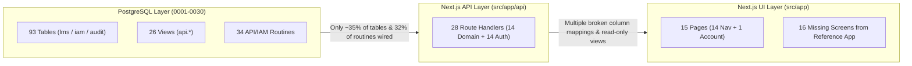

# Comprehensive Application Audit Report — Mari Energies LMS

**Audit Date:** 2026-10-28  
**Scope:** End-to-end forensic comparison of Business Requirements ([lms_project_analysis.md](file:///Users/omair/Downloads/03%20Vibe-Coded%20Apps/lms/requirments/lms_project_analysis.md), [email.txt](file:///Users/omair/Downloads/03%20Vibe-Coded%20Apps/lms/requirments/email.txt)), the 30-screen Reference System ([screens.js](file:///Users/omair/Downloads/03%20Vibe-Coded%20Apps/lms/legacy-demo/assets/js/ui/screens.js)), the PostgreSQL 30-Migration Database Layer (`db/migrations/0001`–`0030`), and the Next.js 15 Application Tier (`src/`).

---

## 1. Executive Scorecard



| Audit Dimension | Reference / DB Baseline | Implemented in Next.js (`src/`) | Missing / Incomplete | Coverage |
| :--- | :--- | :--- | :--- | :--- |
| **Application Screens** | 30 screens in [screens.js](file:///Users/omair/Downloads/03%20Vibe-Coded%20Apps/lms/legacy-demo/assets/js/ui/screens.js#L13-L45) | 14 nav routes in [nav.ts](file:///Users/omair/Downloads/03%20Vibe-Coded%20Apps/lms/src/components/layout/nav.ts#L10-L28) + `/account/security` | **16 entire screens missing**; 4 existing screens lack create/edit workflows | **47%** |
| **Database Tables (`lms.*`, `iam.*`, `audit.*`)** | 93 tables across 30 migrations | ~33 tables queried or mutated by `src/app/api/**` | **60 tables** have zero API routes or UI surfaces | **35%** |
| **Stored Procedures / API Functions (`api.*`, `iam.*`)** | 16 `api.*` functions + 18 `iam.*` lifecycle functions | 6 `api.*` functions + 9 `iam.*` auth functions called | **10 `api.*` domain functions & 9 `iam.*` admin functions** unused | **44%** |
| **Analytical & Operational Views (`api.v_*`)** | 26 views (`0014`, `0017`, `0019`, `0025`, `0026`) | 6 views queried in API routes | **20 database views** completely unused by the backend | **23%** |
| **Core CRUD & Workflow Completeness** | Create, View, Edit, Workflow Advance/Return/Cancel, Export | Create + View on 8 screens; Read-only on 4 screens | No Edit (`PUT`/`PATCH`) on almost all entities; no Reject/Return in stepper | **~40%** |

> [!CAUTION]
> **Critical Operational Deadlocks Identified:**
>
> 1. **Deceased Landowner Deadlock:** The system enforces a hard block on deceased landowners (`is_deceased = true`) in [`/landowners`](file:///Users/omair/Downloads/03%20Vibe-Coded%20Apps/lms/src/app/landowners/page.tsx), [`/surveys`](file:///Users/omair/Downloads/03%20Vibe-Coded%20Apps/lms/src/app/surveys/page.tsx), and [`/cases`](file:///Users/omair/Downloads/03%20Vibe-Coded%20Apps/lms/src/app/cases/page.tsx), instructing users to complete a **Succession / Mutation (*Wirasat*)**. However, neither `/mutations` UI nor `/api/mutations` exists—making it impossible to ever unlock a deceased landowner's shares or cases without direct SQL intervention.
> 2. **Permanent Project-Wide Payment Freeze Bug:** Placing a hold on a single lease via [`POST /api/leases/[id]/hold`](file:///Users/omair/Downloads/03%20Vibe-Coded%20Apps/lms/src/app/api/leases/%5Bid%5D/hold/route.ts#L73-L81) inserts a `scope = 'project'` hold into `lms.payment_hold`, freezing **all** payments across the entire project. Worse, calling `RELEASE` on the lease ([lines 85–105](file:///Users/omair/Downloads/03%20Vibe-Coded%20Apps/lms/src/app/api/leases/%5Bid%5D/hold/route.ts#L85-L105)) updates `lms.lease.status` back to `'Active'` but **never lifts the row in `lms.payment_hold`**, leaving the entire project permanently frozen for payment releases.
> 3. **KML/KMZ Upload Hard Crash (`42703`):** [`POST /api/gis/kml`](file:///Users/omair/Downloads/03%20Vibe-Coded%20Apps/lms/src/app/api/gis/kml/route.ts#L145-L147) executes `SELECT id, survey_no, code FROM lms.survey WHERE project_id = $1`. Because `lms.survey` ([0003_land_and_landowners.sql](file:///Users/omair/Downloads/03%20Vibe-Coded%20Apps/lms/db/migrations/0003_land_and_landowners.sql#L67-L109)) has no `project_id` column (surveys link via `lms.project_survey`), every KML/KMZ upload crashes and rolls back.

---

## 2. Missing Application Screens & Modules (16 Unmigrated Screens)

The reference application ([legacy-demo/assets/js/ui/screens.js](file:///Users/omair/Downloads/03%20Vibe-Coded%20Apps/lms/legacy-demo/assets/js/ui/screens.js#L13-L45)) and PostgreSQL schema define 30 functional modules. Next.js ([src/components/layout/nav.ts](file:///Users/omair/Downloads/03%20Vibe-Coded%20Apps/lms/src/components/layout/nav.ts#L10-L28)) only implements 14 navigation routes. The following **16 screens are completely absent** from `src/app/`:

| # | Missing Route / Screen | Reference Function | Underlying DB Tables & Views (Already Built in DB) | Operational Impact of Absence |
| :- | :--- | :--- | :--- | :--- |
| 1 | **`/mutations`** (Mutation & Succession / *Wirasat*) | [`scrMutations()`](file:///Users/omair/Downloads/03%20Vibe-Coded%20Apps/lms/legacy-demo/assets/js/ui/screens.js#L1562-L1629) | `lms.mutation`, `lms.mutation_survey`, `lms.mutation_heir`, `api.apply_mutation()` | **Critical blocker:** Deceased landowners (`is_deceased = true`) can never have their shares transferred to legal heirs or unlocked for payment. |
| 2 | **`/legal`** (Legal Cases & Court Stay Orders) | [`scrLegal()`](file:///Users/omair/Downloads/03%20Vibe-Coded%20Apps/lms/legacy-demo/assets/js/ui/screens.js#L1631-L1687) | `lms.legal_case`, `lms.legal_case_landowner`, `lms.legal_case_survey`, `lms.legal_hearing`, `lms.tg_legal_case_stay()` | Database triggers automatically place/lift payment holds when `has_stay_order` changes on `lms.legal_case`, and Report R15 queries it, but no UI/API exists to record or vacate stay orders. |
| 3 | **`/acquisitions`** (Statutory LAA 1894 — Sec 4, 6, 9, 11) | [`scrAcquisitions()`](file:///Users/omair/Downloads/03%20Vibe-Coded%20Apps/lms/legacy-demo/assets/js/ui/screens.js#L696-L779) | `lms.acquisition`, `lms.acquisition_survey`, `lms.acquisition_title_check`, `lms.title_check_item`, `lms.wf_guard_acquisitions()` | Only the internal 4-tier Land Lease Request (`/requests`) exists; statutory Land Acquisition Act 1894 workflows (Sec 4, Sec 6, Sec 9, Sec 11 Award, Mutation) and the 7-point Title Verification Checklist are missing. |
| 4 | **`/inbox`** (Approvals Queue & Notifications Center) | [`scrInbox()`](file:///Users/omair/Downloads/03%20Vibe-Coded%20Apps/lms/legacy-demo/assets/js/ui/screens.js#L298-L355), [`scrNotif()`](file:///Users/omair/Downloads/03%20Vibe-Coded%20Apps/lms/legacy-demo/assets/js/ui/screens.js#L357-L384) | `lms.workflow_assignment`, `lms.notification`, `lms.workflow_escalation` | Approvers have no unified queue showing items awaiting their action across Cases, Requests, Leases, Payments, and Mutations, and no notification bell in [`Header.tsx`](file:///Users/omair/Downloads/03%20Vibe-Coded%20Apps/lms/src/components/layout/Header.tsx). |
| 5 | **`/units`** (Admin Hierarchy Master & Unit Converter) | [`scrUnits()`](file:///Users/omair/Downloads/03%20Vibe-Coded%20Apps/lms/legacy-demo/assets/js/ui/screens.js#L430-L505) | `lms.admin_unit`, `lms.province_level`, `lms.unit_conversion`, `api.v_admin_unit_path` | Explicitly required by client sample screenshots (`Sample District Master Entry Entry Form.png`, `Sample Master Key Deh Entry.png`). Currently there is no UI to add/edit Districts, Tehsils/Talukas, Qanungos, or Dehs/Mouzas. |
| 6 | **`/matrix`** (Designation Approval Matrix) | [`scrMatrix()`](file:///Users/omair/Downloads/03%20Vibe-Coded%20Apps/lms/legacy-demo/assets/js/ui/screens.js#L2024-L2077) | `lms.workflow`, `lms.workflow_stage`, `lms.workflow_step_group`, `lms.workflow_matrix_history` | Explicitly required by client screenshot (`Sample Showing Approval Rights against each deisgnation.png`). No screen exists to inspect or configure designation-wise approval rights and SLA days. |
| 7 | **`/users`** (IAM User, Role & Provisioning Admin) | [`scrUsers()`](file:///Users/omair/Downloads/03%20Vibe-Coded%20Apps/lms/legacy-demo/assets/js/ui/screens.js#L1972-L2022) | `lms.app_user`, `iam.role`, `iam.user_role`, `iam.invitation`, `iam.provisioning_request`, `iam.access_review` | Complete enterprise IAM lifecycle functions (`iam.create_user`, `iam.set_user_status`, `iam.issue_token`, `iam.decide_provisioning`) exist in [`0022_iam_lifecycle.sql`](file:///Users/omair/Downloads/03%20Vibe-Coded%20Apps/lms/db/migrations/0022_iam_lifecycle.sql) with zero admin UI or API endpoints. |
| 8 | **`/documents`** (Document Repository & Vault) | [`scrDocuments()`](file:///Users/omair/Downloads/03%20Vibe-Coded%20Apps/lms/legacy-demo/assets/js/ui/screens.js#L1794-L1856) | `lms.document`, `lms.document_category`, `lms.document_access_log` | No ability to upload, hash-verify (`sha256_hex`), download, or audit-log supporting legal documents (Sale Deeds, Jamabandi, Award Copies, Lease Deeds). |
| 9 | **`/budgets`** (Project Budgets & Cost Centers) | [`scrBudgets()`](file:///Users/omair/Downloads/03%20Vibe-Coded%20Apps/lms/legacy-demo/assets/js/ui/screens.js#L1689-L1736) | `lms.budget`, `api.budget_status()`, `api.v_budget_utilisation` | `api.request_payment()` checks project budget ceilings in [`0012_functions_financial.sql`](file:///Users/omair/Downloads/03%20Vibe-Coded%20Apps/lms/db/migrations/0012_functions_financial.sql#L31-L87), and Report R10 reports on `lms.budget`, but no UI/API exists to allocate or revise annual project budgets. |
| 10 | **`/grievances`** (Community Grievances & IIR) | [`scrGrievances()`](file:///Users/omair/Downloads/03%20Vibe-Coded%20Apps/lms/legacy-demo/assets/js/ui/screens.js#L1738-L1792) | `lms.grievance`, `lms.grievance_category`, `api.v_grievance_status` | Queried in Report R15 (`Litigation & Grievance Impact Report`), but there is no screen or API to log, assign, investigate, or resolve community complaints/IIRs. |
| 11 | **`/encroachments`** (ROW & Lease Encroachments) | [`scrEncroachments()`](file:///Users/omair/Downloads/03%20Vibe-Coded%20Apps/lms/legacy-demo/assets/js/ui/screens.js#L1509-L1560) | `lms.encroachment`, `lms.encroachment_category`, `api.v_encroachment_status` | No screen or API to log illegal construction/cultivation within ROW corridors or leased parcels. |
| 12 | **`/import`** (Bulk CSV/Excel Import & Reconciliation) | [`scrImport()`](file:///Users/omair/Downloads/03%20Vibe-Coded%20Apps/lms/legacy-demo/assets/js/ui/screens.js#L1905-L1970) | `lms.import_batch`, `lms.import_row`, `lms.import_validation_error`, `api.validate_import_batch()`, `api.promote_import_batch()` | Complete staging, validation, and promotion engine exists in [`0018_functions_import_report.sql`](file:///Users/omair/Downloads/03%20Vibe-Coded%20Apps/lms/db/migrations/0018_functions_import_report.sql#L28-L315) with zero API or UI exposure. |
| 13 | **`/calendar`** (Compliance & Lease Expiry Calendar) | [`scrCalendar()`](file:///Users/omair/Downloads/03%20Vibe-Coded%20Apps/lms/legacy-demo/assets/js/ui/screens.js#L386-L428) | `api.v_lease_expiry_alert`, `api.v_row_renewal_schedule`, `lms.legal_hearing` | No calendar timeline view for upcoming 90-day lease expiries, annual rent escalations, ROW renewals, or court hearing dates. |
| 14 | **`/projdash`** (Project Drill-Down Dashboard) | [`scrProjDash()`](file:///Users/omair/Downloads/03%20Vibe-Coded%20Apps/lms/legacy-demo/assets/js/ui/screens.js#L225-L296) | `api.v_project_land_status`, `api.v_project_portfolio` | No dedicated single-project drill-down view showing parcel acquisition progress, budget burn, and project-specific bottlenecks. |
| 15 | **`/province`** (Provincial Revenue System Overview) | [`scrProvince()`](file:///Users/omair/Downloads/03%20Vibe-Coded%20Apps/lms/legacy-demo/assets/js/ui/screens.js#L507-L558) | `api.v_province_summary`, `lms.province_unit`, `lms.province_level` | No provincial comparison/reference screen explaining each province's revenue hierarchy, statutory basis, and conversion rules. |
| 16 | **`/settings`** (System Settings & Parameters) | [`scrSettings()`](file:///Users/omair/Downloads/03%20Vibe-Coded%20Apps/lms/legacy-demo/assets/js/ui/screens.js#L2079-L2129) | `lms.system_setting`, `lms.setting_history`, `api.set_setting()`, `iam.set_policy()` | No UI to manage configurable system parameters (WHT tax rates, SLA thresholds, lockout policies, escalation alerts). |

Also note that [`src/middleware.ts`](file:///Users/omair/Downloads/03%20Vibe-Coded%20Apps/lms/src/middleware.ts#L7) whitelists `/forgot-password`, `/reset-password`, and `/accept-invitation` as public pages, and [`src/app/login/page.tsx`](file:///Users/omair/Downloads/03%20Vibe-Coded%20Apps/lms/src/app/login/page.tsx#L103) links to `<a href="/forgot-password">Forgot password?</a>`, **but none of `/forgot-password/page.tsx`, `/reset-password/page.tsx`, or `/accept-invitation/page.tsx` exist in `src/app/`** (clicking "Forgot password?" on the login screen returns a **404 Not Found**!).

---

## 3. Critical Runtime Bugs & Broken Logic in Existing Code

### 3.1. `POST /api/gis/kml` Crashes on Every Upload (SQL Error `42703`)

- **Location:** [`src/app/api/gis/kml/route.ts`](file:///Users/omair/Downloads/03%20Vibe-Coded%20Apps/lms/src/app/api/gis/kml/route.ts#L145-L147)
- **Defect:** When matching uploaded KML placemarks to surveys, the handler runs:

  ```sql
  SELECT id, survey_no, code FROM lms.survey WHERE project_id = $1
  ```

  In [`0003_land_and_landowners.sql`](file:///Users/omair/Downloads/03%20Vibe-Coded%20Apps/lms/db/migrations/0003_land_and_landowners.sql#L67-L118), `lms.survey` does **not** have a `project_id` column; surveys are linked to projects via the junction table `lms.project_survey (project_id, survey_id)`.
- **Impact:** Every KML/KMZ upload throws PostgreSQL error `42703: column "project_id" does not exist`, aborts the transaction, and returns an error.

### 3.2. Dashboard Finance Aging & Project Portfolio Columns Render `undefined` / `0`

- **Locations:** [`src/app/dashboard/page.tsx`](file:///Users/omair/Downloads/03%20Vibe-Coded%20Apps/lms/src/app/dashboard/page.tsx#L67-L265) vs [`src/app/api/analytics/kpis/route.ts`](file:///Users/omair/Downloads/03%20Vibe-Coded%20Apps/lms/src/app/api/analytics/kpis/route.ts#L86-L103) and [`0026_decision_intelligence_and_gis.sql`](file:///Users/omair/Downloads/03%20Vibe-Coded%20Apps/lms/db/migrations/0026_decision_intelligence_and_gis.sql#L271-L338)
- **Defects:**
  1. **Finance Tab Aging Cards & Bar Chart:** [`/api/analytics/kpis`](file:///Users/omair/Downloads/03%20Vibe-Coded%20Apps/lms/src/app/api/analytics/kpis/route.ts#L89-L94) maps `api.v_finance_aging` into `{ aging_bracket, count, gross_amount, wht_amount, net_amount }`. However, [`dashboard/page.tsx`](file:///Users/omair/Downloads/03%20Vibe-Coded%20Apps/lms/src/app/dashboard/page.tsx#L88) reads `b.total_net_liability` and [lines 179–180](file:///Users/omair/Downloads/03%20Vibe-Coded%20Apps/lms/src/app/dashboard/page.tsx#L179-L180) read `b.total_net_liability` and `b.voucher_count`. Because both properties are `undefined`, the Finance tab displays `Rs —` and `— voucher(s) pending` on all 4 aging cards and plots `0` on the Payment Aging Bar Chart.
  2. **Over-90-Days Bracket String Mismatch:** [`dashboard/page.tsx` line 172](file:///Users/omair/Downloads/03%20Vibe-Coded%20Apps/lms/src/app/dashboard/page.tsx#L172) checks `String(b.aging_bracket).includes('>90')`, whereas `api.v_finance_aging` ([`0026` line 319](file:///Users/omair/Downloads/03%20Vibe-Coded%20Apps/lms/db/migrations/0026_decision_intelligence_and_gis.sql#L319)) emits `'Over 90 Days'`.
  3. **Project Portfolio "Released" & "Status" Columns:** `api.v_project_portfolio` ([`0026` lines 277, 287](file:///Users/omair/Downloads/03%20Vibe-Coded%20Apps/lms/db/migrations/0026_decision_intelligence_and_gis.sql#L277-L287)) outputs `project_status` and `paid_compensation`. [`dashboard/page.tsx`](file:///Users/omair/Downloads/03%20Vibe-Coded%20Apps/lms/src/app/dashboard/page.tsx#L67) reads `p.total_released` (in the Overview chart at line 67, Finance chart at line 194, and table at line 264) and `p.status` (line 262). Consequently, **Released Compensation always shows `0`** in every project chart and table on the dashboard, and **Project Status always shows `—`**.
  4. **Province Filter Ignored on 4 of 5 Dashboard Queries:** In [`/api/analytics/kpis/route.ts`](file:///Users/omair/Downloads/03%20Vibe-Coded%20Apps/lms/src/app/api/analytics/kpis/route.ts#L20-L115), only `api.v_project_portfolio` filters by `WHERE province_code = $1`. The queries for `api.v_executive_kpis`, `api.v_finance_aging`, `api.v_data_quality_audit`, and `api.v_gis_coverage` ignore the `province` query parameter completely.

### 3.3. SQL Join Fan-Out (Cartesian Multiplication) in `api.v_project_portfolio` and Report `r1`

- **Locations:** [`db/migrations/0026_decision_intelligence_and_gis.sql`](file:///Users/omair/Downloads/03%20Vibe-Coded%20Apps/lms/db/migrations/0026_decision_intelligence_and_gis.sql#L271-L304) and [`src/app/api/analytics/reports/route.ts`](file:///Users/omair/Downloads/03%20Vibe-Coded%20Apps/lms/src/app/api/analytics/reports/route.ts#L31-L57)
- **Defect:** Both queries perform parallel `LEFT JOIN`s across `project_survey`, `survey_ownership_share`, `compensation_case`, `payment_request`, `lease`, and `project_spatial_feature` in a single flat query and then compute `SUM(s.total_area)`, `SUM(c.total_amount)`, and `SUM(pay.net_amount)`.
- **Impact:** Whenever a project has $N$ surveys, $M$ cases, $K$ payments, and $F$ spatial features, every sum is multiplied by the row count of the other joined tables (a classic SQL fan-out bug), inflating area and financial totals by orders of magnitude. (Contrast with [`api.v_project_land_status`](file:///Users/omair/Downloads/03%20Vibe-Coded%20Apps/lms/db/migrations/0019_indexes_and_plan_fixes.sql#L580-L617) in `0019`, which properly pre-aggregates CTEs per project).
- **Additional SQL View Logic Bugs in `0026`:**
  - `api.v_executive_kpis` ([line 208](file:///Users/omair/Downloads/03%20Vibe-Coded%20Apps/lms/db/migrations/0026_decision_intelligence_and_gis.sql#L208)) sums `total_amount` of **all** cases (including `Prepared`/`Cancelled`) into `total_approved_compensation`.
  - `api.v_finance_aging` ([lines 307–338](file:///Users/omair/Downloads/03%20Vibe-Coded%20Apps/lms/db/migrations/0026_decision_intelligence_and_gis.sql#L307-L338)) does not exclude `stage_code IN ('Released', 'Cancelled')`, counting already-paid vouchers as unpaid aging liabilities.

### 3.4. Lease Hold Freezes Entire Project & Lease Release Never Lifts the Hold

- **Location:** [`src/app/api/leases/[id]/hold/route.ts`](file:///Users/omair/Downloads/03%20Vibe-Coded%20Apps/lms/src/app/api/leases/%5Bid%5D/hold/route.ts#L69-L105)
- **Defects:**
  1. When `action === 'HOLD'`, lines 73–81 insert a row into `lms.payment_hold` with `scope = 'project'` and `project_id = lease.project_id` because `lms.payment_hold` (`0006` line 200) only supports scopes `'case'`, `'landowner'`, `'survey'`, and `'project'`. Thus holding a single lease freezes every case and payment in the entire project.
  2. When `action === 'RELEASE'`, lines 85–105 set `lms.lease.status = 'Active'`, **but never update `lms.payment_hold SET lifted_by = ..., lifted_at = now()`**. The database trigger/guard (`lms.wf_guard_payments` in `0011` line 101) checks `lms.payment_hold WHERE lifted_at IS NULL`, meaning the project remains permanently blocked from releasing payments.

### 3.5. Lease Renewal Corrupts Rate & Never Updates `annual_rent`

- **Locations:** [`src/app/leases/page.tsx`](file:///Users/omair/Downloads/03%20Vibe-Coded%20Apps/lms/src/app/leases/page.tsx#L194-L280) and [`src/app/api/leases/[id]/renew/route.ts`](file:///Users/omair/Downloads/03%20Vibe-Coded%20Apps/lms/src/app/api/leases/%5Bid%5D/renew/route.ts#L60-L99)
- **Defects:**
  1. The "+ Add Lease" modal in `src/app/leases/page.tsx` only collects `annual_rent` and never collects `rate_per_acre` or linked `survey_ids` (`lms.lease_survey`). Thus all UI-created leases have `rate_per_acre = NULL` and `initial_area = 0`.
  2. When renewing a lease via `POST /api/leases/[id]/renew`, line 61 computes:

     ```ts
     const oldRate = Number(lease.rate_per_acre) || 0;
     const newRate = Math.round(oldRate * (1 + escPct / 100));
     ```

     When `rate_per_acre` is `NULL`, `oldRate` is `0` and `newRate` becomes `0`. Lines 91–99 update `rate_per_acre = 0` and **never update `annual_rent`**!
  3. Similarly, Report `r8` (`Lease & Rental Escalation Schedule` in [`/api/analytics/reports/route.ts` line 394](file:///Users/omair/Downloads/03%20Vibe-Coded%20Apps/lms/src/app/api/analytics/reports/route.ts#L394)) calculates `annual_rent` as `(l.initial_area * l.rate_per_acre)` instead of reading `l.annual_rent`, producing `0`/`NULL` for UI-created leases.

### 3.6. Broken Auth Links & Orphaned Components

- **Broken SSO Start Link:** [`src/app/login/page.tsx` line 111](file:///Users/omair/Downloads/03%20Vibe-Coded%20Apps/lms/src/app/login/page.tsx#L111) links SSO buttons to `/api/auth/sso/${p.kind}/${encodeURIComponent(p.name)}/start`, which does not exist (`src/app/api/auth/sso/` only contains `login/route.ts` and `callback/route.ts`).
- **Missing Public Auth Pages:** `/forgot-password`, `/reset-password`, and `/accept-invitation` have backend API routes (`/api/auth/password/forgot`, `/api/auth/password/reset`, `/api/auth/invitation/accept`), but **zero frontend pages** in `src/app/`.
- **Orphaned & Broken `RoleSwitcherModal`:** [`src/components/ui/RoleSwitcherModal.tsx`](file:///Users/omair/Downloads/03%20Vibe-Coded%20Apps/lms/src/components/ui/RoleSwitcherModal.tsx#L29-L48) is never rendered anywhere, calls `GET /api/auth/login` (which returns `405 Method Not Allowed`), and sends `POST /api/auth/login` without a `password`.
- **Verification Report vs Actual Code Branding Drift:** [`docs/reports/MULTI_AGENT_RELEASE_VERIFICATION_REPORT.md`](file:///Users/omair/Downloads/03%20Vibe-Coded%20Apps/lms/docs/reports/MULTI_AGENT_RELEASE_VERIFICATION_REPORT.md#L219-L237) claims `/login` `h1` is `Mari Energies Limited — Land Management System` and that `Shell.tsx` / `Header.tsx` include the official Mari Energies logo and `Developed by Alisons Technology` attribution. In actual code, [`src/app/login/page.tsx` line 66](file:///Users/omair/Downloads/03%20Vibe-Coded%20Apps/lms/src/app/login/page.tsx#L66) renders `<h1>Land Management System</h1>`, [`Sidebar.tsx` line 32](file:///Users/omair/Downloads/03%20Vibe-Coded%20Apps/lms/src/components/layout/Sidebar.tsx#L32) renders a text badge `LMS`, and [`Shell.tsx` line 162](file:///Users/omair/Downloads/03%20Vibe-Coded%20Apps/lms/src/components/layout/Shell.tsx#L162) omits the developer attribution.

---

## 4. Missing Functions & Features in Existing Screens (Screen-by-Screen)

| Screen (`src/app/...`) | What Works | Missing Functions, Missing UI Controls & Broken Workflows |
| :--- | :--- | :--- |
| **[`/dashboard`](file:///Users/omair/Downloads/03%20Vibe-Coded%20Apps/lms/src/app/dashboard/page.tsx)** | 4 tabs (Overview, Portfolio, Finance, Governance), unit selector | • Finance aging cards & chart broken (`total_net_liability` / `voucher_count` undefined)<br>• Portfolio "Released" & "Status" columns broken (`total_released` / `status` undefined)<br>• Province filter ignored on KPIs, Finance Aging, Data Quality, and GIS Coverage<br>• Missing Approval Bottleneck widget (`api.v_approval_bottleneck`) & Lease Expiry Alert widget (`api.v_lease_expiry_alert`) |
| **[`/projects`](file:///Users/omair/Downloads/03%20Vibe-Coded%20Apps/lms/src/app/projects/page.tsx)** | List, filter, Create Project (`POST`), View Drawer | • **No Edit (`PUT`/`PATCH`)** project modal or API<br>• **No Survey Parcel Linking (`lms.project_survey`)** — cannot attach or detach surveys to a project<br>• No drill-down link to Project Dashboard (`/projdash`) or Project Budget (`lms.budget`)<br>• No Excel/PDF list export |
| **[`/surveys`](file:///Users/omair/Downloads/03%20Vibe-Coded%20Apps/lms/src/app/surveys/page.tsx)** | List, Create Survey (`POST`), Edit Ownership Shares (`PUT` via `ShareBalancer`) | • **No Edit (`PUT`/`PATCH`)** for survey metadata (survey number, area, land status, coordinates, administrative unit)<br>• **No Project Linking (`lms.project_survey`)** when creating or editing a survey<br>• **No Ownership History viewer (`lms.survey_ownership_history`)**<br>• Creates codes with `Math.random()` (`AREA-xxxx`) instead of `lms.next_code('SRV-')` |
| **[`/landowners`](file:///Users/omair/Downloads/03%20Vibe-Coded%20Apps/lms/src/app/landowners/page.tsx)** | List, search, Create Landowner (`POST`), View Drawer | • **No Edit (`PUT`/`PATCH`)** landowner modal or API (cannot update bank/IBAN, contact info, FBR tax status, or mark deceased)<br>• **No Landowner Statement of Account** (DB function `api.report_landowner_statement(uuid)` in `0018` is unused)<br>• **Deceased Landowner Deadlock:** Banner instructs user to use Mutation workflow, which does not exist<br>• Creates codes with `Math.random()` (`SND-xxxx`) instead of `lms.next_code('LO-')` |
| **[`/cases`](file:///Users/omair/Downloads/03%20Vibe-Coded%20Apps/lms/src/app/cases/page.tsx)** | List, Create Case (`POST`), Advance Stage (`WorkflowStepper`) | • **Single-Owner Only Creation:** Modal only allows picking 1 landowner (hardcoded `share_pct: 100.0`) instead of multi-owner shares from survey (`lms.case_owner`)<br>• **Zero Survey Parcel Linking:** `lms.case_lease_line` is never populated during case creation<br>• **No Itemized Crop/Tree/Misc Line Items:** Only accepts flat lump-sum numbers; `lms.case_crop_line`, `lms.case_tree_line`, and `lms.case_misc_line` are never populated from UI, and `api.recalculate_case_totals()` is bypassed<br>• **Auto-faked Document Checklist:** `POST /api/cases` automatically inserts `checked = true` for all `lms.case_document_check` items instead of providing an interactive verification checklist in the UI<br>• **No Reject / Send Back / Cancel in [`WorkflowStepper.tsx`](file:///Users/omair/Downloads/03%20Vibe-Coded%20Apps/lms/src/components/ui/WorkflowStepper.tsx):** Only renders the forward `Advance to ...` button<br>• **No Printable Case Award Sheet** (`printCase()` in `legacy-demo`) |
| **[`/leases`](file:///Users/omair/Downloads/03%20Vibe-Coded%20Apps/lms/src/app/leases/page.tsx)** | List, Create Lease (`POST`), Hold/Release, Renew | • Create modal lacks `rate_per_acre` and `survey_ids` (`lms.lease_survey`), causing renewal calculation to zero out rate and leave `annual_rent` unchanged<br>• Hold/Release has the project-wide payment freeze bug (Section 3.4)<br>• **No Printable Lease Agreement** (`Sample Lease Agreement Document.png` / `printLease()`) |
| **[`/payments`](file:///Users/omair/Downloads/03%20Vibe-Coded%20Apps/lms/src/app/payments/page.tsx)** | List, Release Voucher (`POST` with `action: 'release'`) | • **No "+ Request Payment Voucher" UI Modal:** `POST /api/payments` supports `action: 'request'` (calling `api.request_payment()`), but the UI has no button or form to create a payment voucher!<br>• **No Workflow Stage Progression UI:** Payment vouchers have a 5-stage workflow (`Requested` → `Verified` → `Audit Cleared` → `Approved` → `Released`), but UI only shows a "Release Now" button<br>• **No Payment Hold Management UI** (`lms.payment_hold`), **No Payment Allocation UI** (`api.allocate_payment`), **No SAP Reconciliation UI** (`api.reconcile`)<br>• **No Printable Payment Receipt** (`Sample Payment Receipt.png` / `lms.payment_receipt`) |
| **[`/requests`](file:///Users/omair/Downloads/03%20Vibe-Coded%20Apps/lms/src/app/requests/page.tsx)** | List, Create Request (`POST`), 4-tier Approval & Reject (`POST /transition`) | • Hardcodes `concession_name: 'Mari Concession'` and `target_deh: 'Deh Mari'` in state defaults<br>• No Edit (`PUT`) for returned/draft requests<br>• Does not automatically spawn an Acquisition (`lms.acquisition`) or Lease (`lms.lease`) upon CEO approval |
| **[`/rows`](file:///Users/omair/Downloads/03%20Vibe-Coded%20Apps/lms/src/app/rows/page.tsx)** | Read-only table of ROW corridors | • **100% Read-Only UI:** Even though [`POST /api/rows`](file:///Users/omair/Downloads/03%20Vibe-Coded%20Apps/lms/src/app/api/rows/route.ts#L34-L98) exists in the backend, `src/app/rows/page.tsx` has **no "+ New ROW Corridor" button, no modal, no detail drawer, no survey/landowner linking (`lms.row_survey`, `lms.row_landowner`), and no workflow transition (`Route Survey` → `Valuation` → `Approval` → `Active`)** |
| **[`/dbpfc`](file:///Users/omair/Downloads/03%20Vibe-Coded%20Apps/lms/src/app/dbpfc/page.tsx)** | Read-only table of DBPFC estimates | • **100% Read-Only UI & API:** [`/api/dbpfc/route.ts`](file:///Users/omair/Downloads/03%20Vibe-Coded%20Apps/lms/src/app/api/dbpfc/route.ts) only implements `GET`. There is no `POST` to create a DBPFC estimate, no survey class linking (`lms.dbpfc_survey`), no rate history (`lms.dbpfc_rate_history`), and no workflow progression (`lms.wf_guard_dbpfc`)<br>• Does not filter by `activeProvince` from `useLMS()` |
| **[`/gis`](file:///Users/omair/Downloads/03%20Vibe-Coded%20Apps/lms/src/app/gis/page.tsx)** | MapLibre canvas, layer toggles, KML upload & merge controls | • KML/KMZ upload crashes on backend due to `lms.survey.project_id` SQL bug (Section 3.1)<br>• When no KML features exist in DB, falls back to synthetic bounding boxes around hardcoded province centroids |
| **[`/reports`](file:///Users/omair/Downloads/03%20Vibe-Coded%20Apps/lms/src/app/reports/page.tsx)** | 15 report cards (`r1`–`r15`), CSV download, browser print | • Report `r1` has SQL join fan-out inflating totals (Section 3.3)<br>• Report `r8` computes `initial_area * rate_per_acre` instead of `annual_rent` (Section 3.5)<br>• Unit selector includes `'Sq Yard'`, which fails to match `'Square Yard'` in `lms.measurement_unit`, silently returning `0` for all converted areas when selected<br>• Does not use the audited database report functions in `0018_functions_import_report.sql` (`api.report_compensation_summary`, `api.report_payment_register`, `api.report_landowner_statement`, `api.report_approval_turnaround`) |
| **[`/audit`](file:///Users/omair/Downloads/03%20Vibe-Coded%20Apps/lms/src/app/audit/page.tsx)** | List of `audit.audit_event` rows with JSON diff viewer | • Entity filter dropdown hardcodes only 6 tables (`compensation_case`, `survey`, `landowner`, `lease`, `payment_request`, `payment_release`), omitting `project`, `land_request`, `row_corridor`, `project_kml_import`, `app_user`, etc.<br>• No viewer for `audit.record_version` (`api.v_record_version_history`) or `audit.auth_event` |

---

## 5. Missing API Endpoints & Unwired Database Capabilities

### 5.1. Missing Domain API Routes (Existing DB Tables & Functions with Zero API Endpoints)

| Missing API Endpoint | Backing Database Tables & Stored Procedures | Missing Capabilities |
| :--- | :--- | :--- |
| **`/api/mutations`** & **`/api/mutations/[id]/apply`** | `lms.mutation`, `lms.mutation_survey`, `lms.mutation_heir`, `lms.wf_guard_mutations()`, [`api.apply_mutation(uuid)`](file:///Users/omair/Downloads/03%20Vibe-Coded%20Apps/lms/db/migrations/0012_functions_financial.sql#L557) | Create inheritance/sale mutation, validate heir shares $= 100\%$, advance workflow, and atomically transfer `lms.survey_ownership_share` while unlocking deceased landowner flags. |
| **`/api/legal`** & **`/api/legal/[id]/hearings`** | `lms.legal_case`, `lms.legal_case_landowner`, `lms.legal_case_survey`, `lms.legal_hearing`, [`lms.tg_legal_case_stay()`](file:///Users/omair/Downloads/03%20Vibe-Coded%20Apps/lms/db/migrations/0013_triggers.sql#L594) | Register court litigation, toggle `has_stay_order` (which triggers automatic `lms.payment_hold`), and log court hearing dates. |
| **`/api/acquisitions`** | `lms.acquisition`, `lms.acquisition_survey`, `lms.acquisition_title_check`, `lms.title_check_item`, [`lms.wf_guard_acquisitions()`](file:///Users/omair/Downloads/03%20Vibe-Coded%20Apps/lms/db/migrations/0011_functions_workflow.sql#L44) | Manage statutory LAA 1894 acquisitions (Sec 4, Sec 6, Sec 9, Sec 11 Award, Mutation) and verify 7-point title checklists. |
| **`/api/budgets`** | `lms.budget`, [`api.budget_status(uuid, int)`](file:///Users/omair/Downloads/03%20Vibe-Coded%20Apps/lms/db/migrations/0012_functions_financial.sql#L31), [`api.v_budget_utilisation`](file:///Users/omair/Downloads/03%20Vibe-Coded%20Apps/lms/db/migrations/0014_views.sql#L295) | Create/update fiscal year project budgets and query committed vs remaining budget balances. |
| **`/api/grievances`** | `lms.grievance`, `lms.grievance_category`, [`api.v_grievance_status`](file:///Users/omair/Downloads/03%20Vibe-Coded%20Apps/lms/db/migrations/0014_views.sql#L328) | Log, assign, escalate, and resolve community grievances / IIRs. |
| **`/api/encroachments`** | `lms.encroachment`, `lms.encroachment_category`, [`api.v_encroachment_status`](file:///Users/omair/Downloads/03%20Vibe-Coded%20Apps/lms/db/migrations/0014_views.sql#L344) | Log and track corridor/parcel encroachments. |
| **`/api/documents`** | `lms.document`, `lms.document_category`, `lms.document_access_log` | Upload metadata/storage keys, verify SHA-256 checksums, log document reads, and soft-delete documents. |
| **`/api/import`** | `lms.import_batch`, `lms.import_row`, `lms.import_validation_error`, [`api.validate_import_batch()`](file:///Users/omair/Downloads/03%20Vibe-Coded%20Apps/lms/db/migrations/0018_functions_import_report.sql#L28), [`api.promote_import_batch()`](file:///Users/omair/Downloads/03%20Vibe-Coded%20Apps/lms/db/migrations/0018_functions_import_report.sql#L236) | Upload CSV/Excel rows into staging, run batch validation, and promote clean batches into production tables with provenance tracking (`lms.data_provenance`). |
| **`/api/payments/holds`**, **`/api/payments/allocate`**, **`/api/payments/reconcile`** | `lms.payment_hold`, `lms.payment_allocation`, `lms.reconciliation_run`, [`api.allocate_payment()`](file:///Users/omair/Downloads/03%20Vibe-Coded%20Apps/lms/db/migrations/0012_functions_financial.sql#L374), [`api.reconcile()`](file:///Users/omair/Downloads/03%20Vibe-Coded%20Apps/lms/db/migrations/0012_functions_financial.sql#L433) | Place/lift granular payment holds, allocate released payments across co-owners, and reconcile ERP/SAP bank disbursements. |
| **`/api/inbox`** & **`/api/notifications`** | `lms.workflow_assignment`, `lms.notification`, `lms.workflow_escalation` | Query current user's pending workflow queue and unread notifications. |
| **`/api/users`**, **`/api/roles`**, **`/api/provisioning`** | `lms.app_user`, `iam.role`, `iam.user_role`, [`iam.create_user()`](file:///Users/omair/Downloads/03%20Vibe-Coded%20Apps/lms/db/migrations/0022_iam_lifecycle.sql#L33), [`iam.update_user()`](file:///Users/omair/Downloads/03%20Vibe-Coded%20Apps/lms/db/migrations/0022_iam_lifecycle.sql#L72), [`iam.set_user_status()`](file:///Users/omair/Downloads/03%20Vibe-Coded%20Apps/lms/db/migrations/0022_iam_lifecycle.sql#L103), [`iam.decide_provisioning()`](file:///Users/omair/Downloads/03%20Vibe-Coded%20Apps/lms/db/migrations/0022_iam_lifecycle.sql#L499) | Administer users, roles, SoD conflict checks (`iam.sod_conflicts`), invitations (`iam.issue_token`), and external IdP provisioning requests. |
| **`/api/settings`** & **`/api/matrix`** | `lms.system_setting`, `lms.workflow_stage`, [`api.set_setting()`](file:///Users/omair/Downloads/03%20Vibe-Coded%20Apps/lms/db/migrations/0017_grants.sql#L350), [`iam.set_policy()`](file:///Users/omair/Downloads/03%20Vibe-Coded%20Apps/lms/db/migrations/0022_iam_lifecycle.sql#L345) | Read/update system settings and workflow approval matrix stages. |

### 5.2. Missing HTTP Methods on Existing API Routes

| Existing Route | Implemented Methods | Missing Methods & Capabilities |
| :--- | :--- | :--- |
| [`/api/dbpfc`](file:///Users/omair/Downloads/03%20Vibe-Coded%20Apps/lms/src/app/api/dbpfc/route.ts) | `GET` | Missing `POST` (create DBPFC estimate + survey links), `PUT` (update rates/status), and `/api/dbpfc/[id]/transition` (`api.advance_workflow('dbpfc', ...)`). |
| [`/api/units`](file:///Users/omair/Downloads/03%20Vibe-Coded%20Apps/lms/src/app/api/units/route.ts) | `GET` | Missing `POST` and `PUT` to create/edit administrative hierarchy units (`lms.admin_unit` — District, Tehsil/Taluka, Qanungo, Deh/Mouza) and confirm unit conversions (`lms.unit_conversion`). |
| [`/api/provinces`](file:///Users/omair/Downloads/03%20Vibe-Coded%20Apps/lms/src/app/api/provinces/route.ts) | `GET` | Read-only (returns `lms.province` and `lms.province_unit`). |
| [`/api/projects`](file:///Users/omair/Downloads/03%20Vibe-Coded%20Apps/lms/src/app/api/projects/route.ts) | `GET`, `POST` | Missing `PUT`/`PATCH` (update project metadata/status) and `/api/projects/[id]/surveys` (link/unlink `lms.project_survey`). |
| [`/api/landowners`](file:///Users/omair/Downloads/03%20Vibe-Coded%20Apps/lms/src/app/api/landowners/route.ts) | `GET`, `POST` | Missing `PUT`/`PATCH` (update landowner contact/bank/tax status/deceased flag) and `/api/landowners/[id]/statement` (`api.report_landowner_statement`). |
| [`/api/surveys`](file:///Users/omair/Downloads/03%20Vibe-Coded%20Apps/lms/src/app/api/surveys/route.ts) | `GET`, `POST`, `PUT` (shares only) | `PUT` only updates `lms.survey_ownership_share`; missing `PATCH` for survey parcel attributes (`lms.survey`). |
| [`/api/cases`](file:///Users/omair/Downloads/03%20Vibe-Coded%20Apps/lms/src/app/api/cases/route.ts) | `GET`, `POST` | Missing `PUT`/`PATCH` for editing draft (`Prepared`) cases, updating itemized crop/tree/lease lines, and toggling `lms.case_document_check` items. |
| [`/api/payments`](file:///Users/omair/Downloads/03%20Vibe-Coded%20Apps/lms/src/app/api/payments/route.ts) | `GET`, `POST` (`request`, `release`) | Missing `/api/payments/[id]/transition` to advance payment vouchers through intermediate stages (`Requested` → `Verified` → `Audit Cleared` → `Approved`). |
| [`/api/rows`](file:///Users/omair/Downloads/03%20Vibe-Coded%20Apps/lms/src/app/api/rows/route.ts) | `GET`, `POST` | Missing `PUT`/`PATCH` and workflow stage transition endpoint. |

---

## 6. Static, Hardcoded & Divergent Data Inventory

### 6.1. FBR Withholding Tax (WHT) Rate Contradictions

There is a direct conflict between the documented FBR WHT rates and the hardcoded rates in TypeScript:

- **Release Verification Report ([`docs/reports/MULTI_AGENT_RELEASE_VERIFICATION_REPORT.md` lines 28, 247](file:///Users/omair/Downloads/03%20Vibe-Coded%20Apps/lms/docs/reports/MULTI_AGENT_RELEASE_VERIFICATION_REPORT.md#L247)):** States WHT rates are **7.5% (Filer)** and **15% (Non-Filer)** under Section 152/153 of the Income Tax Ordinance 2001.
- **Database Seed (`lms.system_setting` in `0015_seed_reference.sql`):** Stores configurable tax keys in `lms.system_setting`, and `api.request_payment()` ([`0012_functions_financial.sql` lines 173–191](file:///Users/omair/Downloads/03%20Vibe-Coded%20Apps/lms/db/migrations/0012_functions_financial.sql#L173-L191)) reads `lms.payment_category.filer_wht_pct` / `non_filer_wht_pct` from the database.
- **Frontend Hardcoded Rates ([`src/lib/domain.ts` lines 77–86](file:///Users/omair/Downloads/03%20Vibe-Coded%20Apps/lms/src/lib/domain.ts#L77-L86), [`src/app/landowners/page.tsx` line 137](file:///Users/omair/Downloads/03%20Vibe-Coded%20Apps/lms/src/app/landowners/page.tsx#L137), [`src/app/cases/page.tsx` line 218](file:///Users/omair/Downloads/03%20Vibe-Coded%20Apps/lms/src/app/cases/page.tsx#L218)):** Hardcode **10% (Filer) / 20% (Non-Filer)** for Compensation, **3% / 6%** for Purchase, and **15% / 30%** for Lease instead of querying `lms.payment_category` or `lms.system_setting`.

### 6.2. Four Divergent Unit Conversion Implementations

Instead of using a single source of truth (`lms.unit_conversion` via `api.convert_area`), unit conversion factors are hardcoded in **four different places** with conflicting unit names and factor coverage:

1. **[`src/lib/domain.ts` (`SQFT_FACTORS`, lines 60–71)](file:///Users/omair/Downloads/03%20Vibe-Coded%20Apps/lms/src/lib/domain.ts#L60-L71):** Hardcodes 10 units (`Acre`, `Kanal`, `Marla`, `Chatak`, `Sarsahi`, `Sqft`, `Sqyd`, `Sqm`, `Jareeb`, `Hectare`). **Missing `Ghunta`, `Bigha`, `Rod`, `Pole`, and full names `'Square Feet'`, `'Square Yard'`, `'Square Meter'`** used in the database!
2. **[`db/migrations/0026_decision_intelligence_and_gis.sql` (`lms.convert_area`, lines 41–116)](file:///Users/omair/Downloads/03%20Vibe-Coded%20Apps/lms/db/migrations/0026_decision_intelligence_and_gis.sql#L41-L116):** Hardcodes conversion factors in a SQL `CASE` statement (flagged as **Finding DB-13** in [`docs/SECURITY_FINDINGS.md` line 51](file:///Users/omair/Downloads/03%20Vibe-Coded%20Apps/lms/docs/SECURITY_FINDINGS.md#L51) because it bypasses `lms.unit_conversion.is_confirmed` and duplicates `api.convert_area`).
3. **[`src/app/dashboard/page.tsx` (line 13)](file:///Users/omair/Downloads/03%20Vibe-Coded%20Apps/lms/src/app/dashboard/page.tsx#L13):** Hardcodes `UNITS = ['Acre', 'Hectare', 'Kanal', 'Ghunta', 'Square Meter']`.
4. **[`src/app/reports/page.tsx` (lines 70–79)](file:///Users/omair/Downloads/03%20Vibe-Coded%20Apps/lms/src/app/reports/page.tsx#L70-L79):** Hardcodes `['Acre', 'Kanal', 'Marla', 'Square Meter', 'Hectare', 'Chatak', 'Sq Yard']`, where `'Sq Yard'` is not recognized by `lms.convert_area` (which expects `'Square Yard'`) and therefore returns `0` for all areas!

### 6.3. Hardcoded Arrays, Form Defaults & Random Code Generators

| File & Lines | Hardcoded / Static Data | Proper Dynamic Source |
| :--- | :--- | :--- |
| [`src/app/requests/page.tsx` (L35–45, L242–265)](file:///Users/omair/Downloads/03%20Vibe-Coded%20Apps/lms/src/app/requests/page.tsx#L35-L45) | Hardcodes `concession_name: 'Mari Concession'`, `target_deh: 'Deh Mari'`, `PURPOSES`, and `PRIORITIES` | Populate from `lms.project` concessions and `lms.admin_unit` (`Deh`/`Mouza` records for the selected province). |
| [`src/app/leases/page.tsx` (L19–25)](file:///Users/omair/Downloads/03%20Vibe-Coded%20Apps/lms/src/app/leases/page.tsx#L19-L25) | Hardcodes `HOLD_REASONS` array in React component | Load from reference table or `lms.system_setting`. |
| [`src/app/cases/page.tsx` (L18–20)](file:///Users/omair/Downloads/03%20Vibe-Coded%20Apps/lms/src/app/cases/page.tsx#L18-L20) | Hardcodes `LAND_USES` and `STAGES` arrays | Load from `lms.land_use` and `lms.workflow_stage WHERE workflow_code = 'cases'`. |
| [`src/components/ui/WorkflowStepper.tsx` (L4–11)](file:///Users/omair/Downloads/03%20Vibe-Coded%20Apps/lms/src/components/ui/WorkflowStepper.tsx#L4-L11) vs [`src/lib/domain.ts` (L51–58)](file:///Users/omair/Downloads/03%20Vibe-Coded%20Apps/lms/src/lib/domain.ts#L51-L58) | Both files define different hardcoded `WORKFLOW_STAGES` arrays (`domain.ts` uses `Field Survey`, `Supervisor Review`, `Kanoongo Verification`, `Finance Check` which don't even match the DB stages!) | Query `lms.workflow_stage` and `lms.workflow_step_group`. |
| [`src/app/audit/page.tsx` (L68–75)](file:///Users/omair/Downloads/03%20Vibe-Coded%20Apps/lms/src/app/audit/page.tsx#L68-L75) | Hardcodes 6 `entity_type` options in filter `<select>` | Query `SELECT DISTINCT entity_type FROM audit.audit_event` or list all audited tables. |
| [`src/app/api/surveys/route.ts` (L59)](file:///Users/omair/Downloads/03%20Vibe-Coded%20Apps/lms/src/app/api/surveys/route.ts#L59) & [`src/app/api/landowners/route.ts` (L52)](file:///Users/omair/Downloads/03%20Vibe-Coded%20Apps/lms/src/app/api/landowners/route.ts#L52) | Uses `Math.floor(1000 + Math.random() * 9000)` to generate `lms.survey.code` (`AREA-xxxx`) and `lms.landowner.code` (`SND-xxxx`) — collision-prone and non-sequential | Call deterministic database sequence function `lms.next_code('SRV-')` and `lms.next_code('LO-')` (defined in [`0010_functions_core.sql` line 114](file:///Users/omair/Downloads/03%20Vibe-Coded%20Apps/lms/db/migrations/0010_functions_core.sql#L114)). |
| [`src/app/gis/page.tsx` (L19–25, L144–166)](file:///Users/omair/Downloads/03%20Vibe-Coded%20Apps/lms/src/app/gis/page.tsx#L144-L166) | Synthesizes fake rectangular polygons around hardcoded `PROVINCE_CENTERS` when spatial features are empty | Render only real `lms.project_spatial_feature` and `lms.survey.geom_geojson` features, showing an explicit "No GIS geometry uploaded" badge for unmapped parcels. |

---

## 7. Prioritized Remediation Roadmap

### Phase 1 — P0 Blockers & Data Corruption Fixes (Immediate)

1. **Fix KML Upload SQL Query:** In [`src/app/api/gis/kml/route.ts`](file:///Users/omair/Downloads/03%20Vibe-Coded%20Apps/lms/src/app/api/gis/kml/route.ts#L145-L147), join `lms.project_survey ps ON ps.survey_id = s.id WHERE ps.project_id = $1` instead of `WHERE project_id = $1`.
2. **Fix Lease Hold / Release Lock Leak:** In [`src/app/api/leases/[id]/hold/route.ts`](file:///Users/omair/Downloads/03%20Vibe-Coded%20Apps/lms/src/app/api/leases/%5Bid%5D/hold/route.ts#L69-L105), scope holds to the lease's surveys (`scope = 'survey'`) or add `'lease'` scope, and ensure `RELEASE` updates `lms.payment_hold SET lifted_by = $1, lifted_at = now()`.
3. **Fix Lease Renewal & Creation:** Add `rate_per_acre` and `survey_ids` to [`src/app/leases/page.tsx`](file:///Users/omair/Downloads/03%20Vibe-Coded%20Apps/lms/src/app/leases/page.tsx) and update `annual_rent` in [`src/app/api/leases/[id]/renew/route.ts`](file:///Users/omair/Downloads/03%20Vibe-Coded%20Apps/lms/src/app/api/leases/%5Bid%5D/renew/route.ts#L91-L99).
4. **Fix Dashboard & Analytics SQL Views:**
   - Align property names between [`/api/analytics/kpis/route.ts`](file:///Users/omair/Downloads/03%20Vibe-Coded%20Apps/lms/src/app/api/analytics/kpis/route.ts) and [`src/app/dashboard/page.tsx`](file:///Users/omair/Downloads/03%20Vibe-Coded%20Apps/lms/src/app/dashboard/page.tsx) (`paid_compensation` vs `total_released`, `project_status` vs `status`, `net_amount` vs `total_net_liability`, `count` vs `voucher_count`).
   - Refactor `api.v_project_portfolio` ([`0026`](file:///Users/omair/Downloads/03%20Vibe-Coded%20Apps/lms/db/migrations/0026_decision_intelligence_and_gis.sql#L271-L304)) and Report `r1` ([`/api/analytics/reports/route.ts`](file:///Users/omair/Downloads/03%20Vibe-Coded%20Apps/lms/src/app/api/analytics/reports/route.ts#L31-L57)) to use pre-aggregated CTEs so join fan-out is eliminated.
   - Apply `province` filtering across all queries in `/api/analytics/kpis` and filter `api.v_finance_aging` to `WHERE stage_code NOT IN ('Released', 'Cancelled')`.

### Phase 2 — Unblocking Core Operational Workflows (High Priority)

1. **Build `/mutations` & `/api/mutations`:** Wire `lms.mutation`, `lms.mutation_heir`, and `api.apply_mutation()` so deceased landowners can be legally succeeded and unlocked.
2. **Build `/legal` & `/api/legal`:** Wire `lms.legal_case` and `lms.legal_hearing` so stay orders can be recorded and vacated through the UI.
3. **Complete `/cases`, `/payments`, `/rows`, and `/dbpfc` Workflows:**
   - Add "+ Request Payment Voucher" modal and workflow stage progression to [`/payments`](file:///Users/omair/Downloads/03%20Vibe-Coded%20Apps/lms/src/app/payments/page.tsx).
   - Add multi-owner share selection, survey parcel linking (`lms.case_lease_line`), itemized crop/tree lines (`lms.case_crop_line`, `lms.case_tree_line`), interactive document checklist (`lms.case_document_check`), and Reject/Return buttons to [`/cases`](file:///Users/omair/Downloads/03%20Vibe-Coded%20Apps/lms/src/app/cases/page.tsx) and [`WorkflowStepper.tsx`](file:///Users/omair/Downloads/03%20Vibe-Coded%20Apps/lms/src/components/ui/WorkflowStepper.tsx).
   - Add Create/Edit/Workflow modals to [`/rows`](file:///Users/omair/Downloads/03%20Vibe-Coded%20Apps/lms/src/app/rows/page.tsx) and [`/dbpfc`](file:///Users/omair/Downloads/03%20Vibe-Coded%20Apps/lms/src/app/dbpfc/page.tsx) (plus `POST`/`PUT` on `/api/dbpfc`).
   - Add Edit (`PUT`/`PATCH`) modals and `lms.project_survey` linking to `/projects`, `/surveys`, and `/landowners`.

### Phase 3 — Missing Reference Screens, Admin & Printable Outputs

1. **Implement Remaining Client-Mandated Screens:** `/units` (District & Deh Master Entry forms + Unit Converter), `/matrix` (Designation Approval Rights Matrix), `/acquisitions` (LAA 1894 Sec 4/6/9/11), `/inbox` (Workflow Queue & Notifications), `/documents`, `/budgets`, `/grievances`, `/encroachments`, `/import`, `/calendar`, `/users`, and `/settings`.
2. **Implement Missing Public Auth Pages:** Create `/forgot-password`, `/reset-password`, and `/accept-invitation` pages in `src/app/` to match `src/middleware.ts` and existing `/api/auth/**` endpoints.
3. **Implement Printable Official Documents:** Lease Agreement (`Sample Lease Agreement Document.png`), Payment Receipt (`Sample Payment Receipt.png`), and Case Compensation Award Sheet.
4. **Consolidate Static Data:** Replace hardcoded conversion maps, WHT tax rates, and `Math.random()` code generators with database-driven lookups (`api.convert_area`, `lms.payment_category`, `lms.next_code()`).
