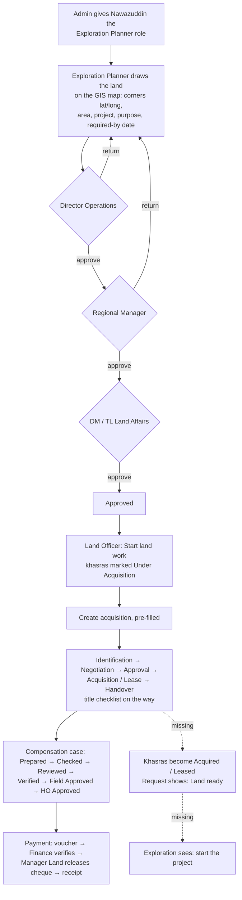

# Client Requirements Analysis (after the first demo), 2 Nov 2026

**Source:** `clientrequirement.md` (8 client messages).
**Checked against:** the code on `main` and the `lms_dev` database (migration 0059). The live site was also probed.
**Nothing was changed for this report.**

---

## 0. Scope

The live server is switched off on purpose (user, 2 Nov). Everything below is based on the **local project** only (code + `lms_dev`).

---

## 1. Summary

| # | Client asks for (in his words) | What it means in the system | Status |
|---|---|---|---|
| 1 | Exploration person (e.g. Nawazuddin) gets **temporary** access from admin and raises a land request: how much, where, coordinates, which project, by when. It goes up the approval chain, reaches the land department, the land department buys it, **shows progress at each step**, and at the end **reports back that the land is ready** | Exploration Planner role → land request with polygon → 3-tier approval → hand-over → acquisition stages → completion fed back to the request | **Partly built.** Request, polygon, approvals, hand-over and acquisition all work. **Missing:** (a) role with an end date, (b) the requester cannot see the acquisition's progress, (c) finishing the acquisition does not mark the land "acquired" or close the request as "Land ready" |
| 2 | One account that sees **all tabs**, then accounts that see fewer and fewer, for the demo | A visibility ladder of demo users | **Mostly there.** A ladder of 31 → 7 tabs exists (§4). **Missing:** one account with all 33 tabs |
| 3 | Prevent wrong entries, wrong access and **double entries**. One CNIC may own many lands, but one entry must never appear twice | Uniqueness and integrity rules | **Built** (§3.3). One small gap: no warning while typing a near-duplicate person (only in a report) |
| 4 | An owner **sold the land** to another owner; future payments must go to the new owner. The field team raises it, then it goes up for approval | Mutation (sale / transfer, inheritance) workflow, then payments follow the new owner | **Partly built.** The mutation module (Initiated → Revenue Verified → Legal Cleared → Approved & Applied) moves the **shares**. **Missing:** an approved compensation case still pays the **old** owner; the case is not re-pointed to the new owner |
| 5 | A third party takes the land to **court**; payments must be **held** until the decision. Someone must start the hold and someone must lift it | Legal case with a stay order → automatic payment hold → lift only with the court order | **Built** |
| 6 | Main demo: **land acquisition workflow** end to end, then CNIC and the audit history | The full chain of §2 | Works up to acquisition **Handover**. The final "record enters the main land register / ready to start" is missing (same gap as 1c) |
| 7 | On **mobile, Sindh is not visible**; all four provinces must show | Province chooser on phones | **Bug confirmed.** On a phone the top of the chooser is cut off, so the Sindh card (the first one) is half hidden and cannot be scrolled to |
| 8 | Each province shows **its own units** (Sindh units in Sindh, Punjab units in Punjab), and **unit sizes** (how many marla in a kanal and so on) can be set in **Settings** | Province unit list, plus editable conversion factors | **Partly built.** Province unit lists and reporting units exist. **Missing:** (a) the khasra form offers all 13 units in every province; (b) there is no screen to edit unit sizes, and sizes are one national set, not per province |

**In one line:** the core flow the client wants to see already runs from the request to the acquisition hand-over. Three things make it feel complete:
- the **completion loop** back to the requester;
- the **mobile province fix**;
- an **"all tabs" demo account**.

Each is a small change and can be done before the demo.

---

## 2. The complete workflow, A to Z (as the system works today)

| Step | Who (demo account) | Screen | Exists |
|---|---|---|---|
| 1. Grant access | `admin` | Users & Roles → assign *Exploration Planner* | ✅ (no end date) |
| 2. Raise the request | `explorer` | GIS Land Map → ✎ Draw land request | ✅ Project, purpose, priority, required-by, deh, concession, justification, polygon (draw, paste GPS or KML), area, centre, parcels inside, warnings |
| 3. Tier 2 | `dirops` | Land Requests → Review | ✅ |
| 4. Tier 3 | `regmgr` | Land Requests → Review (may Return) | ✅ Return → redraw → new version |
| 5. Tier 4 | `landaffairs` | Land Requests → Review | ✅ |
| 6. Hand-over to land dept | `lofield` | Start land work | ✅ Parcels → Under Acquisition |
| 7. Buy / lease process | `lofield` → `nego` → `dmfield` → `mland` → `sradmin` | Acquisition & Title | ✅ 5 stages + title checklist |
| 8. Progress visible to the requester | `explorer` | Land Requests → Details | ❌ Shows only "Handed over · ACQ-…", not the acquisition's current stage |
| 9. Land enters the main record | system | Survey register, GIS | ❌ Parcels stay *Under Acquisition* after Handover |
| 10. "Land ready, start the project" back to the requester | system → `explorer` | Land Requests | ❌ No *Completed / Land ready* stage |
| 11. Compensation and payment | as in the demo pack | Cases, Payments | ✅ |
| 12. History | `audit` | Audit Trail | ✅ Every change, who and when |

---

## 3. Detail per message

### 3.1 Message 1: exploration request with temporary access
- **Built:**
  - roles `exploration-planner` (accounts `explorer`, `explorerqta`) and `land-request-reviewer` (`dirops`, `regmgr*`); `landaffairs*` hold the Land Affairs position;
  - the request form asks for everything the client lists:
    - how much (area drawn and measured)
    - where (polygon, coordinates, deh)
    - which project
    - by when (required-by date)
    - purpose, priority, justification
  - the database enforces the approvals: only the position holder decides, nobody approves their own request or two steps.
- **Gaps:**
  1. **Temporary access.** The database already supports a role with an end date (`iam.user_role.expires_at`), but neither the Users screen nor the API lets admin set one.
  2. **Progress back to the requester.** Request details show only "Handed over" and the acquisition code. They should show the acquisition's live stage (Negotiation, Approval, …) and its date.
  3. **Completion.** When the acquisition reaches *Handover*, nothing happens to the khasras or the request.
- **Prototype check:** the client's v3 prototype has no land-request screen. Its purpose list is longer than ours: it adds *Gathering Station, Processing Facility, Borrow Area (Green Area), Extra Land, Seismic / Exploration*.

### 3.2 Message 2: tab visibility ladder
See §4. The ladder exists, but no account sees all 33 tabs:
- `admin` sees only 10 (separation of duties: no business registers).
- `audit` sees 31 (all but *Approvals & Alerts* and *Settings*), read-only.

### 3.3 Message 3: no duplicate or wrong entries

| Risk | Protection in the system |
|---|---|
| Same person entered twice | CNIC is **unique** (`landowner_cnic_key`); a duplicate is refused with a clear message |
| One CNIC owning many lands | Allowed: one landowner, many khasras through ownership shares |
| Same khasra entered twice | **Unique** per revenue location + khasra no. + block (`survey_revenue_key_uq`) |
| Shares that don't add up | Must total exactly 100%; changed only by an approved mutation |
| The same land compensated twice | The committed area on a parcel cannot exceed its size (`check_survey_commitment`) |
| The same payment submitted twice | Idempotency key on every voucher |
| Paying more than the award | Vouchers are capped at the approved award (0059) |
| Wrong person paid | The payee must be an owner on the case; a deceased owner is refused (0059) |
| Wrong access | Province isolation in the database (RLS); each step only by its position holder; preparer ≠ approver |
| Similar names with different CNICs | Only reported (*Possible duplicate person* in data quality); **no warning while entering** (gap, low) |

### 3.4 Message 4: owner sold the land
- **Built:**
  - *Mutation & Succession*: types include Sale / Transfer and Inheritance (Wirasat / Intiqal);
  - the Land Officer initiates it, then Revenue Verified, Legal Cleared, and finally Approved & Applied by Manager Land (HO);
  - on approval, shares move from the seller to the buyer (`api.apply_mutation`), and the khasra's history keeps both.
- **Gap:** an existing approved compensation case keeps its owners. Future vouchers on that case still go to the seller, and the buyer is not on the case. When a mutation is applied, the system must:
  - move the seller's **unpaid** share on open cases to the buyer;
  - stop vouchers to the seller for that land.
- **Name for the client:** *Ownership Change (Mutation)*, with types *Sale / Transfer* and *Inheritance (Wirasat)*.

### 3.5 Message 5: court case holds payments
**Built:**
- *Legal & Litigation*: the Legal Advisor records the case. Ticking **Stay order** automatically puts a hold on every payment for that khasra: lease, crop, tree, misc and DBPFC lines (0059).
- Finance can also place a manual hold (Payments → Holds) on a landowner, case, project or voucher.
- A held payment cannot be verified or released.
- Lifting the stay requires the court order's reference (screen field added in the audit). Every action is in the audit trail.

### 3.6 Message 7: Sindh missing on mobile
- **Cause:** the sign-in and province-chooser screen (`.screen` in `src/styles/legacy/components.css`) centres its content vertically. On a phone the four province cards are taller than the screen, so the top (the heading and the Sindh card) is pushed above the screen and cannot be scrolled to.
- **Reproduced:** 390 px wide, signed in as `mland` (all provinces). Balochistan, Punjab and KPK are fully visible; Sindh is cut off.
- **Fix:** let the content start at the top when it is taller than the screen. This is a two-line CSS change.

### 3.7 Message 8: province units and editable unit sizes
- **Built:**
  - `lms.province_unit` lists each province's units: Sindh Acre/Jireb/Ghunta, Balochistan Acre/Rod/Pole, Punjab Acre/Kanal/Marla, KPK Acre/Kanal/Bigha/Marla;
  - reports and the Landowner Register can show areas in each province's own unit;
  - conversions come from one table (`lms.unit_conversion`, with dated factors).
- **Gaps:**
  1. The khasra form offers all 13 units in every province, when it should offer the province's own units first (or only).
  2. There is **no Settings screen** to change unit sizes.
  3. Sizes are one national set. If, say, a KPK marla differs from a Punjab marla, the system cannot hold both. This needs a per-province factor (`province_code` on `unit_conversion`).

---

## 4. Demo accounts by number of tabs (menu items; 33 in total)

| Tabs | Account | Role | Good for showing |
|---|---|---|---|
| **33** | *(none yet)* | — | **Needed:** a demo "see everything" account |
| 31 | `audit` | Internal Audit (read-only, all provinces) | Everything, without edit rights |
| 27 | `mland` | Manager Land (HO) | Head office: approvals, payment release, reports |
| 25 | `sradmin`, `dmfield`, `landaffairs` | Field approvers (Sindh) | Field approvals |
| 23 | `lofield` | Land Officer (Sindh) | Data entry: khasras, owners, cases, vouchers |
| 19 | `legal` | Legal Advisor | Court cases, stay orders, mutations |
| 18 | `nego` | Negotiation Officer | Cases, leases |
| 16 | `finance` | Finance Officer | Verify payments, holds, receipts |
| 10 | `admin` | System Administrator | Users, roles, settings, audit (no business data) |
| 8 | `explorer`, `dirops`, `regmgr` | Exploration / reviewers | Map and land requests only |
| 7 | `viewer` | Viewer | Dashboards and reports only |

---

## 5. Implementation plan

### P0: before the demo (today)

| # | Task | Change | Est. |
|---|---|---|---|
| P0-2 | **Sindh visible on mobile** | CSS: `.screen` content starts at the top when taller than the screen (`margin: auto` on the child instead of centring) | 15 min |
| P0-3 | **Close the acquisition loop** | When an acquisition reaches *Handover*: its khasras become *Acquired* (or *Leased* for lease modes), and the linked land request moves to a new stage **"Completed — land ready"**. Request details show the acquisition's live stage and dates. One migration (trigger, stage value) plus the request page | 2–3 h |
| P0-4 | **"All tabs" demo account** | A demo-only account (e.g. `director`) holding read access to every module plus settings read, all provinces, for the opening walkthrough. Seed file only, not for production | 30 min |
| P0-5 | **Purpose list as in the prototype** | Add Gathering Station, Processing Facility, Borrow Area (Green Area), Extra Land, Seismic / Exploration to `land_use` | 15 min |
| P0-6 | **Khasra form shows province units first** | Survey form: the province's units at the top, others under "Other units" | 30 min |
| P0-7 | Rebuild locally, run the land-request and audit-fix tests, record the demo data | — | 45 min |

### P1: after the demo (next sprint)

| # | Task | Notes |
|---|---|---|
| P1-1 | **Ownership change re-points payments** | On *Approved & Applied*, move the seller's unpaid share on open cases to the buyer; block new vouchers to the seller for that land; show it on both landowners' statements |
| P1-2 | **Unit sizes in Settings, per province** | `province_code` on `unit_conversion`; a Settings → Units screen (admin edits, with a confirmed flag and history); conversions use the province's factor |
| P1-3 | **Temporary access** | "Valid until" date when admin assigns a role; expired roles stop working automatically (the column exists) |
| P1-4 | **Land requests in Approvals & Alerts + notifications** | Each reviewer sees "waiting for you"; the requester is told at each step and at "Land ready" |
| P1-5 | **Duplicate-person warning on entry** | Warn when the name + father name match an existing owner with a different CNIC |
| P1-6 | **Hand-over pre-fill for lease, case and DBPFC** | As for acquisition today |

### Demo order (matches message 6)
1. **Opening:** the `director` account (all tabs). Explain modules and roles; then show the ladder with `lofield` (23) and `explorer` (8).
2. **Land acquisition workflow:** explorer request → three approvals (one return) → hand-over → acquisition through Handover → **"Land ready"** back on the request; khasras turn **Acquired** on the map.
3. **CNIC:** add a landowner; show that a duplicate CNIC is refused; one CNIC owning two khasras.
4. **Court case:** Legal records a stay order → the payment is held → lifted with the court order.
5. **Ownership change:** a sale mutation through its approvals; shares move. Say that payment re-pointing is the next step (P1-1).
6. **Units:** a Sindh khasra in Acre/Ghunta and a Punjab one in Kanal/Marla; the Landowner Register in province units.
7. **Audit trail:** the history of the request and the case.
8. **Mobile:** the province chooser on a phone with all four provinces.

---

## 9. Implementation status (2 Nov 2026, local project, `lms_dev` at 0061)

Everything in P0 and P1 above is built. The live server was not touched.

| Client message | What was built | Where |
|---|---|---|
| 1. Request → approvals → purchase → progress → completion | The request shows the acquisition's stage (`work_stage`), so the requester sees progress without access to acquisitions. At acquisition **Handover** the khasras become Acquired (purchase, LAA) or Leased (lease, ROW), and the request closes as **Completed (land ready)**. A lease / case / DBPFC hand-over is closed by the Land Officer with "Mark land ready". Lease form opens pre-filled from a handed-over request and links back. Land requests in **Approvals & Alerts** for each tier, plus notices to the requester (returned, rejected, approved, handed over, land ready). Role **"Valid until"** date (temporary access): set, change or remove; expired grants stop access. | 0060, 0061 n/a; `api/requests/*`, `requests/page.tsx`, `api/inbox/landRequests.ts`, `inbox/page.tsx`, `api/leases`, `leases/page.tsx`, `api/users`, `components/roles/UserAccess.tsx` |
| 2. One account with every tab | Demo account **`director`**: role `demo-director`, every non-sensitive read permission, all provinces, decides nothing, CNIC masked. Sees all 33 menu items. Settings menu also shown to identity-settings readers (auditor). | `db/seed/seed_director_account.sql` (demo only), `nav.ts` |
| 3. No duplicate or wrong entries | Landowner form: exact CNIC match blocks Save with a link to the existing person; similar name + father name in the province warns (pg_trgm). Duplicate khasra gives a plain message naming the existing parcel. | `api/landowners`, `landowners/page.tsx`, `api/surveys` |
| 4. Sold land → future payments to the new owner | When a mutation is applied, open compensation cases on its parcels move the transferor's **unpaid** share to the heirs/buyers (paid share stays); active leases get the new owners as lessors. Every move is recorded (`lms.mutation_repoint`) and shown in the mutation's details. A case where the transferor keeps another parcel of the same case is left for re-apportionment and flagged. | 0061, `api/mutations`, `mutations/page.tsx` |
| 5. Court case → payment hold | Already built (0059). | — |
| 6. Acquisition demo | Now runs to the end: Handover → khasras Acquired → request Completed. | 0060 |
| 7. Sindh hidden on mobile | Fixed: the province chooser scrolls from the top. | `styles/legacy/components.css` |
| 8. Province units, sizes in Settings | **Settings → Land units**: each province's unit list (order) and its own size for local units (per acre), confirmed flag, history kept. New parcels use the province size; recorded parcels keep theirs. Khasra form lists the province's units first. 5 prototype purposes added. | 0060, `api/units`, `settings/_components/UnitsTab.tsx`, `surveys/page.tsx` |

**Verification (2 Nov 2026):**

| Gate | Command / DB | Result |
|---|---|---|
| Typecheck, lint | `npm run typecheck`, `npm run lint` | PASSED |
| Build | `next build` (`.next-test`) | PASSED |
| Unit, KML | `npm run test:unit` (DATABASE_URL = lms_test), `npm run test:integration` | PASSED 42/42, 9/9 |
| Database | `run_tests.py --db lms_test` (clean rebuild to 0061) | PASSED 25/25, 904 assertions |
| API (new tests) | land_request_gis (+2 land-ready flows), inbox_land_requests, temp_access_duplicates, grant_expiry | PASSED 30/30 |
| API (full) | `vitest tests/iam tests/regression` on 3041 / lms_iam_test | 1541/1546; rerun of the failing files: auth and audit_fixes PASSED 70/70. Still failing: `workflows` compensation case (6 cases left on AREA-000007 by earlier runs of the same test; rebuild lms_iam_test to clear) and `passkey` fixture (`login_session_expiry_ck`, known since 30 Oct). Neither is product code. |
| Browser (Chromium, 3041) | phone 390 px chooser, login card, requests list + completed details, Settings → Land units, khasra unit groups | PASSED |

**Open item:** a cancelled acquisition leaves its request at Handed over; a new acquisition from the same request is not possible today. Questions 1–3 were decided, see §10.

---

## 10. Decisions on the open questions (2 Nov 2026, migration 0062)

| # | Question | Decision | Why |
|---|---|---|---|
| 1 | Vouchers raised for the old owner but not released when a mutation is applied | **Put on hold, not cancelled.** Each gets a payment hold naming the mutation; the database refuses to release it. Finance then either **cancels** it (new "Cancel voucher" action, reason required; its hold is lifted with it) and raises a new one for the new owner, or **lifts the hold** and releases it if the money was earned before the transfer. | Rent for a period before the sale, or crop damage before a death, can still belong to the old owner or the estate; cancelling automatically would destroy a financial record and could take money that is owed. Leaving it releasable could pay the wrong person. A hold is safe both ways and visible on the voucher. |
| 2 | Old owner keeps another parcel of the same case | **Split parcel-wise, automatically.** Every case line names its parcel, so the case's value per parcel is known (lease area × rate × term, plus crop / tree / other amounts). The old owner keeps the share for the parcels still held (value × their share), and only the transferred parcels' unpaid part moves to the buyer / heirs. Payments already made count against the parcels kept first; any excess reduces the new owner's portion and is noted. No case is left for manual re-apportionment any more. | Gives each owner exactly what their land earns, with no manual step and no overpayment. |
| 3 | ROW / easement hand-over marks khasras "Leased" | **Kept as Leased.** | The company holds a right of use and the title stays with the owner, which is what "Leased" means. "Acquired" would claim title and overstate acquired acreage. The acquisition keeps its mode, so reports can still separate ROW from leases. |

**Verification:** DB suite 26/26 (919 assertions, new `test_25_mutation_parcelwise_hold.sql` 15/15: parcel-wise split 41.4175% kept / 18.5825% moved on CC-2026-0001, voucher held, release refused); full API suite 1545/1548 then the failing files rerun: auth, payments, audit fixes and the new `voucher_cancel.test.ts` 109/109. Still failing: `workflows` compensation case (leftover test cases on AREA-000007 in lms_iam_test). lms_dev, lms_test and lms_iam_test are at 0062.
